# ADR 0002: The tenant is the session's active organization

- Status: accepted; partly superseded by [ADR 0020](0020-firm-isolation-by-row-level-security.md)
- Date: 2026-10-22

Tenancy uses Better Auth's `organization` plugin. The tenant for a request is the session's `activeOrganizationId`, and URLs carry no tenant. A membership has exactly one role (`owner`, `admin` or `member`); teams are off.

~~Tenant isolation is enforced in application code, not by Postgres row-level security: server code gets the tenant from `getViewer`/`requireTenant` and scopes every query to it. RLS is deferred until the domain model exists.~~ Superseded by [ADR 0020](0020-firm-isolation-by-row-level-security.md): Firm-scoped domain tables have row-level security. Server code still gets the tenant from `getViewer`/`requireTenant` and scopes every query to it, and Better Auth's tables and `audit_event` stay under these application-code rules alone.

## Consequences

- Another tab can switch the session's workspace under an open page. Every tenant mutation therefore takes the `organizationPublicId` the page rendered and fails with `tenant_changed`, before any other check or side effect, when it isn't the active organization. Without this, a stale page would act on whichever workspace another tab switched to.
- A link can't point into a specific workspace: it opens in whichever one is active.
- ~~A query that forgets the tenant filter leaks across tenants, and the database won't catch it. Revisit RLS when domain tables arrive.~~ Superseded by [ADR 0020](0020-firm-isolation-by-row-level-security.md) for Firm-scoped tables. A query on Better Auth's tables or `audit_event` that forgets the tenant filter still leaks.

The stale-tab case from the first consequence:

<picture>
  <source media="(prefers-color-scheme: dark)" srcset="../diagrams/tenant-changed.dark.svg">
  
</picture>
