# ADR 0003: Internal bigint IDs, public UUIDs

- Status: accepted
- Date: 2026-10-22

Primary keys are `bigint generated always as identity` (Better Auth's `advanced.database.generateId: "serial"`). Tables people can see also get `public_id uuid not null unique default uuidv7()`, generated by the database (native in Postgres 18 and PGlite).

Internal IDs never reach the browser. Server Components and Server Actions take `publicId`s, resolve them to internal IDs within the viewer's tenant, and return DTOs that carry no internal ID. The browser-facing auth endpoints return no IDs at all ([ADR 0004](0004-browser-reaches-better-auth-through-an-allowlist.md)).

<picture>
  <source media="(prefers-color-scheme: dark)" srcset="../diagrams/id-boundary.dark.svg">
  
</picture>

## Consequences

- `generateId: "serial"` turns off Better Auth's deterministic single-use "reserve" checks (SAML assertion IDs, DPoP, JWT assertions). We use none of those plugins; adding SSO or an OAuth provider needs a re-check.
- With serial IDs, Better Auth requires a verified email for invitation actions. Magic-link and code sign-in mark the email verified, so this holds.
- Better Auth passes IDs as strings and converts them with `Number()`. IDs above 2^53 would lose precision, which isn't reachable in practice.
- `session.activeOrganizationId` is a plain string field to Better Auth, so it isn't converted like foreign keys. It is a `bigint` column read and written as a JS string (`bigintString`), with a foreign key `on delete set null`.
- Better Auth sees `publicId` through `additionalFields` (`input: false`) on user, organization, member and invitation.
- A UUIDv7 embeds its creation time, so a `publicId` reveals when its row was created.
