# ADR 0004: The browser reaches Better Auth only through an allowlist

- Status: accepted
- Date: 2026-10-22

Better Auth mounts dozens of endpoints by default, and their responses carry internal IDs and messages that reveal account state. The browser gets four of them, through `createAuthRouteHandler`: request a sign-in email, verify a magic link, verify a code, and sign out. Every other path returns `404` without reaching Better Auth's router. Everything else the browser needs goes through Server Components and Server Actions.

The handler rebuilds each forwarded request from validated parts and replaces each response body with `{ ok }` and a small fixed set of error codes. No Better Auth body, header or redirect reaches the browser. The exact rules are in [docs/auth.md](../auth.md), "Browser-facing HTTP surface".

<picture>
  <source media="(prefers-color-scheme: dark)" srcset="../diagrams/auth-route-handler.dark.svg">
  
</picture>

Adding a browser-facing endpoint changes this decision: update this ADR in the same change.

## Consequences

- The browser uses our own fetch helpers (`@repo/auth/client`), not Better Auth's React client, which expects Better Auth's response bodies.
- A Better Auth upgrade that changes an answer shows up as `unknown`, and the handler logs Better Auth's status and error code, so check the server log after upgrades.
- Better Auth's rate limiter and origin check only run on HTTP requests through its router. Server-side `auth.api.*` calls (Server Actions) skip both, so actions apply our own limiter, and Next checks Server Action origins.
