# Architecture

The one-page view of the platform: what runs, how the code is split, how a request flows, and which decisions shape it. Each section is a diagram with a short caption and a link to the document that owns the detail. When this page and the linked document disagree, the linked document wins; fix this page.

Today the platform is the foundation for the product, with no domain features yet: passwordless, invite-only sign-in, multi-tenant organizations with roles, an audit log, and the tooling to build on them safely. What the product will be, the synthetic world it runs on and the phases it is built in are in [product.md](product.md); its vocabulary is in [GLOSSARY.md](../GLOSSARY.md). A Firm is an `organization`.

## System context

<picture>
  <source media="(prefers-color-scheme: dark)" srcset="diagrams/system-context.dark.svg">
  
</picture>

- **One deployable**: `web`, a Next.js standalone server. It must be a host that keeps `after()` work alive, or sign-in emails never send ([ADR 0006](adr/0006-sign-in-email-sent-after-the-response.md)).
- **Postgres is the source of truth**. The app connects as `app` (DML only); migrations run as `migrator` in their own job.
- **Redis holds only what we can lose**: the session cache and rate-limit counters ([ADR 0005](adr/0005-sessions-cached-in-redis.md)).
- **The browser reaches Better Auth through four routes**. Everything else goes through Server Components and Server Actions ([ADR 0004](adr/0004-browser-reaches-better-auth-through-an-allowlist.md)).
- **Organizations are created by an operator**, never by users ([ADR 0001](adr/0001-better-auth-passwordless-invite-only.md)).

## Workspace packages

<picture>
  <source media="(prefers-color-scheme: dark)" srcset="diagrams/packages.dark.svg">
  
</picture>

Solid arrows are runtime dependencies and dashed ones are dev-only. Every workspace also has `@repo/testing` and `@repo/typescript-config` as dev dependencies, left out of the diagram. So is `@repo/agent-hooks` (`.claude/hooks`), a workspace only so that `pnpm test` runs the agent hooks' tests. Packages aren't built: consumers import their TypeScript source, and Next transpiles it. What each package exports is in [CLAUDE.md](../CLAUDE.md#architecture).

`custodian` (`apps/custodian`) is the simulated custodian, in Python on FastAPI ([ADR 0011](adr/0011-custodian-simulator-in-python.md)). It shares no code with the TypeScript packages: Turborepo reaches it through a `package.json` whose scripts call `uv run`, so the root `lint`, `format`, `check-types`, `test`, `test:integration` and `dev` include it. For now it serves only `GET /health`. Its ledger (Securities and their daily prices, Accounts and append-only Transactions, in SQLAlchemy with Alembic migrations, and the Positions it rebuilds from them by Trade date) is in a Postgres server of its own, Compose's `custodian-db`, on a network none of Cognitive Wealth's services join; `pnpm --filter custodian world:load` fills it from the custodian half of the world file (`world/v0.json`, validated by the committed `world/schema.json`) and a hand-written ledger fixture, and `pnpm --filter custodian feed:write --date <day>` writes that day's Delivery of the Custodian feed ([ADR 0017](adr/0017-custodian-feed-format.md)). Its conventions and a Python-for-TypeScript cheat sheet are in [apps/custodian/CLAUDE.md](../apps/custodian/CLAUDE.md).

## A signed-in request

<picture>
  <source media="(prefers-color-scheme: dark)" srcset="diagrams/request-lifecycle.dark.svg">
  
</picture>

`proxy.ts` only checks that a cookie exists; layouts, pages and actions verify the session. The tenant is the session's active organization, not a URL segment, and every query filters by it in application code, with no row-level security yet ([ADR 0002](adr/0002-tenant-is-the-sessions-active-organization.md)). Internal IDs stay on the server ([ADR 0003](adr/0003-internal-bigint-ids-public-uuids.md)). Mutations add more checks: see [Tenant mutations](auth.md#tenant-and-session-api-server-only).

## Data model

<picture>
  <source media="(prefers-color-scheme: dark)" srcset="diagrams/data-model.dark.svg">
  
</picture>

The diagram shows keys and the columns that carry rules, not every column: the schema is `packages/db/src/schema/`, and the rules it doesn't state are in [docs/auth.md](auth.md#data-model-rules). `audit_event` is append-only for the `app` role.

## Environments

Every environment that serves the app runs the production build with `NODE_ENV=production`, except `pnpm dev`. They differ by explicit settings, never by an environment name ([ADR 0008](adr/0008-production-mode-everywhere.md)).

| Environment                     | App                                                                                                                               | Postgres, Redis, Mail                                | Isolation                                        |
| ------------------------------- | --------------------------------------------------------------------------------------------------------------------------------- | ---------------------------------------------------- | ------------------------------------------------ |
| `pnpm dev`                      | `next dev` through portless, `https://cognitive-wealth.localhost` (a worktree gets `https://<branch>.cognitive-wealth.localhost`) | Compose services from the main checkout, on loopback | one shared dev database                          |
| `docker compose up`             | the `web` image, `http://localhost:3000`                                                                                          | Compose, on internal networks                        | one stack                                        |
| Verification (`verifier-web`)   | host production build, `:3100` (after) and `:3101` (before)                                                                       | `compose.verify.yaml`, in memory                     | a fresh database per server                      |
| `pnpm e2e`                      | one standalone server per Playwright worker                                                                                       | Testcontainers                                       | a database per worker, tables truncated per test |
| `pnpm test`, `test:integration` | none                                                                                                                              | PGlite                                               | a cloned database per test                       |

How to start each one is in [CLAUDE.md](../CLAUDE.md#commands) and [docs/dev-sign-in.md](dev-sign-in.md).

## Build and delivery

<picture>
  <source media="(prefers-color-scheme: dark)" srcset="diagrams/image-build.dark.svg">
  
</picture>

One Dockerfile (`apps/web/Dockerfile`) builds both images, pinned by `tag@digest`. Turborepo runs `build` and `check-types` after the same task in dependencies. There's no CI workflow and no deployment target yet: see [Open before the domain lands](#open-before-the-domain-lands).

## Decisions

<picture>
  <source media="(prefers-color-scheme: dark)" srcset="diagrams/decisions.dark.svg">
  
</picture>

| ADR                                                                  | Decision                                                                                                 |
| -------------------------------------------------------------------- | -------------------------------------------------------------------------------------------------------- |
| [0001](adr/0001-better-auth-passwordless-invite-only.md)             | Better Auth in our own app and database; sign-in by an emailed link and code; sign-up by invitation only |
| [0002](adr/0002-tenant-is-the-sessions-active-organization.md)       | The tenant is the session's active organization; isolation in application code, RLS deferred             |
| [0003](adr/0003-internal-bigint-ids-public-uuids.md)                 | bigint primary keys inside, UUIDv7 `public_id` outside                                                   |
| [0004](adr/0004-browser-reaches-better-auth-through-an-allowlist.md) | Four Better Auth routes reach the browser, rebuilt and with replaced bodies                              |
| [0005](adr/0005-sessions-cached-in-redis.md)                         | Sessions in Postgres, cached in Redis; revoke only through Better Auth                                   |
| [0006](adr/0006-sign-in-email-sent-after-the-response.md)            | Sign-in email work runs after the response, so timing reveals nothing                                    |
| [0007](adr/0007-no-auth-backdoor.md)                                 | No test-only sign-in; dev and tests use the real email flow                                              |
| [0008](adr/0008-production-mode-everywhere.md)                       | Production mode everywhere; environments differ by explicit settings                                     |
| [0009](adr/0009-custodian-is-the-book-of-record.md)                  | The Custodian is the book of record for holdings, simulated as a separate service                        |
| [0010](adr/0010-cognitive-ai-states-only-computed-facts.md)          | Cognitive AI states only Computed facts, cited to the calculation that produced them                     |
| [0011](adr/0011-custodian-simulator-in-python.md)                    | The custodian simulator is Python and FastAPI; Cognitive Wealth uses its OpenAPI through Orval           |
| [0012](adr/0012-domain-code-in-one-package-per-area.md)              | Domain code lives in one framework-agnostic package per area                                             |
| [0013](adr/0013-money-shares-prices-and-rates-are-separate-types.md) | Money is whole cents; shares, prices and rates are separate types; no floats; round once                 |
| [0014](adr/0014-cognitive-ai-on-the-ai-sdk-starting-small.md)        | Cognitive AI runs on the AI SDK and starts on the smallest model                                         |
| [0015](adr/0015-positions-counted-by-trade-date.md)                  | Positions count from the Trade date; the Settlement date never changes one                               |
| [0016](adr/0016-settled-cash-and-market-value-rules.md)              | Settled cash counts money in from its Settlement date; unpriced Securities have no Market value          |
| [0017](adr/0017-custodian-feed-format.md)                            | The Custodian feed's format; Transaction IDs set by whoever records a row, so a rebuild matches          |

How sign-in, sessions and tenancy work today, with their own diagrams, is in [docs/auth.md](auth.md).

## How work gets done

<picture>
  <source media="(prefers-color-scheme: dark)" srcset="diagrams/agent-sdlc.dark.svg">
  
</picture>

Coding agents follow this loop, defined in [CLAUDE.md](../CLAUDE.md#worktrees). Each step is a skill or a hook, so it doesn't depend on anyone remembering it. Pull requests target `dev`.

## Open before the domain lands

What the decisions so far leave open, each with where it was deferred:

- **Tenant isolation in the database.** Every query is scoped in application code, so a missed filter leaks across tenants. Decided: every Firm-scoped domain table gets row-level security in phase 1, recorded then as an ADR that supersedes that part of [ADR 0002](adr/0002-tenant-is-the-sessions-active-organization.md).
- **"Workspace" in the UI.** Screens call an organization a workspace; the glossary calls it a Firm. Phase 1 renames the copy.
- **The second service.** The custodian simulator ([ADR 0011](adr/0011-custodian-simulator-in-python.md)) brings Python tooling, a second image and a second database into Compose, the worktree hook and Turborepo.
- **CI.** Lint, types, tests and e2e run only locally. Only Dependabot runs on GitHub.
- **Hosting.** The host must keep `after()` work alive and give a 10 to 30 second stop grace period ([ADR 0006](adr/0006-sign-in-email-sent-after-the-response.md)).
- **Environment label.** The first multi-environment deployment adds `APP_ENV` as a label only ([ADR 0008](adr/0008-production-mode-everywhere.md)).
- **Email sending in production.** SPF, DKIM, DMARC and a signed Resend bounce webhook come before the first real email ([docs/auth.md](auth.md#email)).

## Editing the diagrams

Each diagram is a Mermaid source in [`docs/diagrams/`](diagrams/), rendered with Pele into a light and a dark SVG themed with the design system's tokens. Change the `.mmd`, run `pnpm docs:diagrams`, and commit the source and both SVGs together with the doc they illustrate.
