# Auth reference

How sign-in, sessions and tenancy work today. The decisions behind them, and why, are ADRs [0001](adr/0001-better-auth-passwordless-invite-only.md) to [0008](adr/0008-production-mode-everywhere.md) and [0020](adr/0020-firm-isolation-by-row-level-security.md), and where auth sits in the platform is in [docs/architecture.md](architecture.md). This file describes current behaviour: update it, and its diagrams in `docs/diagrams/`, in the same change as the code. Values the code states plainly (column lists, plugin options, DTO fields) live only in the code (`packages/auth/src/auth.ts`, `packages/db/src/schema/`).

Packages: `@repo/auth` is framework-agnostic (takes `Headers`, returns DTOs or typed `Result`s); `apps/web/lib/auth/*` adapts it to `next/headers` and `redirect()`. `createAuth(deps)` is a factory, so tests inject a test database, a memory mailer and memory storage.

## Better Auth setup

- `baseURL` is `BETTER_AUTH_URL`, else `PORTLESS_URL` outside production; an origin only (no path or query). Production requires `https`, except on loopback (`localhost`, `*.localhost`, `127.0.0.0/8`, `[::1]`: the Compose stack and e2e), since anyone who can rewrite a plain-http page can read a sign-in link's fragment.
- The secret is `BETTER_AUTH_SECRET` or `BETTER_AUTH_SECRET_FILE`, at least 32 characters in production.
- Cookies are prefixed `cw`, with Better Auth's default attributes (HttpOnly, SameSite=Lax, and `Secure` plus the `__Secure-` name prefix on https or in production).
- The Better Auth CLI is `npx auth@latest`. `auth migrate` doesn't apply to Drizzle and `auth generate` is only a reference: tables are written by hand in `packages/db/src/schema/` and migrated with drizzle-kit.

### Client IP

Rate limits and audit events need the client IP, and a header clients can set must never decide it.

- `ipAddress.ipAddressHeaders = [AUTH_TRUSTED_IP_HEADER]` and `ipAddress.trustedProxies = AUTH_TRUSTED_PROXIES` (comma-separated IPs or CIDRs). Better Auth accepts a header only when it holds a single IP, or, with `trustedProxies`, walks the chain right to left past the trusted hops.
- When `AUTH_TRUSTED_IP_HEADER` is unset, `ipAddressHeaders` points at a header nothing sends (`x-cw-client-ip-unset`), since Better Auth's default (`x-forwarded-for`) would let clients pick their own bucket on a directly exposed server. Production refuses to start without it: an unresolved IP puts everyone in one shared bucket.
- A deployment uses a header its edge proxy overwrites (`cf-connecting-ip`, `x-real-ip`), or `x-forwarded-for` with `AUTH_TRUSTED_PROXIES`.
- **Deliberate exception:** the local Compose stack (loopback only) and e2e set `AUTH_TRUSTED_IP_HEADER=x-forwarded-for` without `AUTH_TRUSTED_PROXIES`, so they trust a client-set header. That's acceptable only because nothing beyond loopback reaches them.
- Everything else that needs the IP (the Server Action limiter, audit events) calls Better Auth's `getIP(headers, auth.options)` from `better-auth/api`, so there is one set of trust rules. Never use a "first header that holds an IP" helper (such as remix-utils `getClientIPAddress`).

### Redis

`secondaryStorage` is our adapter over `redis@6`. Keys are prefixed with `REDIS_KEY_PREFIX` (default `cw:`, and it must start with `cw:`, the only keys the app's ACL user can touch). The ACL allows only `GET`, `SET`, `DEL`, `INCR`, `EXPIRE` and `GETDEL`: no `MULTI`, `EVAL` or `SCAN`. So `increment` is three pipelined commands, each safe alone (`SET NX EX`, `INCR`, `EXPIRE NX`), not a transaction. Rate-limit counters from `consumeRateLimit` live under `rl:` (`<prefix>rl:<key>`).

## Data model rules

What the schema files don't make obvious:

- `user.email` is stored lowercase.
- `member.role` and `invitation.role` hold exactly one of `owner`, `admin`, `member` (CHECK constraints, migration `0003_role_check`). Better Auth stores a comma-separated list when asked for several roles; nothing may write one.
- `member` is unique on `(organization_id, user_id)`.
- `app` has only the privileges `APP_PRIVILEGES` (`@repo/db`, `src/app-privileges.ts`) lists, granted per table by migrations; it gets none by default (migration `0008_app_privileges`). `audit_event` and the Custodian feed's Deliveries, Transactions, Positions and prices are append-only for it (`select, insert`). So are the Household tables for now, since only the seed writes them. On `custodial_account` and `security` it may update only the details Ingestion refreshes, never an account number or identifier. Better Auth's tables keep full DML. `app-privileges.integration.test.ts` fails when the catalog and the list differ, and `app-never-rules.integration.test.ts` fails when `app` may update, delete or truncate a fact, delete a Custodian Account or Security, truncate any table, or update a column that identifies a row or its Firm, whatever the list says.
- IDs: see [ADR 0003](adr/0003-internal-bigint-ids-public-uuids.md).
- An organization can't be deleted while it has records ([ADR 0021](adr/0021-firm-and-delivery-records-cant-be-deleted.md)). Better Auth is configured with `disableOrganizationDeletion`, so `deleteOrganization` answers `404`. In SQL, the `firm_id` foreign keys and `audit_event.organization_id` are `on delete restrict`, so the delete fails with `restrict_violation` for any role, even `app` with no Firm set. `pnpm org:create` records `org.created`, so every Firm has an audit event and none can be deleted; only an organization a test inserts by hand, with no rows or events, can be, and its `member` and `invitation` rows go with it.
- Every domain table with a `firm_id` (the Household and Custodian feed tables, not Better Auth's or `audit_event`) has row-level security: a `firm_isolation` policy lets `app` see and write only the rows of the transaction's Firm, `app.firm_id`. `withFirm(db, { firmId, query })` (`@repo/db/firm`) sets it for one transaction, from the tenant `requireTenant` returned; without it, a query on those tables fails with `Firm not set`. RLS catches a query that forgets its Firm filter. It can't catch a Firm taken from anywhere but the session, and it's no defence against SQL injection: any SQL running as `app` can set `app.firm_id` itself, so injection still exposes every Firm and queries must stay parameterized. The rules below still apply ([ADR 0020](adr/0020-firm-isolation-by-row-level-security.md)).

## Sign-in request

One email carries a magic link and a 6-digit code. `sendMagicLink` runs inside `POST /sign-in/magic-link` and does only same-cost work in the request; the rest runs after the response ([ADR 0006](adr/0006-sign-in-email-sent-after-the-response.md)):

<picture>
  <source media="(prefers-color-scheme: dark)" srcset="diagrams/sign-in-request.dark.svg">
  
</picture>

1. **Eligibility:** an existing user, or a pending, unexpired invitation for the address. Otherwise return without sending.
2. **Limits:** see "Sign-in email limits". When a rule trips: no email, the stored link is deleted, and `auth.sign_in_throttled` is audited with `metadata: { rule }`, the IP and the user's `publicId` as target (never the email).
3. **Issue the code:** `auth.api.sendVerificationOTP({ body: { email, type: "sign-in" } })` inside an `AsyncLocalStorage` slot. The emailOTP callback writes the code into the slot and throws if there's no slot, so a code is only ever issued alongside a link.
4. **Build the confirm URL:** `${baseURL}/sign-in/confirm#token=<token>&next=<callbackPath>`. The token is in the fragment, so opening the link sends it to no server, log or Referer. It reaches the server once, in the confirm page's same-origin verify call, which spends it; a proxy that logs query strings records only spent tokens, or ones refused before the token check (`429`, `5xx`), which expire within 5 minutes. `callbackPath` comes from the `callbackURL` query of Better Auth's `url`, accepted only if it starts with a single `/` (not `//` or `/\`), else `/`.
5. **Send:** render the sign-in email and send it, with `idempotencyKey: "sign-in/<random uuid>"` (never derived from the token) and `tags: { category: "sign_in" }`.

Also:

- **Defense in depth:** `databaseHooks.user.create.before` refuses to create a user unless the email has a pending, unexpired invitation. The seed and CLIs insert users with Drizzle directly, so they never reach the hook.
- **One email, one session:** after a successful sign-in (`hooks.after` on `/magic-link/verify` and `/sign-in/email-otp`), every other pending credential for that address is deleted (the `sign-in-otp-<email>` verification row and magic-link rows for that email). If that cleanup or setting the device cookie fails, the hook deletes the session it just created and sign-in fails with `unknown`.

Confirming with the link (the code path is the same from step 5, through `POST /sign-in/email-otp`):

<picture>
  <source media="(prefers-color-scheme: dark)" srcset="diagrams/sign-in-confirm.dark.svg">
  
</picture>

### Sign-in email limits

Requests count no matter who makes them, and there's no password fallback, so a plain per-address limit would let anyone who knows an address block that user's sign-in. Instead (counters in Redis, all checked before a code is issued):

<picture>
  <source media="(prefers-color-scheme: dark)" srcset="diagrams/sign-in-limits.dark.svg">
  
</picture>

- **Known device:** if the request carries a valid device cookie for the user who owns the address, only `sign-in-email:dev:<email>:<device id>` applies (3 per 10 minutes) and the next two rules are skipped. A browser the user signed in from before can always get an email, even while the address is flooded or an attacker shares their NAT.
- **Per requester:** otherwise, `sign-in-email:req:<email>:<client IP>` (3 per 10 minutes) and then `sign-in-email:req-hour:<email>:<client IP>` (6 per hour), from `SIGN_IN_REQUESTER_LIMITS` in `constants.ts` (client-safe, so the sign-in page mirrors them). Someone who resends quickly waits at most 10 minutes, and one requester's hourly total stays below the address backstop, so it takes at least two requesters to use it up.
- **Per address:** only if the requester rule passed, `sign-in-email:addr:<email>` (10 per hour), a backstop against inbox bombing from many IPs. Because it runs second, one requester stuck at its limit can't spend the budget everyone else shares.

Per-IP rules don't stop a determined attacker (Better Auth buckets IPv6 by /64, and a /48 holds 65,536 of those); the backstop and the device cookie are what bound the damage.

#### Device cookie

`cw.device` (`__Secure-cw.device` with secure cookies) is a Better Auth signed cookie (HMAC-SHA256 with the auth secret) holding `<user publicId>.<issued at, epoch seconds>.<random 16-byte base64url device id>`. `hooks.after` sets it on every successful sign-in, keeping the device id when the browser already holds a valid one for the same user. `HttpOnly`, `SameSite=Lax`, `Secure` like the session cookie, `Path=/api/auth`, `Max-Age` 180 days. It marks a device and authenticates nothing, so sign-out leaves it. It counts only if the signature verifies, it's well-formed, it was issued neither in the future nor more than 180 days ago, and its `publicId` is the existing user's with that email (invitees never match).

### Codes and enumeration

A code allows 3 tries (`allowedAttempts`), and the route handler counts every code attempt per address, `sign-in-code:<email>`, 10 per day: past it, every code for the address is refused until the window ends (the link still works). Both refusals, and Better Auth's `TOO_MANY_ATTEMPTS`, answer exactly like a wrong code (`400 invalid_or_expired`): only an address that was sent a code can use one up, so a distinct answer would tell anyone who guesses 4 times which addresses are users or invitees. The sign-in page counts tries itself to say a code is used up.

## Browser-facing HTTP surface

`app/api/auth/[...all]/route.ts` exports `createAuthRouteHandler(auth)` ([ADR 0004](adr/0004-browser-reaches-better-auth-through-an-allowlist.md)). Anything not listed returns `404` without reaching Better Auth's router.

<picture>
  <source media="(prefers-color-scheme: dark)" srcset="diagrams/auth-route-handler.dark.svg">
  
</picture>

| Method and path            | Extra rule                                                                                                                | Response the browser sees                                                        | Rate limit (per IP) |
| -------------------------- | ------------------------------------------------------------------------------------------------------------------------- | -------------------------------------------------------------------------------- | ------------------- |
| `POST /sign-in/magic-link` | body `{ email, callbackURL? }`, callbackURL must be a relative path                                                       | `{ status: true }`                                                               | 5 / 60s             |
| `GET /magic-link/verify`   | `Sec-Fetch-Site: same-origin` and `Sec-Fetch-Mode` ≠ `navigate`; no `callbackURL`/`newUserCallbackURL`/`errorCallbackURL` | body replaced with `{ ok: true }` (or `{ ok: false, error }`), `Set-Cookie` kept | 10 / 60s            |
| `POST /sign-in/email-otp`  | body `{ email, otp }`; at most 10 attempts per address per day                                                            | body replaced with `{ ok: true }` (or `{ ok: false, error }`), `Set-Cookie` kept | 5 / 60s             |
| `POST /sign-out`           | none                                                                                                                      | `{ ok: true }`                                                                   | 100 / 60s           |

- **Scanners never spend a token.** Opening the verify URL as a page (scanner, prefetch, link click) arrives as `navigate`; only a same-origin `fetch` from the confirm page (`Sec-Fetch-Mode` `cors` or `same-origin`) is accepted. `navigate`, `no-cors` and a missing header are refused.
- **Requests are rebuilt** from checked parts: exact, case-sensitive path match (no trailing slash), strict JSON bodies of at most 4 KiB with only the listed fields, no query string on POSTs and only `token` on verify.
- **Login CSRF:** every POST must carry `Origin` equal to the app's origin (or `Origin: null` with `Sec-Fetch-Site: same-origin`, which browsers send under `Referrer-Policy: no-referrer`), and any `Sec-Fetch-Site` other than `same-origin` is refused. Better Auth's own check skips cookie-less requests to `/sign-in/email-otp`.
- **Errors** use a fixed set of codes: `invalid_or_expired`, `rate_limited`, `invalid_request`, `forbidden`, `unknown`. Better Auth's redirect to `/?error=INVALID_TOKEN` on a bad verify token becomes `400 { ok: false, error: "invalid_or_expired" }`, and no `Location` is passed on. When an answer falls back to `unknown`, the handler logs the route and Better Auth's status and error code (never bodies, tokens or addresses).

The browser calls these through `@repo/auth/client` (`requestSignIn`, `verifyMagicLink`, `verifyCode`, `signOut`), each returning `{ ok: true } | { ok: false, error: AuthErrorCode }`.

## Tenant and session API (server only)

- `getViewer(auth, headers)` returns `null` or a `Viewer`: `user`, `session` (`createdAt`, `expiresAt`, `isFresh`), `tenant`, `memberships`, and `internal` IDs, which stay on the server and never go into props or responses. Only `getViewer` can build a `Viewer` (a unique-symbol brand). `apps/web/lib/auth/viewer.ts` caches it per request with React `cache`.
- `Viewer.deactivatedFirms` lists the viewer's memberships in Deactivated Firms (`DeactivatedFirm`: `publicId`, `name`, `deactivatedAt`), on every call; `memberships` and `tenant` leave those Firms out (see "Deactivated Firms" below).
- `Viewer.removedFrom` is the Firm a Removal moved this session off (`RemovedFirm`: `publicId`, `name`), or `null` (see "Removal notice" below).
- `requireTenant(auth, headers)` returns `Result<TenantViewer>`, failing with `unauthenticated` or `no_tenant`; `tenantOf(viewer)` does the same for a viewer already looked up.
- **Active organization:** on session creation, it's the organization of the user's latest session while they still belong to it (so signing in again, e.g. to confirm a sensitive action, doesn't switch workspaces), otherwise their most recently created membership. If it's missing or they're no longer a member, `getViewer` falls back to another membership (and updates the session) or returns `tenant: null`.
- **Reads take a verified viewer**, not `headers`: `listMemberships`, `listMembers`, `listInvitations` (the tenant's pending invitations, expired ones included, so they can be resent), `listMyInvitations` (open invitations to the viewer's own normalized email, never another address's).
- **Mutations** take `auth` and one object of `headers` plus `publicId`s (`removeMember(auth, { headers, organizationPublicId, memberPublicId })`), resolve them within the viewer's tenant, call `auth.api.*`, write an audit event and return DTOs (`PublicUser`, `PublicOrganization`, `PublicMember`, `PublicInvitation`; mappers drop every internal ID).
  - **Tenant mutations** (`inviteMember`, `changeMemberRole`, `removeMember`, `cancelInvitation` and every later one, all through `mutateTenant`) take the `organizationPublicId` the page rendered and return `tenant_changed` when it isn't the active organization, before any other check or side effect ([ADR 0002](adr/0002-tenant-is-the-sessions-active-organization.md)). Only `unauthenticated` and `no_tenant` come first. The web app then says "You switched workspace in another tab. This page now shows <workspace>." and re-renders in the active tenant.
  - **Fresh session required** (created within the last hour, else `reauth_required`): role changes, member removal, invitation cancellation, and inviting someone as owner or admin. An elevated invite grants as much as a role change: without the gate, a stolen old session could invite a new owner, accept from a fresh sign-in, and remove the real owners.
  - `inviteMember` runs Better Auth's permission checks (`invitation:create`; owner invitations only from owners) and the already-a-member check before the per-inviter limit (20 per hour), so a refused invite doesn't spend it.
  - **Invitation email failures:** Better Auth awaits `sendInvitationEmail` but swallows its errors. The callback marks a failure in an `AsyncLocalStorage` slot (`trackInvitationEmail`), and `inviteMember` returns `email_failed` after auditing the stored invitation (`metadata: { role, emailSent: false }`). Inviting again replaces it and sends a new email.
  - **An invitation is only as good as its inviter:** accepting checks (`organizationHooks.beforeAcceptInvitation`) that the inviter is still a member allowed `invitation:create`, and that an owner invitation still comes from an owner; otherwise `not_found`. `getInvitation` and `listMyInvitations` apply the same rule, and removing someone or changing their role cancels the pending invitations they could no longer send (`metadata: { reason: "inviter_removed" | "inviter_role_changed" }`). Better Auth only checks the inviter at creation, so without this a removed owner could rejoin through an invitation to another of their addresses.
  - **Re-inviting** an address replaces its pending invitations in that organization, expired ones included. Better Auth's `cancelPendingInvitationsOnReInvite` only sees unexpired ones, so `inviteMember` cancels the rest itself and audits each as `org.invitation.cancelled` with `metadata: { replacedBy }`. A resend is an ordinary invite: same permission, same limit.
- `revokeUserSessions(auth, userPublicId)` signs a user out everywhere at once, in Postgres and the Redis cache ([ADR 0005](adr/0005-sessions-cached-in-redis.md)), and audits `auth.sessions_revoked`. It checks no permissions: call it only from trusted server code. A storage error is thrown, never reported as success.
- `consumeRateLimit({ storage, key, rule: { window, max } })` is the Server Action limiter, for the invite action and anything else costly.

The order every tenant mutation checks in:

<picture>
  <source media="(prefers-color-scheme: dark)" srcset="diagrams/tenant-mutation.dark.svg">
  
</picture>

### Deactivated Firms

A Firm that leaves is deactivated, never deleted ([ADR 0022](adr/0022-a-firm-that-leaves-is-deactivated.md)); `GLOSSARY.md` has the term.

- **The CLIs.** `pnpm org:deactivate --slug <slug> --reason <text> [--dry-run]` and `pnpm org:reactivate --slug <slug> --reason <text> [--dry-run]`, aliases of `pnpm cw org deactivate` and `cw org reactivate` (`packages/cli`, [ADR 0026](adr/0026-cw-one-agent-first-cli-on-incur.md); the rules are in `packages/db/src/cli/organizations.ts`, beside `org:create`), on any database through `DATABASE_URL`. `--reason` is required. An unknown slug (`unknown_organization`), deactivating a Deactivated Firm (`already_deactivated`) or reactivating an active one (`not_deactivated`) exits 1 with that code and writes nothing. `--dry-run` runs the same transaction and rolls it back, so it reports the invitations it would cancel and refuses what a real run refuses. Neither command is an MCP tool. Deactivation, in one transaction: sets `organization.deactivated_at`, cancels the Firm's pending invitations (each audited `org.invitation.cancelled`, `metadata: { reason: "firm_deactivated" }`) and audits `org.deactivated`. Reactivation clears `deactivated_at` and audits `org.reactivated`; canceled invitations stay canceled. Both events have no actor, the Firm as `organization_id` and target, and `metadata: { via: "cli", reason }`. No record, membership or session changes.
- **Nobody is signed out.** The block is `getViewer`'s, from each member's next request: it ignores memberships in Deactivated Firms, so `requireTenant` refuses one, the switcher leaves it out, `switchOrganization` answers `not_found`, tenant mutations on it fail (`tenant_changed` or `no_tenant`), and the session falls back to the member's most recent other membership (and is updated) or to no tenant, as for a removed member. A member left with none lands on `/no-workspace`; sign-in itself doesn't change.
- **`withFirm` refuses a Deactivated Firm** with `FirmDeactivatedError` (`@repo/db/firm`), reads included, before running its query, so no domain path reaches its rows whether or not its caller checked. Ingestion reports it as `refused` with `firm_deactivated`, and `custodian:ingest` exits 1.
- **Invitations.** An invitation into a Deactivated Firm (one created in a race with the cancel) makes no address eligible to sign in, isn't listed or shown, and can't be accepted (`not_found`): `hasPendingInvitation` and `inviterMayGrant` both require an active Firm.
- **What members see.** `/no-workspace`, for a viewer whose Firms are all deactivated, names them: "Acme no longer uses Cognitive Wealth". A member who still has an active Firm sees a notice above every app page ("Acme no longer uses Cognitive Wealth, so its workspace is no longer available. You're in Globex."), worked out from `deactivatedFirms` on every request. It's ordinary content, not a live region, and never takes focus. Dismiss is a Server Action (`dismissDeactivatedNotice`) that works without JavaScript; afterwards focus moves to the page's `h1`. No email is sent.
- **The dismissal cookie**, `cw.dismissed_notices` (`apps/web/lib/dismissed-notices.ts`): `.`-separated `<Firm publicId>~<deactivation time in epoch ms>` pairs, `HttpOnly`, `Secure`, `SameSite=Lax`, `Path=/`, 400 days. The notice hides a Firm when the cookie lists its pair, so a Firm deactivated again shows its notice again. Each write keeps only the pairs of Firms the viewer still has deactivated, and a malformed or oversized value (over 2,048 characters) is ignored. It isn't signed: editing it only hides or shows the viewer's own notice. A dismissal holds per browser.

### Records export

The operator produces a Firm's records on request (ADR 0022 point 9) with `pnpm org:export --slug <slug> --out <dir> --reason <text>` (`cw org export`, on `packages/db/src/cli/records-export.ts`); `GLOSSARY.md` has the term. Nothing in the app reaches it, and no owner can start one (ADR 0004).

- **Any Firm, all of it.** Active or deactivated, with no Household or date filter. It reads as `migrator`, which row-level security doesn't hold, so it never goes through `withFirm` (which refuses a Deactivated Firm); connected as any other role it refuses before reading. On a local database it signs in as `migrator` as `db:studio` does; elsewhere `DATABASE_URL` must name it.
- **One snapshot.** Every table is read in one `repeatable read, read only` transaction, with `timezone` set to UTC, through Drizzle's query builders. Each table is read in batches of 1,000 by `id` (each after the last one's) and written as they come, so no table is held in memory; Drizzle has no cursor on postgres.js.
- **What's in it.** The tables in `RECORD_TABLES` (`packages/db/src/records.ts`): the Firm's `organization` row, `member`, `invitation`, its `audit_event` rows, the CRM and Custodian feed tables, and `id`, `name` and `email` of the Users those rows name (present members, and past ones through the invitations and audit events they left; removal deletes the `member` row). Every column is as stored, internal ids included, since the files join on them; ADR 0003 keeps them from the browser, not from the records. `EXCLUDED_TABLES` holds the rest, each with its reason: `session`, `verification`, `account` (sign-in plumbing) and `world_seed` (dev seed bookkeeping).
- **Format.** One CSV per table (UTF-8, RFC 4180 with CRLF, header row; null is an empty field and an empty string `""`, as `COPY … csv` writes them; every value in Postgres's text form, `jsonb` as JSON text), `manifest.json` (format `version`, the Firm's slug, publicId and state, the snapshot's time, and per file its table, row count, SHA-256 and column names and types; the excluded tables) and `README.md`.
- **Output.** A non-empty `--out` is refused (`out_not_empty`). The files are written into a temporary folder beside `--out` (mode `0700`, files `0600`), then `org.records_exported` is audited, then the folder is renamed to `--out`. A failure anywhere, the audit write included (`audit_failed`), removes the temporary folder and exits 1. The command returns the folder, the manifest's hash and each table's row count; an `--out` inside the repo adds a `warnings` entry. `--dry-run` makes the same checks and counts the rows in the same kind of snapshot, and writes no file and no audit event. Encrypting and delivering the export are the operator's job.
- **Audit.** `org.records_exported`, inserted directly so a failure throws, with no actor, the Firm as `organization_id` and target, and `metadata: { via: "cli", reason, firmState, tables: { <table>: rowCount }, manifestHash }`, the SHA-256 of `manifest.json`.

### Removal notice

A member whose active Firm removes them is told through a notice on their session ([ADR 0023](adr/0023-a-removed-member-is-told-through-their-session.md)); `GLOSSARY.md` has **Removal**.

- **When it's stored.** When `getViewer` moves a session off an active organization whose `member` row is gone, it writes that organization to `session.removed_from_organization_id` (Better Auth's `removedFromOrganizationId`, an `additionalFields` entry) in the same `internalAdapter.updateSession` call that moves `activeOrganizationId`, so the Redis cache moves with the row (ADR 0005). Whichever request does the move stores it: a page, a prefetch or a Server Action. A session's first pick of a Firm (from none) isn't a move; neither is a move off a Deactivated Firm, whose kept membership says why. One notice per session: a second move replaces the first. Removed from a Firm that's also deactivated reads as removed.
- **What clears it.** `dismissRemovalNotice(auth, headers)` (the Dismiss button's Server Action), `switchOrganization` and `acceptInvitation` (both change the session's workspace), and `getViewer` when the viewer is a member of that Firm again, or when a session with no Firm picks one. A session with no Firm keeps it, so `/no-workspace` still explains after a reload. Each clears only its own session: another device is told when its own session is moved. Signing out ends it with the session.
- **What members see.** On app pages, a `role="status"` notice above the page: "You're no longer a member of Acme. You're now in Globex.", naming the workspace the page renders in, with a Dismiss button named "Dismiss notice about Acme". It never takes focus; after Dismiss, focus moves to the page's `h1`. On `/no-workspace`: "You're no longer a member of Acme", then "To join another workspace, ask a workspace owner or admin to invite {email}." (or "Open an invitation to join another workspace."), after "Globex also no longer uses Cognitive Wealth." when other Firms of theirs are deactivated. It never names who removed them, and no email is sent.
- **Client navigation.** Layouts don't re-render on a client navigation, so the page whose request moved the session would show the new workspace under the old header, with no notice. The layout publishes a `shellKey` (tenant, workspaces, `removedFrom`, Deactivated Firms, as publicIds) and every app page renders `AppShellSync`, which refreshes the route when its own key differs (`apps/web/components/app-shell/shell-sync.tsx`). Oxlint's `repo/app-page-renders-shell-sync` (`packages/lint-rules`) fails a page under `app/(app)/` that renders without it.

**Audit events:** `auth.sign_in` (method), `auth.sign_in_throttled`, `auth.sign_out`, `auth.sessions_revoked`, `org.created` (written by `pnpm org:create`), `org.deactivated` and `org.reactivated` (written by `pnpm org:deactivate` and `org:reactivate`), `org.records_exported` (written by `pnpm org:export`), `org.invitation.created|accepted|declined|cancelled`, `org.member.role_changed|removed`, `org.switched`, `user.profile_updated`. Writing an audit event never blocks the user's action: on failure, log and continue. The user agent is cut to 512 characters.

**Profile names** are one line of printable text, 1 to 100 characters, with no C0 or C1 control characters, line or paragraph separators, or bidi controls (U+200E, U+200F, U+202A–U+202E, U+2066–U+2069), since names appear in invitation emails sent to other people.

## Email

- `render*Email(props)` returns `{ subject, html, text }`. **Plain-text contract** (parsed by the harness, enforced by tests): sign-in has a line `Sign-in link: <url>` and a line `Sign-in code: <6 digits>`; invitation has a line `Invitation link: <url>`.
- `mailerFromEnv()` picks `EMAIL_TRANSPORT` = `smtp` (Mailpit in dev and e2e) or `resend`. Production requires `EMAIL_TRANSPORT` and `EMAIL_FROM`, and `SMTP_URL` for smtp. The Resend mailer retries network errors, 429 and 5xx up to 3 attempts with backoff and jitter, reusing one idempotency key, so a retry never sends twice. Invitations use `idempotencyKey: "invitation/<invitation publicId>"`.
- Templates import from `react-email` (`@react-email/components` is deprecated).
- **Before production sending:** SPF, DKIM and DMARC records for the `EMAIL_FROM` domain, and a signed Resend webhook that records bounces and complaints so we stop emailing suppressed addresses.

## Web

- `proxy.ts` sends app routes without a session cookie to `/sign-in?next=…` (an optimistic check; layouts, pages and actions verify the session) and sets the per-request nonce CSP, which carries `frame-ancestors 'none'`. `next.config.ts` sets the static headers (`lib/security-headers.ts`): Referrer-Policy (`no-referrer` on `/sign-in/*` and `/invite/*`, since their URLs carry tokens or IDs, `strict-origin-when-cross-origin` elsewhere), nosniff, HSTS in production, and a static CSP for `/api/*`.
- `/sign-in/confirm` reads `#token` and `#next`, clears the fragment with `history.replaceState`, and calls verify only when the person clicks "Continue". It never auto-submits. A link signs in whoever it was sent to, so someone already signed in is told which account continuing switches to. A token that fails `SIGN_IN_TOKEN_PATTERN` is never sent.
- `/sign-in?next=/invite/…` is headed "Sign in to view your invitation" without naming the organization to a signed-out visitor.
- `/sign-in` mirrors `SIGN_IN_REQUESTER_LIMITS` in the browser (in memory, and in `localStorage` under a SHA-256 of the normalized address, never the address), so it doesn't send a request the server would quietly refuse and can say when the next email can go out. It's a hint: requests from other devices, or the per-address backstop, can still stop an email it expects.

## Configuration

Server environment variables, read at request time and declared in `turbo.json` `dev.passThroughEnv`: `BETTER_AUTH_URL`, `BETTER_AUTH_SECRET`, `BETTER_AUTH_SECRET_FILE`, `AUTH_TRUSTED_IP_HEADER`, `AUTH_TRUSTED_PROXIES`, `REDIS_URL`, `REDIS_PASSWORD_FILE`, `REDIS_KEY_PREFIX`, `EMAIL_TRANSPORT`, `EMAIL_FROM`, `SMTP_URL`, `RESEND_API_KEY`, `RESEND_API_KEY_FILE`, `MAILPIT_URL` (harness only), plus `PORTLESS_URL` (covered by `PORTLESS*`). Production refuses to start without the ones it needs ([ADR 0008](adr/0008-production-mode-everywhere.md)).

Redis and Mailpit run in `compose.yaml` (Redis's password comes from an ACL file built from a mounted secret, never argv or env; no persistence). E2E starts both per run: each worker gets its own `REDIS_KEY_PREFIX` (`cw:e2e_w<index>_<rand>:`), and an e2e-only Redis `janitor` user (`SCAN`, `DEL`) clears the worker's keys between tests.
