# Signing in during development

Sign-in is passwordless and invite-only ([ADR 0001](adr/0001-better-auth-passwordless-invite-only.md)): the app emails a link and a 6-digit code, and only to an existing user or a pending invitation. There is no backdoor. In development the email lands in Mailpit, and a harness reads it from Mailpit's API to finish sign-in from outside the app. Run every command from the repo root.

## 1. Start the dev stack

1. Create the Compose secrets once (a no-op for files that already exist):

   ```sh
   (umask 077 && mkdir -p .secrets) && for s in postgres_password db_migrator_password db_app_password \
     redis_password better_auth_secret; do
     [ -s .secrets/$s ] || (openssl rand -hex 32 > .secrets/$s && chmod 644 .secrets/$s); done
   ```

2. Start Postgres (and run migrations), Redis and Mailpit, published on loopback:

   ```sh
   docker compose -f compose.yaml -f compose.dev.yaml up -d db migrate redis mailpit
   ```

3. Point the app at them. The file holds no secrets, only paths into `.secrets/`:

   ```sh
   cp apps/web/.env.example apps/web/.env.local
   ```

4. Add the dev users and organizations, and the world file's Households. It's idempotent, so run it again whenever you like:

   ```sh
   pnpm db:seed
   ```

   | Email                          | Name         | Roles                                              |
   | ------------------------------ | ------------ | -------------------------------------------------- |
   | `owner@cognitive-wealth.test`  | Olivia Owner | owner of Larkspur Wealth Partners, owner of Globex |
   | `admin@cognitive-wealth.test`  | Adam Admin   | admin of Larkspur Wealth Partners                  |
   | `member@cognitive-wealth.test` | Mia Member   | member of Larkspur Wealth Partners                 |

   Larkspur Wealth Partners (slug `larkspur`) is the world file's Firm, and `owner@` is its Advisor. Globex is the small second Firm that shows one Firm can't see another's data ([docs/product.md](product.md), "The synthetic world"). In the synthetic world the Advisor is the only User: `admin@` and `member@` exist only to try member management.

   The seed also loads the CRM half of `world/v0.json` (its Households, People, Account roles and the Accounts they name) into Larkspur. It checks the file against `world/schema.json` and the cross-field rules first, and refuses before writing anything if the file is invalid or its Firm isn't Larkspur. Accounts get only their number: their registration type comes from the Custodian feed when it's ingested.

   The seed only adds what's missing, with one exception: in a database seeded when the world's Firm was Acme, it renames Acme (slug `acme`) to Larkspur, unless Larkspur already exists. Members, invitations, audit events and sessions stay with the renamed Firm, so the app opens Larkspur where it used to open Acme.

   The seed refuses to run when `NODE_ENV=production` or when the `DATABASE_URL` host isn't `localhost`, `127.0.0.1`, `::1` or `*.localhost`.

5. Start the app at `https://cognitive-wealth.localhost`:

   ```sh
   pnpm dev
   ```

   The first run starts the portless proxy on port 443 and installs its local CA, which asks for `sudo`. In a non-interactive shell (an agent's), run `portless proxy start` once in a terminal first.

To stop the stack, run `docker compose -f compose.yaml -f compose.dev.yaml down`. The database volume survives; add `-v` to start over (the seed then needs to run again).

## 2. Sign in as an agent

```sh
pnpm dev:sign-in owner@cognitive-wealth.test
agent-browser --state .dev/auth/owner@cognitive-wealth.test.json open https://cognitive-wealth.localhost
```

`dev:sign-in` runs the real flow (request the email, read it from Mailpit, verify the token as the confirm page does) and saves the session cookies to `.dev/auth/<email>.json` (gitignored, mode 0600). The same file works as a Playwright `storageState`. `--state <file>` saves elsewhere, `--app <url>` targets another local app (such as a worktree's `https://<branch>.cognitive-wealth.localhost`), and `--help` lists the rest. It only talks to local hosts.

<picture>
  <source media="(prefers-color-scheme: dark)" srcset="diagrams/dev-sign-in.dark.svg">
  
</picture>

### One client IP per session

Sign-in is rate limited per client IP, and everything you run locally comes from the same address, so a few sign-ins in a row (several users, or one user again and again) can trip the limit and quietly get no email. The Compose stack's `web` service (`http://localhost:3000`) trusts a client-set `x-forwarded-for` ([docs/auth.md](auth.md), "Client IP"), so there you can give each session an address of its own with `--ip`, and send the same header from the browser:

```sh
pnpm dev:sign-in owner@cognitive-wealth.test --app http://localhost:3000 --ip 10.77.0.1
agent-browser --state .dev/auth/owner@cognitive-wealth.test.json \
  --headers '{"x-forwarded-for":"10.77.0.1"}' open http://localhost:3000
pnpm dev:sign-in admin@cognitive-wealth.test --app http://localhost:3000 --ip 10.77.0.2
```

`--ip` takes one IPv4 or IPv6 address and sends it as `x-forwarded-for` on the sign-in request and the verify call (with `--link`, on the request only). Behind portless (`pnpm dev`) it doesn't help: the proxy appends its own hop, and a header holding more than one address doesn't count as a client IP unless `AUTH_TRUSTED_PROXIES` names the proxy.

## 3. Sign in by hand

Either:

- `pnpm dev:sign-in owner@cognitive-wealth.test --link` requests the email and prints the confirm link and code. Open the link, or type the code on the sign-in page.
- Use the form at `https://cognitive-wealth.localhost/sign-in`, then open the email in the Mailpit UI at <http://127.0.0.1:8025>.

## 4. Add organizations and users

```sh
pnpm org:create --name "Initech Labs" --owner bill@initech.test   # slug: initech-labs
pnpm org:create --name Umbrella --slug umbrella-corp --owner owner@cognitive-wealth.test
```

It creates the owner if they don't exist yet (an empty name, which they set at `/welcome` on first sign-in), the organization and the owner membership in one transaction, plus an `org.created` audit event, and prints the organization's `publicId` and slug. A taken slug fails without writing anything. To add other people, sign in as an owner or admin and invite them from `/settings/members`; the invitation email lands in Mailpit too.

`org:create` is also how organizations are created in production. Without `DATABASE_URL` it reads `DATABASE_URL` and `DATABASE_PASSWORD_FILE` from `apps/web/.env.local`; set them explicitly to target another database (it prints the database it connects to, without the password):

```sh
DATABASE_URL=postgres://app@db.internal:5432/cognitive_wealth \
DATABASE_PASSWORD_FILE=/run/secrets/db_app_password \
  pnpm org:create --name "Acme Corp" --owner ceo@acme.example
```

The `app` role is enough: it only reads and inserts rows.

## 5. Write e2e tests that sign in

Import `test` and `expect` from `apps/web-e2e/fixtures.ts`. Each test gets an emptied database (`db`), so seed what it needs through `db`, with an email unique to the test: all workers share one Mailpit.

```ts
import { randomUUID } from "node:crypto";
import { user } from "@repo/db/schema";
import { expect, test } from "../fixtures";

test("a signed-in user skips the sign-in page", async ({ db, signIn, page }) => {
  const email = `ada-${randomUUID()}@example.test`;
  await db.insert(user).values({ email, name: "Ada", emailVerified: true });

  await signIn(email);
  await page.goto("/");

  await expect(page).not.toHaveURL(/\/sign-in/);
});
```

- `signIn(email)` runs the real flow from the test's own `clientIp` and adds the session cookies to `context`, so `page` is signed in. Use a second `browser.newContext()` (and its own sign-in) for a second user.
- `mailbox` is the run's Mailpit client. To drive the UI flow yourself, take `await mailbox.messageIds(email)` before submitting the form, then `mailbox.waitForMessage({ to: email, exclude })` and parse it with `parseSignInEmail` or `parseInvitationEmail` from `@repo/testing/mailpit`.
- `clientIp` is unique per test and sent as `x-forwarded-for` on every request, so per-IP rate limits never cross tests.

## 6. Preview emails

```sh
pnpm --filter @repo/email dev
```

The previews run at `https://emails.cognitive-wealth.localhost`, from each template's `PreviewProps` in `packages/email/src/templates/`.

## Troubleshooting

- **`dev:sign-in` fails with a certificate error, or warns "no portless CA".** The portless CA doesn't exist until the proxy has started once: run `pnpm dev` (or `portless proxy start`) in a terminal and accept the `sudo` prompt. The harness then trusts `~/.portless/ca.pem` (or `$PORTLESS_STATE_DIR/ca.pem`) by itself.
- **No email arrived.** The address must be a user (`pnpm db:seed`, `pnpm org:create`) or have a pending invitation. Anyone else gets the same success response and no email, by design. Also check that Mailpit is up (<http://127.0.0.1:8025>) and that `SMTP_URL` in `apps/web/.env.local` is `smtp://localhost:1025`.
- **Sign-in stopped sending emails, or returns `rate_limited`.** Requests are limited per IP and per address (`ROUTE_RATE_LIMITS` and `SIGN_IN_EMAIL_LIMITS` in `@repo/auth`), and an address over its limit silently gets no email. Wait out the window, or clear the counters: Redis keeps nothing on disk, so `docker compose -f compose.yaml -f compose.dev.yaml restart redis` resets them (and the session cache, which Postgres rebuilds).
- **`Refusing to seed: …`.** The message names the reason: unset `NODE_ENV=production`, or point `DATABASE_URL` at the local stack.
- **`password authentication failed`.** Roles get their passwords when the `pgdata` volume is first created; a regenerated `.secrets/` file doesn't change them. Run `docker compose -f compose.yaml -f compose.dev.yaml down -v`, start the stack again and reseed.
