# Incident response

Sessions live in Postgres and are cached in Redis ([ADR 0005](adr/0005-sessions-cached-in-redis.md)). Better Auth serves a cached session without checking Postgres, so SQL alone leaves people signed in for up to 7 days. Every procedure below reaches the cache too.

<picture>
  <source media="(prefers-color-scheme: dark)" srcset="diagrams/session-cache.dark.svg">
  
</picture>

Redis keys are under `REDIS_KEY_PREFIX` (default `cw:`). The app's Redis user can't `SCAN`, so key-pattern deletes need an admin connection.

## Sign out one user (immediate)

Call `revokeUserSessions(auth, userPublicId)` from trusted server code. It deletes the user's sessions in Postgres and each cached entry, and audits `auth.sessions_revoked`.

Without it: `delete from session where user_id = …` **plus** deleting that user's Redis keys (each of their session tokens, and `active-sessions-<user id>`).

## Sign out everyone (immediate once both steps are done)

1. `delete from session`.
2. Delete the app's Redis keys (prefix `REDIS_KEY_PREFIX`) through an admin connection. Or restart Redis: it has no persistence, so this also resets every rate-limit counter.

## Strongest (immediate on deploy)

Rotate `BETTER_AUTH_SECRET`. It invalidates every signed session and device cookie, whatever Postgres or Redis still hold. Everyone has to sign in again, and every browser loses its known-device status for sign-in limits.

## Disabling an account

Delete or deactivate users only through Better Auth (the internal adapter's `deleteUser`) and revoke their sessions in the same operation. A direct update to the user row isn't seen by cached sessions.
