# The ledger, Positions and the three dates

This primer is for you if money, shares and custodians are new to you. It starts from zero. You don't need any finance background, only patience for a few small sums.

By the end you'll know:

- what a share, a fund and an Account are
- what a Custodian is, and why one has to exist
- how a Custodian writes down everything that happens to an Account
- why Cognitive Wealth works out an Account's holdings instead of storing them
- the three dates that matter, and why they differ
- how a mistake is fixed without erasing anything
- how much an Account is worth on a given day
- what real Custodians do that a simple example leaves out

Read it before the custodian's ledger is built (#35). Each section answers one question. It starts with the short answer, then explains it, then shows it with numbers. Words with a capital letter, such as Account or Position, are defined in [GLOSSARY.md](../../GLOSSARY.md).

## How to read this

The primer climbs in three levels. Each level uses only what the levels before it explained.

| Level                 | Parts   | What you get                                                                        |
| --------------------- | ------- | ----------------------------------------------------------------------------------- |
| **1. The basics**     | 1 and 2 | Everyday comparisons and small numbers: shares, Accounts, Custodians, the Ledger    |
| **2. How it works**   | 3 to 5  | The same week, looked at closely: the three dates, fixing mistakes, what it's worth |
| **3. The real world** | 6 and 7 | What real Custodians do that the example left out, and what it means for the code   |

On a first read, it's fine to stop after Level 1, take a break, and come back. Level 3 makes most sense once Levels 1 and 2 feel familiar.

Not covered here: Tax lots, Cost basis and Reconciliation (phase 2, though Part 6 previews Reconciliation), the Close, and the Custodian feed. Each gets its own primer.

## Part 1: The basics (Level 1)

### What is a share?

**Short answer:** a tiny piece of ownership in a company.

A company can split its ownership into millions of equal pieces called shares. If you own one share, you own one of those pieces. Shares are bought and sold on a market, and the price of a share changes every day, depending on what buyers will pay for it.

**Example:** a share costs $50.00. You buy 10 of them. You paid 10 × $50.00 = $500.00, and you now hold 10 shares. Tomorrow the price is $52.00, so your 10 shares are worth $520.00. You haven't bought or sold anything, but what you hold is worth $20.00 more.

Remember two things already: **the number of shares only changes when you buy or sell, but the price changes every day.** (Part 6 shows two rare exceptions.)

### What is a fund?

**Short answer:** a basket of many shares, which you can buy a piece of.

Buying shares of one company is risky: if that company does badly, you lose. A fund pools money from many people and buys shares of many companies, or many bonds (loans to companies or governments). When you buy one share of the fund, you own a small slice of everything in the basket.

Some funds are traded on a market just like a company's shares. These are called exchange-traded funds. The examples in this primer use two invented ones:

- **the Larkspur Stock Fund:** a basket of company shares, priced at about $150 a share
- **the Larkspur Bond Fund:** a basket of bonds, priced at about $10 a share

Shares, funds, bonds and the cash sweep (where an Account's cash is kept; Part 5 explains it) are all called **Securities**: things an Account can hold.

### What is an Account?

**Short answer:** a place that holds a person's cash and Securities, like a bank account that can also hold shares.

A bank account holds only money. An investment Account holds two kinds of thing:

1. **cash:** dollars waiting to be used
2. **shares of Securities:** for example, 300 shares of the Bond Fund

Each Account has an account number, and one or more people own it. A person can have several Accounts, such as one for everyday investing and one for retirement. In this primer you'll follow one Account, owned by a person called Dana.

### What is a Custodian?

**Short answer:** the company that holds an Account's cash and shares and keeps the official record of them.

Think of a coat check at a theatre. You hand over your coat, and you get a ticket. The coat still belongs to you, but the coat check holds it, keeps it safe, and keeps a record of whose coat is where.

A Custodian does the same for money and shares. It is a regulated company, usually a bank or a brokerage firm. Large US custodians include Charles Schwab, Fidelity and BNY Pershing. Its jobs are to:

- **hold** the cash and shares of every Account, kept separate from its own money
- **carry out** buys and sells when it is asked to
- **collect** what the Account earns, such as dividends and interest, and pay it into the Account
- **record** every movement of cash or shares, in order
- **report** to the owner, with statements, and to the Advisor, with daily files

### Why do we even need a Custodian?

**Short answer:** so that the person who advises on the money is never the person who holds it.

Dana pays an Advisor for advice: what to buy, what to sell, how to plan for retirement. Dana could just give the Advisor the money. But then only the Advisor would know where it is. If the Advisor made a mistake, or stole it, Dana might never find out.

This has happened. In 2008, Bernard Madoff's fraud came to light. His firm both managed its clients' money and held it, and it sent them statements showing investments that didn't exist. Clients lost billions of dollars before anyone noticed.

A Custodian splits the two jobs:

- The Advisor **decides**: "buy 40 shares of the Stock Fund for Dana."
- The Custodian **holds and does**: it buys the shares, keeps them in Dana's Account, and sends Dana a statement directly.

If the Advisor's reports and the Custodian's statements ever disagree, Dana can see it. The Advisor can't invent a statement or move money out unseen, because the Advisor never holds the money and the statements come from someone else.

This isn't only good practice; it is the law. The SEC's custody rule says that an investment adviser registered with the SEC (a Firm, in our words) that has custody of client money or securities must keep them with a qualified custodian, such as a bank or a broker-dealer ([17 CFR 275.206(4)-2](<https://www.ecfr.gov/current/title-17/chapter-II/part-275/section-275.206(4)-2>)).

There is also a practical reason. Buying a share means reaching a market and paying the seller, through systems that only regulated firms can use. A Custodian is plugged into those systems. A small advisory Firm isn't.

### Isn't a bank enough?

**Short answer:** no. Money you put in a bank becomes the bank's, and the bank owes it back to you. Shares you leave with a Custodian stay yours, and the Custodian only looks after them.

You already know banks, so start there. When you deposit $1,000 into your bank account, two things happen that you never see:

1. **The $1,000 becomes the bank's money.** What you own now is a promise: the bank owes you $1,000, and your balance is the size of that promise.
2. **The bank uses it.** It lends most of it out, for example as other people's mortgages and car loans. That's how a bank makes money, and part of why it can pay you interest.

That's fine for dollars, because one dollar is as good as another. When you withdraw, the bank pays you any $1,000, not the same banknotes.

Shares are different. They're not interchangeable with anything else, and their value moves every day. Dana wants to own 300 shares of the Bond Fund, not a promise that someone will pay back roughly what they were worth. So Dana needs somewhere that holds the shares themselves, in Dana's name, and doesn't use them for its own business. That's a Custodian.

Compare it with the coat check again. A bank is like lending your coat to a friend who promises to give you back "a coat like it" later, and may wear it in the meantime. A Custodian is the coat check: your own coat, on a hanger with your ticket number, never worn by anyone else.

Here are the differences side by side:

| Question                      | A bank account                                                          | An Account at a Custodian                                                                                                                       |
| ----------------------------- | ----------------------------------------------------------------------- | ----------------------------------------------------------------------------------------------------------------------------------------------- |
| What can it hold?             | Dollars only                                                            | Cash and Securities: shares, funds, bonds                                                                                                       |
| Whose is it?                  | The bank's. The bank owes you the balance                               | Yours. The Custodian must keep it apart from its own property                                                                                   |
| What does the holder do?      | Lends it out                                                            | Keeps it safe, and buys, sells and collects dividends when asked                                                                                |
| What if the holder goes bust? | Government insurance (the FDIC) repays deposits up to $250,000 per bank | Your shares are yours, so they're returned to you. If some are missing, insurance (SIPC) covers up to $500,000, of which up to $250,000 is cash |
| What if prices fall?          | Doesn't apply: $1,000 stays $1,000                                      | Nobody covers that. Owning shares means owning their ups and downs                                                                              |
| What else does it do?         | Payments, cards, loans                                                  | Trades and settlement, dividends, statements, tax forms                                                                                         |

Sources: the FDIC says it insures deposits up to $250,000 at each insured bank, and doesn't insure stocks, bonds or mutual funds ([FDIC](https://www.fdic.gov/resources/deposit-insurance)). SIPC protects cash and securities at a failed brokerage up to $500,000, including $250,000 for cash, and doesn't protect against falling prices ([SIPC](https://www.sipc.org/for-investors/what-sipc-protects)). A brokerage must keep customers' securities separate from its own under SEC Rule 15c3-3 ([17 CFR 240.15c3-3](https://www.ecfr.gov/current/title-17/chapter-II/part-240/section-240.15c3-3)).

Two things that can make this confusing:

- **The same company can be both.** "Custodian" is a job, not a kind of company. A bank can also offer custody, and a brokerage can own a bank. When a company acts as a Custodian, it holds your shares under the custody rules, even if the same company also takes deposits.
- **Custodians and banks work together.** Dana's spare cash at the Custodian usually ends up in a bank deposit, through the cash sweep (Part 5 explains it). The Custodian looks after the shares; a bank looks after the spare dollars.

### Who does what?

Here is everyone in one picture:

<picture>
  <source media="(prefers-color-scheme: dark)" srcset="../diagrams/who-holds-what.dark.svg">
  
</picture>

Cognitive Wealth is the Advisor's software. It never holds Dana's money. It gets a copy of the Custodian's records every day and shows them to the Advisor.

### Who is right when two records disagree?

**Short answer:** the Custodian, for anything about holdings and Transactions.

Think of your bank and your own budgeting app. If the app says you have $1,200 and the bank says $1,150, the bank is right: it is the one actually holding your money. The app has missed something.

The same is true here. The Custodian is the **Book of record** for holdings and Transactions. Cognitive Wealth keeps its own copy, but if the copy disagrees with the Custodian, the copy is wrong and someone has to find out why ([ADR 0009](../adr/0009-custodian-is-the-book-of-record.md)).

There is no real Custodian in this project, so a simulated one runs as its own service. It plays the Custodian's part, and the rest of this primer describes its records.

## Part 2: Transactions and the Ledger (Level 1)

### What is a Transaction?

**Short answer:** one event that changes an Account's cash, its shares, or both.

Every time something happens to Dana's Account, the Custodian records it as a Transaction. There are eight kinds, plus one special kind for fixing mistakes that Part 4 explains. Here are the eight, one at a time, with what each does:

1. **Contribution:** Dana puts money in. _Dana sends $1,000. Cash goes up by $1,000._
2. **Withdrawal:** Dana takes money out. _Dana takes $200. Cash goes down by $200._
3. **Buy:** the Account uses cash to buy shares. _Buy 10 shares at $50.00. Cash goes down by $500, shares go up by 10._
4. **Sell:** the Account sells shares for cash. _Sell 4 shares at $55.00. Shares go down by 4, cash goes up by $220._
5. **Dividend:** a company or fund pays out some of its profit or income to the people who hold its shares. _The fund pays 3 cents for each of 300 shares. Cash goes up by $9.00._
6. **Interest:** the Account's cash earns a little money while it waits. _Cash goes up by $1.15._
7. **Fee:** money is taken out to pay a bill. _Cash goes down by $45._
8. **Transfer:** cash or shares move between Accounts without being bought or sold. _100 shares arrive from Dana's old account at another firm. Shares go up by 100; cash doesn't change._

The same list as a table:

| Kind         | Cash goes… | Shares go…             |
| ------------ | ---------- | ---------------------- |
| Contribution | up         | –                      |
| Withdrawal   | down       | –                      |
| Buy          | down       | up                     |
| Sell         | up         | down                   |
| Dividend     | up         | –                      |
| Interest     | up         | –                      |
| Fee          | down       | –                      |
| Transfer     | up or down | up or down, no trading |

Only a buy and a sell are called _trades_. A dividend or a fee is a Transaction, but not a trade.

### Why does a buy change two things?

**Short answer:** because you give cash and get shares, and both must be written down.

When the Account buys 40 shares at $150.25, two things happen at once:

- cash goes **down** by 40 × $150.25 = $6,010.00
- shares of the Stock Fund go **up** by 40

These two halves are called the _legs_ of the Transaction: a cash leg and a share leg. They're kept in their own units. Dollars are only ever added to dollars, and shares only to shares. Adding 40 shares to $6,010.00 would make no sense, so the code keeps them as different types that can't be mixed by accident ([ADR 0013](../adr/0013-money-shares-prices-and-rates-are-separate-types.md)).

### What is a Ledger?

**Short answer:** the Custodian's list of every Transaction in an Account, in order, written in pen.

Imagine a notebook where each row is one Transaction: the date, what happened, and how much cash and how many shares moved. You may only ever add a new row at the bottom. You may never erase or change a row, even a wrong one. That notebook is the **Ledger**, and a list you can only add to is called _append-only_.

Why so strict? Because the Ledger is the evidence. If rows could be changed, nobody could trust what it said last month, and nobody could tell what had been changed or why.

### What is a Position?

**Short answer:** how much of one thing an Account holds on a given day: for example, "300 shares of the Bond Fund" or "$5,990.00 of cash".

Here's the key idea of this whole primer: **Cognitive Wealth doesn't store a Position. It works it out by adding up the Ledger.**

You already know this from your bank. Your bank statement lists rows like these:

| Row | What happened  | Amount  |
| --- | -------------- | ------- |
| 1   | Salary arrives | +100.00 |
| 2   | Groceries      | −30.00  |
| 3   | Friend repays  | +50.00  |

Your balance is 100.00 − 30.00 + 50.00 = **120.00**. The balance is just the sum of the rows.

A Position works the same way, once for cash and once for each Security. To find Dana's Bond Fund Position, add up every change to Bond Fund shares in the Ledger. To find Dana's cash Position, add up every change to cash.

### Why work it out instead of storing it?

**Short answer:** because the sum can answer questions that a stored number can't.

You could keep one number, "cash = $5,990.00", and change it after every Transaction. Many simple apps do. But that number only knows about today. Adding up the Ledger instead gives you four things:

1. **Any day, not only today.** "What did Dana hold on 3 March?" Add up the rows up to 3 March.
2. **A reason for every number.** If cash is $6,476.65, you can point at the exact rows that add up to it.
3. **Mistakes can be fixed without losing history.** Part 4 shows how.
4. **Two systems can check each other.** Cognitive Wealth adds up its copy of the Ledger and compares the result with the Custodian's own Positions. If they agree, nothing was lost on the way.

For a programmer: this is a fold, `positions = transactions.reduce(apply, empty)`. If you know event sourcing or Redux, it's the same idea. The Transactions are the events, and the Positions are the state you get by replaying them.

### Dana's week, one day at a time

Now let's follow Dana's Account for a week, starting in February 2026. Each day you'll see what happened, the row or rows the Custodian adds to the Ledger, and Dana's Positions at the end of the day.

#### Thursday 26 February: the Account opens

Dana wires $5,000.00 into the new Account. A wire is a bank-to-bank transfer that arrives the same day. The Advisor then buys 300 shares of the Bond Fund at $10.00 each: 300 × $10.00 = $3,000.00.

| #   | Date       | Kind         | Security  | Shares | Price  | Cash      |
| --- | ---------- | ------------ | --------- | ------ | ------ | --------- |
| 1   | Thu 26 Feb | Contribution |           |        |        | +5,000.00 |
| 2   | Thu 26 Feb | Buy          | Bond Fund | +300   | $10.00 | −3,000.00 |

End of day: cash is $5,000.00 − $3,000.00 = **$2,000.00**. Bond Fund: **300 shares**.

Nothing happens on Friday or over the weekend, so Monday starts from the same Positions.

#### Monday 2 March: more money, and a buy

Dana wires another $10,000.00. The Advisor buys 40 shares of the Stock Fund at $150.25: 40 × $150.25 = $6,010.00.

| #   | Date      | Kind         | Security   | Shares | Price   | Cash       |
| --- | --------- | ------------ | ---------- | ------ | ------- | ---------- |
| 3   | Mon 2 Mar | Contribution |            |        |         | +10,000.00 |
| 4   | Mon 2 Mar | Buy          | Stock Fund | +40    | $150.25 | −6,010.00  |

End of day: cash is $2,000.00 + $10,000.00 − $6,010.00 = **$5,990.00**. Stock Fund: **40 shares**. Bond Fund: **300 shares**.

#### Tuesday 3 March: a dividend

The Bond Fund pays its holders 3 cents a share. Dana holds 300 shares: 300 × $0.03 = $9.00. (How a fund decides who gets a dividend is a topic for a later primer. Here it's just cash arriving.)

| #   | Date      | Kind     | Security  | Shares | Price | Cash  |
| --- | --------- | -------- | --------- | ------ | ----- | ----- |
| 5   | Tue 3 Mar | Dividend | Bond Fund |        |       | +9.00 |

End of day: cash is $5,990.00 + $9.00 = **$5,999.00**. Stock Fund: 40. Bond Fund: 300.

#### Wednesday 4 March: a sell and a fee

The Advisor sells 10 of the Stock Fund shares at $152.00: 10 × $152.00 = $1,520.00. A $45.00 fee is also taken out of the Account.

| #   | Date      | Kind | Security   | Shares | Price   | Cash      |
| --- | --------- | ---- | ---------- | ------ | ------- | --------- |
| 6   | Wed 4 Mar | Sell | Stock Fund | −10    | $152.00 | +1,520.00 |
| 7   | Wed 4 Mar | Fee  |            |        |         | −45.00    |

End of day: cash is $5,999.00 + $1,520.00 − $45.00 = **$7,474.00**. Stock Fund: 40 − 10 = **30 shares**. Bond Fund: 300.

#### Thursday 5 March: a withdrawal

Dana takes out $1,000.00.

| #   | Date      | Kind       | Security | Shares | Price | Cash      |
| --- | --------- | ---------- | -------- | ------ | ----- | --------- |
| 8   | Thu 5 Mar | Withdrawal |          |        |       | −1,000.00 |

End of day: cash is $7,474.00 − $1,000.00 = **$6,474.00**. Stock Fund: 30. Bond Fund: 300.

Friday brings a surprise, which Part 4 covers.

#### The week so far, in two tables

Here is the whole Ledger so far:

| #   | Date       | Kind         | Security   | Shares | Price   | Cash       |
| --- | ---------- | ------------ | ---------- | ------ | ------- | ---------- |
| 1   | Thu 26 Feb | Contribution |            |        |         | +5,000.00  |
| 2   | Thu 26 Feb | Buy          | Bond Fund  | +300   | $10.00  | −3,000.00  |
| 3   | Mon 2 Mar  | Contribution |            |        |         | +10,000.00 |
| 4   | Mon 2 Mar  | Buy          | Stock Fund | +40    | $150.25 | −6,010.00  |
| 5   | Tue 3 Mar  | Dividend     | Bond Fund  |        |         | +9.00      |
| 6   | Wed 4 Mar  | Sell         | Stock Fund | −10    | $152.00 | +1,520.00  |
| 7   | Wed 4 Mar  | Fee          |            |        |         | −45.00     |
| 8   | Thu 5 Mar  | Withdrawal   |            |        |         | −1,000.00  |

And here are the Positions at the end of each day, worked out from it:

| End of day | Rows added | Cash     | Stock Fund | Bond Fund |
| ---------- | ---------- | -------- | ---------- | --------- |
| Thu 26 Feb | 1–2        | 2,000.00 | 0          | 300       |
| Mon 2 Mar  | 3–4        | 5,990.00 | 40         | 300       |
| Tue 3 Mar  | 5          | 5,999.00 | 40         | 300       |
| Wed 4 Mar  | 6–7        | 7,474.00 | 30         | 300       |
| Thu 5 Mar  | 8          | 6,474.00 | 30         | 300       |

The first table is stored. The second isn't: delete it, and the first table rebuilds it.

## Part 3: The three dates (Level 2)

### Why does one Transaction need more than one date?

**Short answer:** because agreeing to a trade and finishing it happen on different days.

Think of buying a house. You sign the contract one day: the deal is agreed, and the price is fixed. A few weeks later is closing day: you pay, and you get the keys. Two dates, and both matter.

A trade of shares works the same way, only much faster. Each Transaction carries a **Trade date** (the deal is agreed) and a **Settlement date** (cash and shares actually change hands). A third date, the **As-of date**, belongs to reports rather than Transactions: it says which day a number describes. Those are the three dates in this primer's title. A fourth, the **Posting date**, only matters when a mistake is fixed, so it comes at the end of this Part.

### Trade date: when was it agreed?

**Short answer:** the day the Transaction happened.

On Monday 2 March, the Account agreed to buy 40 shares at $150.25. From that moment the price is fixed and Dana is committed: the shares are coming, and the $6,010.00 is owed. (Strictly, the shares legally become Dana's on the Settlement date.) So Monday is the Trade date of row 4.

That's why the Positions in Part 2 already show 40 shares and $5,990.00 of cash on Monday, even though nothing has actually moved yet. Counting from the Trade date is a choice, not a law. Some reports count from the Settlement date instead. Cognitive Wealth and its simulated Custodian both count from the Trade date ([ADR 0015](../adr/0015-positions-counted-by-trade-date.md)).

For a Transaction that isn't a trade, such as a dividend or a fee, the Trade date is simply the day it happened.

### Settlement date: when did it become final?

**Short answer:** for most US share trades, one business day after the Trade date.

After a trade is agreed, the buyer's cash and the seller's shares still have to move. A central clearing company (in the US, a company owned by the industry for exactly this job) sits between the two sides, checks that both can deliver, and swaps the cash and shares. That takes time, so the swap happens later, on the Settlement date.

The gap is called the **Settlement cycle**. For most US share trades it is one **Business day**, written **T+1**: "Trade date plus one". A Business day is a weekday on which the markets are open, so weekends and market holidays don't count:

| Trade date | Settlement date (T+1) |
| ---------- | --------------------- |
| Monday     | Tuesday               |
| Wednesday  | Thursday              |
| Friday     | the next Monday       |

T+1 is a rule. SEC Rule 15c6-1 says a broker-dealer can't make a contract to buy or sell a security that settles "later than the first business day after the date of the contract", unless both sides expressly agree otherwise ([17 CFR 240.15c6-1](https://www.ecfr.gov/current/title-17/chapter-II/part-240/section-240.15c6-1)). Until 2024 the rule was two business days. The SEC shortened it to one, starting on 28 May 2024 ([SEC press release 2023-29](https://www.sec.gov/newsroom/press-releases/2023-29)).

Cash that isn't from a trade follows its own timing. A wire arrives the same day, but a check or an ordinary bank transfer can take days. In Dana's week, every Transaction that isn't a trade settles on its Trade date.

Here are Dana's Transactions with both dates. Only the trades differ:

| #   | Kind         | Trade date | Settlement date |
| --- | ------------ | ---------- | --------------- |
| 1   | Contribution | Thu 26 Feb | Thu 26 Feb      |
| 2   | Buy          | Thu 26 Feb | Fri 27 Feb      |
| 3   | Contribution | Mon 2 Mar  | Mon 2 Mar       |
| 4   | Buy          | Mon 2 Mar  | Tue 3 Mar       |
| 5   | Dividend     | Tue 3 Mar  | Tue 3 Mar       |
| 6   | Sell         | Wed 4 Mar  | Thu 5 Mar       |
| 7   | Fee          | Wed 4 Mar  | Wed 4 Mar       |
| 8   | Withdrawal   | Thu 5 Mar  | Thu 5 Mar       |

<picture>
  <source media="(prefers-color-scheme: dark)" srcset="../diagrams/ledger-week.dark.svg">
  
</picture>

### Why does the Settlement date matter?

**Short answer:** because Dana can only take out cash that has really arrived.

On Wednesday, the Account sold shares for $1,520.00. The cash is Dana's, but it is still on its way and arrives on Thursday. If Dana asked to withdraw it on Wednesday, the Custodian would have to pay out money it doesn't have yet.

So the Custodian keeps a second cash number, **Settled cash**: the cash Dana can actually take out. It's counted cautiously:

- **Money going out** (a buy, a fee, a withdrawal) counts **straight away**, on its Trade date, because it's already owed.
- **Money coming in** (a sale, a contribution, a dividend) counts **only once it arrives**, on its Settlement date.

Here are both numbers for Dana's week:

| End of day | Cash     | Settled cash | Why                                                     |
| ---------- | -------- | ------------ | ------------------------------------------------------- |
| Thu 26 Feb | 2,000.00 | 2,000.00     | The same: row 2's buy is owed, so it counts at once     |
| Mon 2 Mar  | 5,990.00 | 5,990.00     | The same: row 4's buy is owed, so it counts at once     |
| Tue 3 Mar  | 5,999.00 | 5,999.00     | The same: row 5's dividend arrived the same day         |
| Wed 4 Mar  | 7,474.00 | 5,954.00     | Row 6's $1,520.00 from the sale hasn't arrived yet      |
| Thu 5 Mar  | 6,474.00 | 6,474.00     | Row 6 arrived: 5,954.00 + 1,520.00 − 1,000.00 withdrawn |

On Wednesday, Dana could withdraw at most **$5,954.00**, even though the Account's cash is $7,474.00. That's $7,474.00 − $1,520.00 still on its way. By Thursday the two numbers agree again.

### As-of date: which day does a number describe?

**Short answer:** the day a report is about, not the day it was made.

Think of a photo. A photo taken on your birthday shows your birthday, even if you print it a year later. An **As-of date** is the day the "photo" of the Account was taken.

"Cash as of 3 March is $5,999.00" describes the end of Tuesday 3 March. It is the sum of every Transaction with a Trade date up to 3 March. You could make that report on 4 March or a year later, and you'd expect the same answer, because the Ledger is append-only. That's what lets an old statement or bill be reproduced exactly.

But the Ledger can still gain rows about the past, when a mistake is found. Part 4 shows how. For that, the Custodian records one more date on every row, the **Posting date**: the day the row was written into the Ledger. For rows 1 to 8, the Posting date is the same as the Trade date.

## Part 4: Fixing a mistake (Level 2)

### What happens when a Transaction was wrong?

**Short answer:** the Custodian adds two new rows: one that cancels the wrong row, and one with the right numbers. It never edits the wrong row.

On Friday 6 March, the Custodian learns that row 5 was wrong. The Bond Fund paid 3.5 cents a share, not 3 cents. Dana should have received 300 × $0.035 = $10.50, not $9.00.

An accountant never uses an eraser. The Ledger is append-only, so row 5 stays exactly as it is. Instead the Custodian adds a **Correction**, made of two new rows:

| #   | Trade date | Posting date | Kind              | Security  | Cash   | What it does          |
| --- | ---------- | ------------ | ----------------- | --------- | ------ | --------------------- |
| 9   | Tue 3 Mar  | Fri 6 Mar    | Reversal of row 5 | Bond Fund | −9.00  | Cancels row 5 exactly |
| 10  | Tue 3 Mar  | Fri 6 Mar    | Dividend          | Bond Fund | +10.50 | The right amount      |

Row 9 is a **Reversal**: a copy of row 5 with every amount turned negative, and a note saying "this reverses row 5". Row 10 is the dividend as it should have been.

Look at the two dates on rows 9 and 10:

- The **Trade date** is still 3 March, because that's when the dividend really happened.
- The **Posting date** is 6 March, because that's when the Custodian found out and wrote it down.

Rows 5, 9 and 10 together add up to $9.00 − $9.00 + $10.50 = **$10.50**, the right dividend.

On the same Friday, the Account also earns $1.15 of interest on its cash. That's a normal Transaction, not part of the fix:

| #   | Trade date | Posting date | Kind     | Security | Cash  |
| --- | ---------- | ------------ | -------- | -------- | ----- |
| 11  | Fri 6 Mar  | Fri 6 Mar    | Interest |          | +1.15 |

End of Friday: cash is $6,474.00 − $9.00 + $10.50 + $1.15 = **$6,476.65**.

### Why not just change row 5?

**Short answer:** because a statement was already sent with the old number, and you need to be able to explain it.

On Wednesday 4 March, Dana got a statement saying cash as of 3 March was $5,999.00. Now the right answer is $6,000.50. Both answers are honest: each is right for what was known when it was made. The Posting date lets you rebuild either one:

| Asked on  | Rows counted: Trade date by 3 Mar, posted by the day asked | Cash as of Tue 3 Mar               |
| --------- | ---------------------------------------------------------- | ---------------------------------- |
| Wed 4 Mar | 1–5                                                        | 5,999.00                           |
| Mon 9 Mar | 1–5, 9, 10                                                 | 5,999.00 − 9.00 + 10.50 = 6,000.50 |

If row 5 had been edited, the $5,999.00 on Dana's statement could never be explained again. With a Correction, you can always show what was known, when, and what changed.

## Part 5: What is it all worth? (Level 2)

### What is Market value?

**Short answer:** how much a Position is worth on a given day: shares × that day's price.

At the end of Friday 6 March, the Stock Fund's price is $153.40 and the Bond Fund's is $10.02:

| Position   | Shares   | Price on 6 Mar | Market value  |
| ---------- | -------- | -------------- | ------------- |
| Stock Fund | 30       | $153.40        | 4,602.00      |
| Bond Fund  | 300      | $10.02         | 3,006.00      |
| Cash sweep | 6,476.65 | $1.00          | 6,476.65      |
| **Total**  |          |                | **14,084.65** |

Remember Part 1: shares only change with a Transaction, but prices change every day. So Market value changes every day, even in a week with no trades. That's why it's never stored. It's always worked out from the Positions and the prices.

### Is cash a Position too?

**Short answer:** yes. Cash is held in a Security worth exactly $1.00 a share.

Cash in an Account doesn't sit in a drawer. Each night, the Custodian moves it into a **Cash sweep**: a bank deposit or a money market fund that pays a little interest. Row 11's $1.15 is that interest. (Real sweeps work out interest every day and usually pay it once a month; the example pays it on Friday to keep the week short.)

The sweep is treated as one more Security, priced at exactly $1.00. Then Dana's $6,476.65 of cash is simply 6,476.65 shares of the sweep, worth $6,476.65. That's the last row in the table above. Every cash leg of every Transaction moves sweep shares up or down, so the same adding-up that counts fund shares also counts cash. How the sweep's interest is set comes in a later primer.

### Does it all add up?

**Short answer:** yes. What the Account is worth equals what went in, minus what came out, plus what it earned and gained.

| What                                                                                                  | Amount        |
| ----------------------------------------------------------------------------------------------------- | ------------- |
| Put in: $5,000.00 + $10,000.00                                                                        | +15,000.00    |
| Taken out: withdrawal                                                                                 | −1,000.00     |
| Taken out: fee                                                                                        | −45.00        |
| Earned: dividend $10.50 + interest $1.15                                                              | +11.65        |
| Stock Fund gain: 30 shares now worth $4,602.00, plus $1,520.00 from the 10 sold, minus $6,010.00 paid | +112.00       |
| Bond Fund gain: worth $3,006.00, paid $3,000.00                                                       | +6.00         |
| **Total**                                                                                             | **14,084.65** |

The same $14,084.65 as the Market value table. Two different routes give one answer, which is a good sign that every row in the Ledger was counted once.

## Part 6: In the real world (Level 3)

Dana's week was kept simple on purpose. Real Accounts have a few more wrinkles. Each one below starts from something you've already seen and adds one new idea.

### Two kinds of time

**Short answer:** every row has a date for when it happened and a date for when it was known, and a good Ledger keeps both.

In Part 4 you asked "what was cash on 3 March?" and got two right answers, depending on when you asked. That's because the Ledger tracks time in two directions:

- **when something happened:** the Trade date
- **when the Custodian knew about it:** the Posting date

A record that keeps both is called _bitemporal_ ("two times"). It can answer two kinds of question:

- "What was true on 3 March?" Use every row with a Trade date up to 3 March. Today's best answer: $6,000.50.
- "What did we think on 4 March was true on 3 March?" Use only rows posted by 4 March. The answer then: $5,999.00.

Statements, bills and performance reports need the second kind of question. A bill sent in April must be explainable from what was known in April, even after later corrections. Martin Fowler's [Bitemporal History](https://martinfowler.com/articles/bitemporal-history.html) explains the idea for programmers.

Cognitive Wealth adds a third time of its own: the moment a row reached it from the Custodian. That's how a past report can be rebuilt from exactly the data it was made from ([ADR 0009](../adr/0009-custodian-is-the-book-of-record.md)).

### Can a Position change without a trade?

**Short answer:** yes. Some events change the number of shares without anyone buying or selling.

The most common is a _stock split_. Say the Stock Fund splits 2-for-1: every share becomes two, and the price halves. Dana's Position changes like this:

| Before the split        | After the split         |
| ----------------------- | ----------------------- |
| 30 shares × $153.40     | 60 shares × $76.70      |
| Market value: $4,602.00 | Market value: $4,602.00 |

Dana owns the same slice of the fund, cut into more pieces, so the Market value doesn't change. But the share count does, so the split must be a row in the Ledger, or the sum would be wrong.

Events like splits and mergers are called _corporate actions_. Real Custodians record many more kinds of Transaction than the eight in Part 2. One common data format lists 44 kinds ([research notes](../research/wealth-domain.md)). Cognitive Wealth starts with the eight, and adds others when the synthetic world needs them.

### Can you hold part of a share?

**Short answer:** yes. Fractional shares are common, which is why shares aren't stored as whole numbers.

Many Accounts reinvest dividends automatically: the cash from a dividend buys more shares of the same fund at once. A $37.50 dividend reinvested at $84.2731 a share buys 37.50 ÷ 84.2731 = 0.4449818… shares, recorded as 0.444981: the digits past the sixth are dropped (rounded down), so the shares never cost more than the $37.50 that bought them. That's why shares are kept to six decimal places, and prices to as many as they're quoted with ([ADR 0013](../adr/0013-money-shares-prices-and-rates-are-separate-types.md)).

### Does every trade settle on time?

**Short answer:** almost always, but not every time, and not every Security follows T+1.

- **A trade can fail.** If one side can't deliver on the Settlement date, the trade settles late. If Dana was the seller, the cash from the sale arrives late, so Settled cash stays lower for longer. The Positions don't change, because they count from the Trade date.
- **Some Securities have their own timing.** Rule 15c6-1 leaves out some kinds of security, such as government and municipal bonds and commercial paper. They settle by their own market's custom. A fund bought directly from the fund company, rather than on an exchange, follows that fund's own schedule.

This is why each Transaction stores its own Settlement date, rather than the code adding one day to the Trade date.

### When does a dividend really belong to you?

**Short answer:** it's decided on one day and paid on a later day.

In Dana's week the dividend simply arrived. In reality a fund announces a dividend in advance. Whoever holds the shares at a cut-off date gets it, and the cash is paid days or weeks later. So a dividend has its own dates, separate from Trade and Settlement. The primer on prices, dividends and the cash sweep (#44) covers them.

### How do real Custodians send corrections?

**Short answer:** the same way as in Part 4, but sometimes late, and inside the normal daily files.

Custodians often call a Correction a _cancel and rebill_: cancel the wrong row, then send the right one. It can arrive days or weeks after the original. To Cognitive Wealth it's just more rows in that night's files, with an old Trade date and a new Posting date.

Two consequences for the code:

- **The same file can arrive twice.** If Cognitive Wealth reads a file twice, it must not count its rows twice. Each row has the Custodian's own ID, and a row already received is ignored. Slices #36 and #40 build this.
- **Old answers can change.** After a correction, "cash as of 3 March" is different. Anything that showed the old number, such as a statement or a fee, must be explainable from what was known at the time.

### What if our numbers and the Custodian's disagree?

**Short answer:** someone has to find out why, and the difference is kept until they do.

Every night the Custodian sends its own Positions, not only its Transactions. Cognitive Wealth adds up its copy of the Ledger and compares. Usually they match. When they don't, the difference is called a **Break**, and it's recorded rather than quietly overwritten. That comparison, **Reconciliation**, is phase 2.

Breaks have ordinary causes: a missing row, a row read twice, or two sides counting on different dates. If the Custodian counted Positions by Settlement date and Cognitive Wealth by Trade date, every trade would cause a one-day Break. That's why both sides here count by Trade date, and why Reconciliation must compare on the same basis as the Custodian's report ([ADR 0015](../adr/0015-positions-counted-by-trade-date.md)).

## Part 7: What this means for the code (Level 3)

### What does #35 store, and what does it work out?

**Short answer:** it stores the Ledger and the prices. It works out everything else.

<picture>
  <source media="(prefers-color-scheme: dark)" srcset="../diagrams/ledger-fold.dark.svg">
  
</picture>

**Stored**, and never changed once written:

- the Ledger's Transactions: Account, kind, Security, the change in shares, the change in cash, Trade date, Settlement date, Posting date, and, for a Reversal, the row it reverses
- each Security's price for each Business day

**Worked out** when asked, for an As-of date and the day asked, counting only rows posted by the day asked:

- Positions: shares per Security, and cash, by Trade date ([ADR 0015](../adr/0015-positions-counted-by-trade-date.md))
- Settled cash: money going out by Trade date, money coming in by Settlement date (built after #35, in #84)
- Market value: Positions × prices (also #84)

Two rules come with it:

- **Corrections are new rows.** The code has no way to update or delete a Transaction. A fix adds a Reversal and a replacement.
- **Each number keeps its type.** Cash is dollars in whole cents. Shares are a count, to six decimal places. Prices keep the decimal places they were quoted with. A Market value is worked out at full precision and rounded to cents once, at the end ([ADR 0013](../adr/0013-money-shares-prices-and-rates-are-separate-types.md)).

A good test for #35 is Dana's week: load rows 1 to 11 and the prices, and every Position the code works out must match the tables in this primer exactly. #84 does the same for Settled cash and Market value.

### What if nobody runs the custodian for a week?

**Short answer:** when it starts again, it fills in each missed Business day, one at a time and in order, and gets exactly the numbers it would have got by running every evening.

A real Custodian never stops: every Business day ends with a **Close**, which settles that day's prices and Transactions. The simulated Custodian only runs while someone runs it, on a laptop that may be switched off for a week. (Dana's week is hand-written and fixed, so it can't change while nobody looks. This question is about the live version, which closes each day by itself.)

Think of a diary you're meant to write every evening. If you miss a week, you don't skip it, and you don't rewrite last month. You sit down and fill in each missing day, in order, then carry on as usual.

Say the Custodian last closed on Friday 6 March and is next started on Monday 16 March:

| Step               | Days                                                |
| ------------------ | --------------------------------------------------- |
| Last Close stored  | Fri 6 Mar                                           |
| Started again      | Mon 16 Mar                                          |
| Catch-up, in order | Mon 9, Tue 10, Wed 11, Thu 12, Fri 13 Mar           |
| Skipped            | Sat 7, Sun 8, Sat 14, Sun 15 Mar: not Business days |
| From then on       | a Close each evening, starting Mon 16 Mar           |

<picture>
  <source media="(prefers-color-scheme: dark)" srcset="../diagrams/catch-up.dark.svg">
  
</picture>

The top row is when the laptop was on. The bottom row is when each Business day got its Close: on time, or late during the catch-up. The bottom row has no gaps except weekends.

Each catch-up Close does what that evening's Close would have done: that day's prices, dividends, interest, and any money a Household puts in or takes out.

Four rules make those filled-in days as trustworthy as if they had happened on time:

1. **A day is a recipe, not luck.** Every number for a day comes from three fixed ingredients: the _seed_ (the starting number for the simulation's random choices), the _pin_ (the exact version of the real market history the prices are built from) and the date. The same ingredients always make the same day. So closing 11 March on 16 March gives exactly what closing it on 11 March would have given, and a wiped database or a second laptop rebuilds the same history.
2. **Closed days are never rewritten.** It's the Ledger's append-only rule, applied to whole days: catching up only adds the missing days at the end.
3. **Nothing asks "what day is it?" in the middle of a sum.** Every calculation is told which date it's for. That's why the code that works out Positions takes the As-of date as an input instead of reading today's date: it gives the same answer for 11 March whether it runs on 11 March or a week later.
4. **Cognitive Wealth catches up the same way.** Each Close publishes that day's files, the **Custodian feed**. Cognitive Wealth reads them one Close at a time, in order, and ignores a file it has already read (Part 6, "How do real Custodians send corrections?"). It doesn't matter whether five days of files arrive at once or one each evening.

This is also how real systems recover. A real Custodian doesn't stop, but an advisor's software does: an outage, a failed nightly job, a holiday. Real platforms recover the same way, by fetching the daily files they missed and reading them in order. So a week away from the project is a free rehearsal of recovering from an outage.

One wrinkle: the real market history that prices are built from ends on some date. For days after that, the simulation draws returns at random from the past, using the date itself as the seed, so those days are still the same every time, just not real. The primers on prices (#44) and the Close (#48) cover both. Catching up is built in #50, after a single day's Close in #49.

## Recap

1. A **share** is a small piece of a company; a **fund** is a basket of them. Both are **Securities**.
2. An **Account** holds cash and Securities for its owner.
3. A **Custodian** holds the Account and keeps its official record. The Advisor gives advice but never holds the money, so the Advisor can't lose it or hide it.
4. The Custodian is the **Book of record**: if Cognitive Wealth disagrees with it, Cognitive Wealth is wrong.
5. Every change to an Account is a **Transaction**, and every Transaction goes into the **Ledger**, which is only ever added to.
6. A **Position** isn't stored. It's the sum of the Ledger up to a day.
7. The **Trade date** is when a deal is agreed. The **Settlement date** is when it's final, usually one Business day later (**T+1**).
8. **Settled cash** is what can be withdrawn: money out counts at once, money in only once it arrives.
9. The **As-of date** is the day a number describes, and the **Posting date** is the day a row was written down.
10. A mistake is fixed with a **Correction**: a **Reversal** plus a new row, never an edit.
11. **Market value** is shares × price, and changes every day. Cash is a Position in the **Cash sweep**, worth $1.00 a share.
12. In the real world, the Ledger is _bitemporal_: it answers both "what was true then?" and "what did we know then?".
13. Shares can change without a trade (a split), shares can be fractional, and settlement can be late, so each row carries its own dates and amounts rather than the code assuming them.
14. When Cognitive Wealth and the Custodian disagree, the difference is a **Break**, kept until someone finds the cause.
15. If the simulated Custodian is off for a while, it **catches up** on start: it runs each missed **Close** in order, and because every day is rebuilt from the same seed, pin and date, the result is the same as running every evening.

## Check yourself

Try to answer each one before opening it.

1. Dana buys 5 shares at $20.00 on a Monday. What happens to Dana's Positions that Monday?

Cash goes down by 5 × $20.00 = $100.00, and shares go up by 5. Positions count from the Trade date, so both change on Monday.

2. When does that buy settle? And if it had been on a Friday?

On Tuesday: T+1, one Business day later. A Friday trade settles on the next Monday, because the weekend isn't made of Business days.

3. Dana sells shares on Wednesday for $1,520.00. Can Dana withdraw that money on Wednesday?

No. The sale settles on Thursday, and money coming in only counts toward Settled cash once it has arrived.

4. Why doesn't the Custodian just fix a wrong row in the Ledger?

Because the Ledger is append-only. Statements and reports were made from the old row, and editing it would make them impossible to explain. Instead it adds a Reversal and a new, right row.

5. On Monday, Dana holds 30 shares priced at $150.00. On Tuesday the price is $151.00 and nothing was traded. What changed?

The Position didn't change: still 30 shares. The Market value did: from 30 × $150.00 = $4,500.00 to 30 × $151.00 = $4,530.00.

6. Why does a Firm need a Custodian at all?

So the people who advise on the money never hold it. The Custodian holds the cash and shares, does the trading, and reports straight to the owner. The law also requires it: an adviser with custody of client money must keep it with a qualified custodian.

7. Why can't Dana just keep the Bond Fund shares in a bank account?

A bank account holds only dollars, and money deposited in a bank becomes the bank's, which it lends out. Dana wants the shares themselves, kept in Dana's name and never used by anyone else, plus someone to trade them and collect their dividends. That's a Custodian's job.

8. (Level 3) Dana holds 30 shares at $153.40, and the fund splits 2-for-1. What are the Position and the Market value afterwards?

60 shares at $76.70. The Market value stays 60 × $76.70 = $4,602.00, the same as 30 × $153.40. The share count changed without a trade, so the split needs its own row in the Ledger.

9. (Level 3) On 9 March, the Advisor asks "what did we tell Dana on 4 March that cash was on 3 March?" Which rows answer it?

Rows with a Trade date by 3 March and a Posting date by 4 March: rows 1 to 5, giving $5,999.00. The Correction (rows 9 and 10) was posted on 6 March, so it's left out. That's the bitemporal question: what was known then, not what is known now.

10. (Level 3) The simulated Custodian last closed on Friday 6 March and is started again on Monday 16 March. What does it do first, and will 11 March look any different from a week when it ran every evening?

It catches up: it runs the Close for Monday 9 to Friday 13 March, one day at a time and in order, skipping the weekends because they aren't Business days. Then it closes 16 March as usual. 11 March comes out exactly the same, because each day is rebuilt from the same seed, pin and date, and no calculation reads today's date.

