# The Custodian feed and Ingestion

This primer is for you if you've never seen how an Advisor's software learns what happened in a client's Accounts. It starts from zero. It builds on [the first primer](01-ledger-positions-and-dates.md): what a Custodian, a Transaction, the Ledger and a Position are, and the Trade, Settlement and Posting dates. It follows the Reyes Household from [the second primer](02-account-types.md): Dana and Jordan Reyes, their joint account CW-000001, and Dana's Traditional IRA CW-000002.

By the end you'll know:

- how a Custodian tells an Advisor's software what happened each day, and why it's done with files
- what one day's files hold, and why each file is needed
- how a reader can tell a complete set of files from a partial or damaged one
- what a Content hash is, and why one file listing them all is enough to check everything
- why loading the same files twice must change nothing, and how the code makes sure of it
- why Cognitive Wealth checks every row instead of trusting the file
- what goes wrong in the real world: late files, files sent twice, past days sent again, and numbers that don't agree

Read it alongside the simulated Custodian's writer (#37) and before Cognitive Wealth loads its files (#40). Each section answers one question. It starts with the short answer, then explains it, then shows it with numbers. Words with a capital letter, such as Delivery or Manifest, are defined in [GLOSSARY.md](../../GLOSSARY.md).

## How to read this

The primer climbs in three levels. Each level uses only what the levels before it explained.

| Level                 | Parts   | What you get                                                                                          |
| --------------------- | ------- | ----------------------------------------------------------------------------------------------------- |
| **1. The basics**     | 1 and 2 | Everyday comparisons: how the Custodian's records travel, and what one day's files hold               |
| **2. How it works**   | 3 to 5  | One day of the Reyes Household, followed closely: its files, checking them, and loading them once     |
| **3. The real world** | 6 and 7 | Late files, files sent twice, past days sent again, numbers that disagree, and what it means for code |

On a first read, it's fine to stop after Level 1, take a break, and come back.

Not covered here: Reconciliation and Breaks in depth (phase 2, though Part 6 previews them), what each column may hold (the row models in `apps/custodian/src/custodian/feed.py`, which the contract in #38 publishes), and how the Close works out each day's numbers (the Close primer, #48).

## Part 1: How does Cognitive Wealth learn what happened? (Level 1)

### Why can't Cognitive Wealth just look in the Custodian's records?

**Short answer:** because they belong to the Custodian, so Cognitive Wealth only ever gets the copy the Custodian sends.

Think of your bank and a budgeting app on your phone. The app can't open the bank's database and read your account. The bank decides what to share, in what shape, and when, and the app works from what it's given.

It's the same here. The Custodian holds the Reyes family's money and keeps the Ledger. It is the **Book of record**: if its records and Cognitive Wealth's disagree, the Custodian is right (first primer, Part 1). Cognitive Wealth is the Advisor's software, run by a different company in real life, so it never reaches into the Custodian's systems. It gets a copy of the records through an agreed channel, and builds its own database from that copy.

This project has no real Custodian, so a simulated one runs as its own service, with its own database. Cognitive Wealth may only use what the simulated Custodian publishes, never its code or its database, exactly as it would with a real one ([ADR 0009](../adr/0009-custodian-is-the-book-of-record.md)).

### What is a Custodian feed?

**Short answer:** the files a Custodian sends every Business day, describing every Account at the end of that day.

Picture a chain of shops. Every evening, after closing, each shop sends head office an end-of-day report: what was sold, what's on the shelves, today's prices. Head office never stands in the shop. It runs the business from those reports.

A Custodian does the same for an advisory Firm. After each Business day ends, it sends a set of files covering the Firm's Accounts: what happened in them that day, what each one holds, and what the Securities were worth. That stream of daily files is the **Custodian feed**.

Real Custodians work this way. Charles Schwab, for example, sends advisors "daily data files": "Comprehensive close-of-business data is available daily for: Positions, balances, and transactions; Pricing and security information; Cost basis; Client and account profile information", which firms transfer "into portfolio management, accounting, recordkeeping, and compliance reporting systems" ([Schwab Advisor Services, "Daily data files"](https://advisorservices.schwab.com/managing-your-business/tech-integration/daily-data-files), read 2026-10-24).

### Why once a day, and why after the Close?

**Short answer:** because the day's numbers only stop changing at the Close.

During the day, prices move every second and new Transactions keep arriving. A report made at noon would be out of date by 1 pm. At the end of each Business day, the Custodian does its **Close**: it fixes that day's prices, posts that day's Transactions, and works out every Position as of that day (first primer, Part 7). After the Close, the day is finished, and a report about it won't change.

So the files are made after the Close and describe one day: their **As-of date**, the Business day they describe (first primer, Part 3).

Real Custodians also offer live connections for some jobs, such as checking one Account's balance during the day. But the daily files remain the full, official copy that an Advisor's software is built from. (That's general practice across the industry, not a rule.)

### How do the files travel?

**Short answer:** usually over SFTP, a secure way to copy files between companies, into a folder the Firm's software reads.

Think of a locked mailbox. The Custodian has a key to put things in, the Firm's software has a key to take things out, and nobody else can open it.

SFTP (the SSH File Transfer Protocol) is a common way to build that mailbox. The files travel encrypted, and each side has to prove who it is before it can connect. Overnight, the Custodian puts the day's files in a folder, and the Firm's software picks them up in the morning. (That's general practice, described in the [research notes](../research/synthetic-data-and-infra.md): each Custodian sets its own delivery methods, and Schwab lets firms "choose the files and delivery method that fit your technology and workflows".)

This project skips the network. The simulated Custodian writes its files to a folder on the same machine (#37). Later, it writes them to SeaweedFS instead (#54): _object storage_, a service that stores files by name for programs, like a shared drive.

### Why does every Custodian send a different format?

**Short answer:** because there is no single standard: each Custodian designed its own files long ago, and changing them now would break every Firm that reads them.

So the same buy can look different at two Custodians: different column names, different date formats ("2026-03-02" or "03/02/2026"), and even different signs (one shows cash going out as "−6010.00", another as "6010.00" with a separate "debit" column). Software that serves Firms at several Custodians writes one reader per Custodian, each turning its files into one common shape. (General practice; the research notes in [docs/research/](../research/synthetic-data-and-infra.md) list examples.)

This project has one Custodian, so it has one format. The simulated Custodian defines it (#37) and publishes it as a _contract_ (#38): a written description of every file and every row, which both sides follow.

## Part 2: What's in a Delivery? (Level 1)

<picture>
  <source media="(prefers-color-scheme: dark)" srcset="../diagrams/feed-delivery.dark.svg">
  
</picture>

### What is a Delivery?

**Short answer:** one Close's set of files: everything the Custodian sends about one As-of date, in one folder.

The Custodian feed is the stream; a **Delivery** is one item in it. Each Business day produces one Delivery: a folder named after its As-of date, holding five data files and a sixth file that describes the other five, the **Manifest** (Part 4 explains it).

You may also hear a Delivery called a _bundle_ or a _drop_. This primer says Delivery throughout.

### What files are in a Delivery, and why is each one needed?

**Short answer:** five files (the Securities, the Accounts, the day's Transactions, every Position and the day's prices), each answering a question the others can't.

Think of the chain of shops again. Its end-of-day report would hold a product catalogue, a customer list, the day's receipts, a stock count and a price list. A Delivery holds the same five things:

| File               | What it holds                                                               | The shop's version | Why it's needed                                                                       |
| ------------------ | --------------------------------------------------------------------------- | ------------------ | ------------------------------------------------------------------------------------- |
| `securities.csv`   | the **Security master**: every Security, with its identifier, name and kind | product catalogue  | other files name a Security by a short identifier, such as LKSF; this says what it is |
| `accounts.csv`     | every Account: its account number, Registration type and the day it opened  | customer list      | other files name an Account by its number; this says which Accounts exist             |
| `transactions.csv` | every Transaction **posted** that day                                       | the day's receipts | the copy of the Ledger is built from these, one day at a time                         |
| `positions.csv`    | the Custodian's own count of every Position, as of that day                 | stock count        | to check the copy: Cognitive Wealth's sum of the Transactions must match it           |
| `prices.csv`       | each Security's price that day                                              | price list         | Market value is shares × price, and Cognitive Wealth has no prices of its own         |

CSV ("comma-separated values") is a plain text format for a table: one row per line, with commas between the values. Its first row names the columns: the _header row_. Any spreadsheet can open it.

Three of these need a closer look.

**Transactions are the ones posted that day.** The file holds Transactions whose **Posting date** is the As-of date, not every Transaction ever made. Most were also traded that day. But a Correction (first primer, Part 4) arrives in the Delivery of the day it was posted, with its old Trade date. So 6 March's Delivery would carry the Reversal and the new dividend for 3 March. That way a late fix doesn't mean replacing a Delivery already sent (Part 6 shows what's known about real Custodians).

**Positions are there even though they can be worked out.** The first primer showed that a Position is the sum of the Ledger. So why send them? For the same reason the first primer added up Dana's Account two different ways: two routes that agree are a good sign that nothing was lost. Comparing them is **Reconciliation**, which phase 2 builds.

**Prices come from the Custodian too.** Cognitive Wealth needs a price for every Security on every Business day to work out Market value. The Custodian already has them, since it values every Account, so it sends them.

### Why do some files repeat everything, and others only what's new?

**Short answer:** Transactions are events, so each one is sent once, while the other four describe how things stand today, so they're sent whole every day.

Compare a diary with a photo. A diary gets one new page each day; you never copy out the old pages again. A photo of your desk is taken whole every day; yesterday's photo is no use for today.

- **Transactions are like the diary.** Each Delivery sends only that day's new rows. Sending old ones again would risk counting them twice (Part 5 shows what that does).
- **Securities, Accounts, Positions and prices are like the photo.** Each Delivery sends a complete _snapshot_: every Security, every Account, every Position. They're small, and a complete picture is simpler to check than a list of changes.

That difference matters later. A lost snapshot is replaced by the next day's. A lost Transaction is never sent again (Part 4).

## Part 3: The Reyes Delivery for Monday 2 March (Level 2)

From here on, the primer follows one Delivery: the one for the Close of **Monday 2 March 2026**, covering the Reyes family's two Accounts.

### What happened on 2 March?

**Short answer:** money went into both Accounts, and each Account bought shares of the Stock Fund.

In the joint account, CW-000001, this is rows 3 and 4 of the first primer: the Reyes family puts in $10,000.00, and the Advisor buys 40 shares of the Larkspur Stock Fund (LKSF) at $150.25: 40 × $150.25 = $6,010.00.

Dana's Traditional IRA, CW-000002, opens that day. Dana puts in $6,000.00 (second primer, Part 3), and the Advisor buys 20 shares of the Stock Fund at $150.25: 20 × $150.25 = $3,005.00. These are rows 12 and 13 of the simulated Custodian's hand-written Ledger, `apps/custodian/fixtures/ledger-v0.json`.

The joint account already had a history. On Thursday 26 February it received $5,000.00 and bought 300 shares of the Larkspur Bond Fund (LKBF) (rows 1 and 2 of the first primer). Friday 27 February was quiet.

### What does each file hold?

**Short answer:** five small tables, shown here exactly as the Custodian writes them.

These are the real files: what the simulated Custodian writes for 2 March, byte for byte, when you run `pnpm --filter custodian feed:write --date 2026-03-02` after `pnpm --filter custodian world:load` has loaded the world file and the hand-written Ledger (#37). The Manifest in Part 4 and its hashes are real too.

**`securities.csv`**, the Security master. Every Security in the simulated Custodian's catalog arrives every day, the same 19 rows, sorted by identifier, whether or not anyone holds it. Dana's Accounts hold only three of them, LKBF, LKSF and SWEEP:

```csv
identifier,name,kind
BRWP,Brightwell Pharmaceuticals,stock
CPLN,Copperline Stores,stock
FNMB,Fenmoor Bank,stock
HVPW,Harrow Valley Power,stock
LKAG,Larkspur Aggregate Bond Fund,fund
LKBF,Larkspur Bond Fund,fund
LKBL,Larkspur Balanced Fund,fund
LKCB,Larkspur Conservative Balanced Fund,fund
LKDF,Larkspur Dividend Fund,fund
LKGF,Larkspur Growth Fund,fund
LKLT,Larkspur Long-Term Treasury Fund,fund
LKSC,Larkspur Small Cap Fund,fund
LKSF,Larkspur Stock Fund,fund
LKST,Larkspur Short-Term Treasury Fund,fund
LKSV,Larkspur Small Cap Value Fund,fund
LKVF,Larkspur Value Fund,fund
QLNC,Quillon Software,stock
SWEEP,Larkspur Bank Sweep,cash_sweep
TMRE,Tamarind Energy,stock
```

SWEEP is the Cash sweep, where an Account's cash is kept, worth exactly $1.00 a share (first primer, Part 5).

**`accounts.csv`**: both Accounts, because both are open on 2 March. 26 February's Delivery had only the first row, since the IRA didn't exist yet:

```csv
account_number,registration_type,opened_on
CW-000001,joint,2026-02-26
CW-000002,traditional_ira,2026-03-02
```

**`transactions.csv`**: the four Transactions posted on 2 March:

```csv
transaction_id,account_number,kind,reverses,security,shares,amount,trade_date,settlement_date,posting_date
TX-000000003,CW-000001,contribution,,,,10000.00,2026-03-02,2026-03-02,2026-03-02
TX-000000004,CW-000001,buy,,LKSF,40.000000,-6010.00,2026-03-02,2026-03-03,2026-03-02
TX-000000012,CW-000002,contribution,,,,6000.00,2026-03-02,2026-03-02,2026-03-02
TX-000000013,CW-000002,buy,,LKSF,20.000000,-3005.00,2026-03-02,2026-03-03,2026-03-02
```

A few things to notice:

- **Every row has the Custodian's own ID**, in `transaction_id`. For the hand-written Ledger, it's `TX-` followed by the row's number in that file. The IRA's rows are TX-000000012 and TX-000000013 because they were added to that file after rows 5 to 11. An ID only has to be unique, not in date order, and a reader treats it as a label, never as a number to do sums with. Part 5 shows one more use for it.
- **`reverses` is empty here.** Only a Reversal fills it in, with the `transaction_id` of the Transaction it undoes. 6 March's Delivery has one: `TX-000000009` reverses `TX-000000005`, the wrong dividend.
- **Empty values are left empty.** A contribution undoes nothing and has no Security and no shares, so those three columns are blank (the `,,,,`).
- **The buys settle a day later.** Their Settlement date is Tuesday 3 March: T+1 (first primer, Part 3).
- **Numbers are written in full, always the same way.** Cash has two decimal places, shares six ([ADR 0013](../adr/0013-money-shares-prices-and-rates-are-separate-types.md)), and money going out is negative. Part 6 shows why "always the same way" matters.

**`positions.csv`**: every Position in both Accounts, as of the end of 2 March, counted by Trade date ([ADR 0015](../adr/0015-positions-counted-by-trade-date.md)), with the price the Custodian used and the Market value it worked out:

```csv
account_number,security,shares,price,market_value
CW-000001,LKBF,300.000000,10.00,3000.00
CW-000001,LKSF,40.000000,150.25,6010.00
CW-000001,SWEEP,5990.000000,1.00,5990.00
CW-000002,LKSF,20.000000,150.25,3005.00
CW-000002,SWEEP,2995.000000,1.00,2995.00
```

Cash is here too, as shares of SWEEP: 5,990 shares worth $1.00 each is $5,990.00 of cash.

**`prices.csv`**: each Security's price at the Close of 2 March:

```csv
security,price
LKBF,10.00
LKSF,150.25
SWEEP,1.00
```

### What about the days before?

**Short answer:** each Business day has its own Delivery, even a day when nothing happened.

| Delivery (As-of date) | securities | accounts | transactions | positions | prices |
| --------------------- | ---------- | -------- | ------------ | --------- | ------ |
| Thu 26 Feb            | 3          | 1        | 2            | 2         | 3      |
| Fri 27 Feb            | 3          | 1        | **0**        | 2         | 3      |
| Mon 2 Mar             | 3          | 2        | 4            | 5         | 3      |

The numbers are rows in each file, not counting the header row. Saturday 28 February and Sunday 1 March aren't Business days, so they have no Close and no Delivery.

Notice Friday. Nothing happened, so `transactions.csv` has **zero rows**: only its header row. But the file is still sent. Why send an empty file? Because "nothing happened" and "the file got lost" must look different. If the file were simply left out on quiet days, a reader couldn't tell a quiet day from a lost file, and a lost file is exactly the kind of damage Part 4 is about.

### Do the files agree with each other?

**Short answer:** yes: adding up the Transactions from all three Deliveries gives exactly the Positions in 2 March's `positions.csv`.

| Account   | Security | Transactions added up                                                  | `positions.csv` |
| --------- | -------- | ---------------------------------------------------------------------- | --------------- |
| CW-000001 | SWEEP    | 5,000.00 − 3,000.00 (26 Feb) + 10,000.00 − 6,010.00 (2 Mar) = 5,990.00 | 5,990.000000    |
| CW-000001 | LKBF     | +300 (26 Feb)                                                          | 300.000000      |
| CW-000001 | LKSF     | +40 (2 Mar)                                                            | 40.000000       |
| CW-000002 | SWEEP    | 6,000.00 − 3,005.00 (2 Mar) = 2,995.00                                 | 2,995.000000    |
| CW-000002 | LKSF     | +20 (2 Mar)                                                            | 20.000000       |

And with the prices, here's what the Household is worth at the Close of 2 March. It's the sum of the `market_value` column, so the Custodian's own numbers agree too:

| Account   | Stock Fund              | Bond Fund               | Cash     | Market value  |
| --------- | ----------------------- | ----------------------- | -------- | ------------- |
| CW-000001 | 40 × $150.25 = 6,010.00 | 300 × $10.00 = 3,000.00 | 5,990.00 | 15,000.00     |
| CW-000002 | 20 × $150.25 = 3,005.00 | –                       | 2,995.00 | 6,000.00      |
| **Total** |                         |                         |          | **21,000.00** |

Notice the comparison needed **all three** Deliveries, not just 2 March's: the joint account's Bond Fund shares were bought on 26 February. That's the reason every Delivery matters, which the next Part builds on.

## Part 4: The Manifest: is the Delivery complete? (Level 2)

### What can go wrong on the way?

**Short answer:** a file can go missing, arrive cut short, or arrive changed.

Files travel through programs, disks and networks, and each can fail:

- **Missing:** the Custodian's job crashed after writing three of the five files.
- **Cut short:** the connection dropped while a file was being copied, so only its first part arrived.
- **Changed:** a disk error changed some bytes (a _byte_ is the smallest piece a file is stored in; in these files, one character), or a program between the two sides rewrote the file.
- **Not finished yet:** the reader looked while the Custodian was still writing.

From the outside, a damaged file usually looks fine. A `transactions.csv` that lost its last row is still a valid CSV file. Nothing in the file itself says "I'm incomplete". So the Custodian sends a separate file that says what complete looks like.

### What is a Manifest?

**Short answer:** a packing list. It names every file in the Delivery, with how many rows it has and a fingerprint of its exact contents.

When furniture is delivered in several boxes, a packing slip says "5 boxes: 1 table top, 4 legs". You check the slip against what arrived before you sign. A missing box is obvious, even though each box that did arrive looks fine.

The **Manifest** is that slip. Here's 2 March's, `manifest.json`, exactly as the Custodian writes it:

```json
{
  "format_version": 1,
  "as_of_date": "2026-03-02",
  "files": [
    {
      "name": "accounts.csv",
      "rows": 2,
      "sha256": "10cbf80225479ef117f8fd036167398fa726419cb07eeeca66f729abae197891"
    },
    {
      "name": "positions.csv",
      "rows": 5,
      "sha256": "38153f72cf4fe88a865704f3deea1f99f3b4c097f53b695d42667544c786bb80"
    },
    {
      "name": "prices.csv",
      "rows": 3,
      "sha256": "73cf51c8688a5f85ddfb8926aed66598d446649f67f71ea3da52febd48642544"
    },
    {
      "name": "securities.csv",
      "rows": 19,
      "sha256": "1af7eacf178bd734c226d5f6fc5d87f5e33989e5e08eb0dec680d5f7f69762e6"
    },
    {
      "name": "transactions.csv",
      "rows": 4,
      "sha256": "4353c6396bde51965802c867d1219be10d90d60b2c4f1fcfdfcb9b13a8257254"
    }
  ]
}
```

- `format_version` says which version of the file format this is, so a reader can refuse a format it doesn't know.
- `as_of_date` says which Close the Delivery describes.
- `files` lists each data file with its `rows` (not counting the header row) and its `sha256`, its **Content hash**, explained next.

These hashes are real: they're computed from the exact files shown in Part 3 (with LF line endings), so you can check them yourself.

### What is a Content hash?

**Short answer:** a fingerprint of a file: a short code worked out from its exact bytes, which comes out completely different if even one character of the file changes.

A person's fingerprint is small, but it identifies one person out of billions. A **Content hash** does the same for a file. It's worked out by a fixed recipe called a _hash function_. This project uses SHA-256, a standard published by the US National Institute of Standards and Technology, whose stated purpose is exactly this: the codes "are used to detect whether messages have been changed since the digests were generated" ([NIST, FIPS 180-4](https://csrc.nist.gov/pubs/fips/180-4/upd1/final)). A SHA-256 hash is 64 characters, using the digits 0 to 9 and the letters a to f.

Three properties make it useful:

1. **The same bytes always give the same hash**, on any computer, in any language.
2. **Any change gives a different hash.** Not a slightly different one: a completely unrelated one.
3. **It's practically impossible to make a different file with the same hash**, by accident or on purpose.

Here's what happens to 2 March's `transactions.csv` when it's damaged in two ways:

| `transactions.csv`                           | rows | SHA-256 starts with | Matches the Manifest? |
| -------------------------------------------- | ---- | ------------------- | --------------------- |
| as the Custodian wrote it                    | 4    | `4353c6396bde…`     | yes                   |
| cut short: the IRA's buy row never arrived   | 3    | `90f1df2d7ad4…`     | no: rows and hash     |
| changed: the IRA's `6000.00` became `600.00` | 4    | `72000fff5be6…`     | no: hash only         |

The last row of that table is why the Manifest has both. The row count is easy to read and gives a clear message ("expected 4 rows, found 3"), but it misses a changed value. The hash catches any change, but can't say what changed. Together they catch both kinds of damage, and the row count often says what went wrong.

### Why is the Manifest written last?

**Short answer:** so that finding a Manifest means the files are finished.

The packing slip goes into the box last, once everything else is packed. If you open a box and the slip isn't there yet, someone is still packing.

The Custodian writes the five data files first, works out their row counts and hashes, and only then writes `manifest.json`. A reader that finds no Manifest knows the Delivery isn't finished, and waits. A reader that finds one can check every file against it. (#37 builds the Custodian's side this way.)

### Why is an incomplete Delivery never loaded?

**Short answer:** because a Transaction is only ever sent once, so a row missing from a loaded Delivery would never arrive later.

Remember Part 2: Transactions are the diary, sent once, on their Posting date. Say 2 March's `transactions.csv` arrived cut short, without the IRA's buy, and Cognitive Wealth loaded it anyway. Then:

- Cognitive Wealth's copy of the IRA shows $6,000.00 of cash and no Stock Fund shares. The Custodian says $2,995.00 and 20 shares.
- 3 March's Delivery won't fix it. It only carries rows posted on 3 March.
- Every Position in that IRA is wrong from then on, and so is every number built on it: Market value, the Household's AUM, and one day a fee.

A partial load is worse than none. Loading nothing is visible and safe: the page shows the Household as of 27 February, someone is told, and the Custodian is asked to send 2 March again. Loading part of it is invisible and wrong. So Cognitive Wealth's rule is **all or nothing**: either every file checks out and everything is loaded, or nothing is.

## Part 5: Ingestion: loading a Delivery exactly once (Level 2)

### What is Ingestion?

**Short answer:** reading a Delivery, checking it, and writing its rows into Cognitive Wealth's own database.

**Ingestion** is Cognitive Wealth's side of the feed. For one As-of date, it:

1. finds the Delivery and its Manifest, and stops if there's no Manifest yet
2. checks it hasn't already loaded this Delivery, or a different one for the same day (later in this Part, and Part 6)
3. checks every file against the Manifest (Part 4)
4. checks every row and every account number (later in this Part)
5. writes the rows into its own tables, all at once, with a record that this Delivery has been loaded

Here's every check, in the order it runs:

<picture>
  <source media="(prefers-color-scheme: dark)" srcset="../diagrams/ingestion-checks.dark.svg">
  
</picture>

### What rows does Ingestion write for 2 March?

**Short answer:** 13: one record of the Delivery, 4 Transactions, 5 Positions and 3 prices.

| What                     | Rows written | Why                                                                                        |
| ------------------------ | ------------ | ------------------------------------------------------------------------------------------ |
| a record of the Delivery | 1            | As-of date 2 March, and the Manifest's own hash (next section), so it's never loaded twice |
| Securities               | 0            | all three are already known, from 26 February's Delivery                                   |
| Accounts                 | 0            | matched, not written (see below)                                                           |
| Transactions             | 4            | the four rows of `transactions.csv`, with their Trade, Settlement and Posting dates        |
| Positions                | 5            | the Custodian's own count, kept as reported, for Reconciliation later                      |
| prices                   | 3            | one per Security, for 2 March                                                              |

Two rows in that table need explaining.

**Accounts are matched, not written.** Cognitive Wealth already knows the Reyes Accounts, and whose they are, from the _world file_ (#39): the one file that describes the whole synthetic world, including who owns each Account. So Ingestion only checks that each account number in the Delivery is one it knows. An unknown number stops Ingestion and names it. Why stop? Every row must belong to a Household at one Firm. Without that, it can't be shown to anyone, or kept apart from other Firms' data, so a person has to look first. A matched Account gets no new row, but Ingestion does fill in what only the Custodian knows about it, its Registration type and the day it opened, since the world file's CRM half names only the account number.

**Each row remembers when it arrived.** Every row Ingestion writes is stamped with the moment it reached Cognitive Wealth. That's the third kind of time from the first primer (Part 6), and it's what lets a past report be rebuilt from exactly the data it was made from ([ADR 0009](../adr/0009-custodian-is-the-book-of-record.md)).

For comparison, 26 February's Delivery wrote 11 rows (the record of the Delivery, 3 Securities seen for the first time, 2 Transactions, 2 Positions, 3 prices), and 27 February's wrote 6 (the record of the Delivery, 2 Positions, 3 prices).

### Why must loading twice change nothing?

**Short answer:** because the same Delivery will be loaded twice at some point, and counting its Transactions twice would invent money.

It happens in ordinary ways:

- the job writes everything, then crashes before it can report success, so it's run again
- someone runs the command by hand, not knowing it already ran
- after a pause, Cognitive Wealth catches up on several days and starts one it had already done (first primer, Part 7)

Here's what happens to the joint account if 2 March's Transactions are counted twice:

| CW-000001 at the end of 2 March | Loaded once | Loaded twice                                   |
| ------------------------------- | ----------- | ---------------------------------------------- |
| Cash                            | 5,990.00    | 5,990.00 + 10,000.00 − 6,010.00 = **9,980.00** |
| Stock Fund                      | 40 shares   | **80 shares**                                  |

$3,990.00 and 40 shares that don't exist. The Advisor would see a richer Household than the real one.

An operation that gives the same result whether it runs once or many times is called **idempotent**. An elevator's call button is idempotent: pressing it five times doesn't call five elevators. Ingestion must be idempotent too.

### How does a Content hash make that checkable?

**Short answer:** the hash of the Manifest identifies the whole Delivery, so Ingestion records it and writes nothing for a Delivery it has already loaded.

The Manifest holds the hash of every data file. So if any file changes, its hash changes, the Manifest changes, and so does the Manifest's own hash. One hash therefore stands for the whole Delivery. For 2 March it's:

```text
77f896ad0c060514b71c25e32efa41ea3b5f65c9d1a7cc2140f96b1f802a0ab1
```

Ingestion keeps it in the record of the Delivery. Before loading anything, it asks: "have I already loaded a Delivery with this hash?" If yes, it writes nothing and says "already ingested". Running it a second, third or tenth time leaves every table exactly as it was.

A second guard could sit underneath: making each Transaction's `transaction_id` from the Custodian unique in Cognitive Wealth's database. Then, even if something got past the first check, the database itself would refuse a second row with the same ID. #40 asks only for the first guard; the second is an option for #40 to weigh.

### What if Ingestion stops halfway through?

**Short answer:** nothing it wrote is kept, because every row goes into the database in one commit, all or nothing.

Databases have a way to group many writes so they happen together or not at all. Databases call it a _transaction_, which is unlucky, because this project already uses Transaction for the Custodian's events. So this primer calls it a **database commit**.

Ingestion writes all 13 rows of 2 March, including the record of the Delivery, in one database commit. If it crashes after writing 7 of them, the database discards all 7. There's never a half-loaded day, and since the record of the Delivery wasn't kept either, the next run simply starts again from the beginning.

### Why check every row instead of trusting the file?

**Short answer:** because the file is someone else's, and a wrong row that gets in becomes a wrong number in front of an Advisor.

A warehouse checks every box on a delivery against the order before putting anything on its shelves. It doesn't trust the label on the truck. Once a wrong item is on a shelf, mixed in with the right ones, it's much harder to find.

A Content hash proves the file arrived as the Custodian wrote it. It doesn't prove the Custodian wrote it correctly. So Ingestion also checks each row on its own, and these rows would each be refused:

| Row (only the part that matters)         | What's wrong                               |
| ---------------------------------------- | ------------------------------------------ |
| `amount` is `6,000.00`                   | a comma inside a number                    |
| `trade_date` is `03/02/2026`             | not the agreed date format (`2026-03-02`)  |
| `shares` is `40.5.0`                     | not a number                               |
| `kind` is `deposit`                      | not one of the agreed kinds of Transaction |
| `kind` is `buy`, and `security` is empty | a buy must say what was bought             |

One bad row refuses the whole Delivery, for the same reason as Part 4: loading the good rows and dropping the bad one would silently lose a Transaction.

How does Cognitive Wealth know what a valid row looks like? The Custodian publishes the shape of each row in its contract, `openapi.json` (#38). Cognitive Wealth generates checking code from it: _Zod schemas_, a TypeScript library's way of describing a shape and testing data against it while the program runs. The two sides are even in different languages, Python and TypeScript, so they can't share code by accident. The contract is the only thing they share, so it's checked for real on every row ([ADR 0011](../adr/0011-custodian-simulator-in-python.md)).

## Part 6: In the real world (Level 3)

The Reyes Delivery arrived complete, on time, once. Real feeds aren't always so tidy. Each section below starts from something you've already seen and adds one new idea.

### What if a Delivery is late?

**Short answer:** Ingestion waits without skipping ahead, and someone is told if the Delivery stays late.

Real Deliveries usually arrive overnight, but sometimes hours late: the Custodian's own Close ran long, or a transfer failed and was retried. (General practice; each Custodian publishes its own schedule to its clients.)

Two things matter for the code:

- **Late or not due?** Ingestion must know which days should have a Delivery. There's no Delivery for Saturday 28 February or Sunday 1 March, or for a market holiday, and that's not late. Only a missing Delivery for a Business day is.
- **In order, with no gaps.** If 27 February's Delivery is late but 2 March's has arrived, loading 2 March first would leave a hole in the copy of the Ledger. The safe rule is to load Deliveries in As-of date order, and to stop at a gap until it's filled. #40 loads the one date it's given, so this rule belongs to whatever picks the dates: the background job in #56. It's the same rule as the Custodian's own catch-up after a pause (first primer, Part 7): each day in order, none skipped.

### What if the Custodian sends the same Delivery again?

**Short answer:** that's a **Redelivery**, and if it's byte-for-byte the same, Ingestion does nothing.

Custodians resend Deliveries for ordinary reasons: a transfer they weren't sure arrived, or a client asking for a day again. (General practice.) An identical Redelivery has the same files, so the same Manifest hash, so Ingestion says "already ingested" and writes nothing. Idempotency, again.

This only works if the Custodian writes the **same bytes** every time it writes a day. If running the Close for 2 March again changed even one byte, the second Delivery would have a different hash and would look like a different Delivery. So the simulated Custodian's writer (#37) follows strict rules:

- **No "now" in any file.** A value like "made at 02:14:07" would differ on every run.
- **The same row order every time**, for example by account number and then ID.
- **The same way of writing every value**: `40.000000`, never sometimes `40` and sometimes `40.0`; dates always as `2026-03-02`; the same line endings.

With those rules, the same seed, pin and date (first primer, Part 7) always give the same bytes, the same hashes, and the same Manifest.

### What if the Custodian sends a different Delivery for a past day?

**Short answer:** that's a **Restatement**: a replacement for a Delivery already sent, because the first one was wrong, which Ingestion refuses until phase 2 handles it.

Say the Custodian finds that 2 March's Stock Fund price should have been $150.52, not $150.25, and sends 2 March again with the right price. `prices.csv` changes, and so does `positions.csv`, whose `price` and `market_value` columns use that price. Their hashes change (the new `prices.csv` starts with `966129f44e6d…`), so the Manifest changes, so the Manifest's own hash changes. Ingestion sees an As-of date it has already loaded, with a different hash: a Restatement.

What would change? The joint account's Market value on 2 March goes from $15,000.00 to $15,010.80, because 40 × ($150.52 − $150.25) = $10.80. The IRA's goes from $6,000.00 to $6,005.40, because 20 × $0.27 = $5.40.

A Restatement is harder than a Correction, and it's worth seeing why:

| A Correction (first primer, Part 4)    | A Restatement                                                           |
| -------------------------------------- | ----------------------------------------------------------------------- |
| new rows in a **later** Delivery       | a **replacement** for a whole earlier Delivery                          |
| the Ledger is only added to, as always | something already loaded is said to be wrong                            |
| Ingestion loads it like any other day  | Ingestion must decide what to keep, and what was shown from the old one |

Anything shown or computed from the old Delivery, such as a Household's AUM on 2 March or a fee, was right for what was known then. So a Restatement can't simply overwrite the old Delivery. Both have to be kept, with the time each arrived, so either version can be explained later. It's the bitemporal idea from the first primer (Part 6), applied to whole days. Phase 1 refuses a Restatement with a clear error (#40); phase 2 decides how to apply one.

### What if the Custodian's Positions don't match the Transactions?

**Short answer:** that's a **Break**: a difference between the Positions Cognitive Wealth works out and the ones the Custodian reports, kept until someone finds the cause (phase 2 builds this).

Part 3 checked that 2 March's Transactions, added up across all three Deliveries, match 2 March's `positions.csv`. Reconciliation runs that check every day, for every Position, automatically.

Suppose the IRA's buy had somehow been lost, despite all the checks: say the Custodian itself left it out of `transactions.csv` but counted it in `positions.csv`. The row count and hash would match the Manifest, because the Custodian wrote them that way. Reconciliation would then find two Breaks:

| CW-000002, 2 March | From the Transactions | From `positions.csv` | Break     |
| ------------------ | --------------------- | -------------------- | --------- |
| Cash               | 6,000.00              | 2,995.00             | 3,005.00  |
| Stock Fund         | 0 shares              | 20 shares            | 20 shares |

The Manifest proves the files arrived as they were sent. Reconciliation checks that what was sent agrees with itself. They catch different problems, so a real platform needs both.

### Do real Custodians send a late fix on the day it was posted?

**Short answer:** public sources are thin, but what there is points that way: one patent's worked example shows a late fix arriving as new rows in a later Delivery, with its old Trade date, and trade reporting rules use the same habit.

Part 2 said `transactions.csv` holds the Transactions posted that day, so a Correction arrives in the Delivery of the day it was posted. The other choice would be to file each row under its Trade date. Then a Correction posted on 6 March for 3 March would belong in 3 March's Delivery, which was sent three days earlier. The Custodian would have to send 3 March again. That would be a Restatement, which the section above showed is harder.

A Transaction that arrives after its Trade date is called a _back-dated_ Transaction. The securities industry also calls it an "as/of" trade, meaning "this happened as of an earlier day". That's a different use of the words from this primer's As-of date, which names the day a Delivery describes.

Custodians share their file formats only with their clients, so no Custodian's own format description was read for this primer. Here is what public sources show. Only the first is about Custodian data:

- **A patent example.** Vestmark, a company that sells portfolio software, has a patent on matching an Advisor's trades to a Custodian's transactions. It says "Periodically, there are transactions present from the custodian that happened on an older day", and that the Custodian "often later sends a cancel transaction for the original transaction", with a corrected one. Its example table, an illustration rather than a real file, shows a cancel (a Reversal) and a rebook (the new, right row), both received on 7 January for a trade dated 1 January ([US patent 8,521,634](https://patents.google.com/patent/US8521634)). That is a Correction arriving the way Part 2 describes.
- **Reporting trades.** FINRA, the industry body that supervises US brokers, requires its member firms to report many trades within seconds. A trade "required to be reported on trade date, but is not reported on trade date, must be reported on an 'as/of' basis on a subsequent date (T+N)", and is marked late ([FINRA Rule 6380A](https://www.finra.org/rules-guidance/rulebooks/finra-rules/6380a)). T+N means N Business days after the Trade date. This rule is about a firm reporting a trade late, not about Custodian files, but it follows the same habit: the late item goes in on the later day, labelled with its earlier date.
- **Trade messages.** FIX, the standard format firms use to send each other trades, has a field for it: `AsOfIndicator`, for "a trade that is being submitted for a trade date prior to the current trade or clearing date" ([FIX 5.0 SP2, field 1015](https://www.inforeachinc.com/fix-dictionary/fix_5_0sp2_ep240_fields_asofindicator)). Clearing is the step, before the Settlement date, where a central company checks that both sides can deliver.

So this section shows how the idea works across the industry. It doesn't prove how any one Custodian formats its files. This project's Custodian does the same, as a design choice: it's the simplest way to add a fix without replacing a Delivery already sent. It's also why Ingestion must accept a row whose Trade date is days in the past, and why every row keeps its Posting date, so Cognitive Wealth can answer "what did we know on 4 March?".

### What do real Custodians do differently?

**Short answer:** more files, older formats and many more kinds of row, but the same ideas.

All of these are general practice, and each Custodian documents its own format for its clients:

- **More files.** Real feeds also send cash balances, Cost basis (what was paid for each Tax lot, which phase 2 covers) and owner details. Schwab's list includes "Cost basis" and "Client and account profile information" alongside positions, transactions and prices ([Schwab Advisor Services](https://advisorservices.schwab.com/managing-your-business/tech-integration/daily-data-files)).
- **Fixed-width files.** Some formats don't use commas. Each value sits at fixed character positions instead: characters 1 to 9 for the account number, 10 to 17 for the date, and so on.
- **The check inside the file.** Older formats often put the row count in the file itself, in a _header_ row at the top and a _trailer_ row at the bottom ("this file has 4 rows"). It's the same idea as a Manifest, kept inside each file.
- **Many more kinds of Transaction.** The first primer's eight kinds are a small part of what real Custodians send (first primer, Part 6).
- **Many Custodians.** A platform serving Firms at several Custodians has one reader per Custodian, each turning its files into the same shape. This project has one Custodian, so it doesn't need that layer.

## Part 7: What this means for the code (Level 3)

### Which slices build what?

**Short answer:** the Custodian writes Deliveries (#37), the contract describes their rows (#38), Ingestion loads them (#40), and later slices change where they're stored and when they run.

| Slice | What it builds                                                                                                         |
| ----- | ---------------------------------------------------------------------------------------------------------------------- |
| #37   | The Custodian writes a Delivery for a date: five CSV files and `manifest.json`, written last, the same bytes every run |
| #38   | `openapi.json` publishes each file's row format; Cognitive Wealth generates its client and Zod schemas from it         |
| #39   | Cognitive Wealth's Households and Accounts, from the world file, so Ingestion has Accounts to match                    |
| #40   | `pnpm custodian:ingest <date>` (now `cw custodian ingest`, #234): Ingestion of one Delivery, from the command line     |
| #54   | SeaweedFS replaces the local folder                                                                                    |
| #56   | A background job ingests each Close as it happens                                                                      |
| #61   | One trace (a timed record of every step) follows a day from the Close through Ingestion                                |

Phase 2 adds Reconciliation, Breaks and Restatements.

### What rules must the code keep?

**Short answer:** six, one for each problem this primer described.

1. **The Custodian writes the Manifest last**, and writes the same bytes for the same day every time.
2. **Ingestion checks the whole Delivery before writing anything**: the Manifest, then that this Delivery and its day are new, then every file's row count and Content hash, then every row and every account number.
3. **One database commit per Delivery.** Every row, and the record of the Delivery, or none of them.
4. **Loading twice changes nothing.** The Manifest's hash is recorded (#40). A unique Transaction ID in the database would be a second guard, which #40 may add.
5. **A different Delivery for a day already loaded is refused**, never merged or overwritten, until phase 2 decides how to handle a Restatement.
6. **Every row keeps when it arrived**, alongside its Trade, Settlement and Posting dates ([ADR 0009](../adr/0009-custodian-is-the-book-of-record.md)).

A good test for #37 and #40 together is this primer's three Deliveries. Write them and load them in order, and Cognitive Wealth must hold exactly the rows in Part 5. Load 2 March again, and nothing may change. Cut a row from `transactions.csv`, and Ingestion must refuse it and write nothing.

## Recap

1. Cognitive Wealth never reads the Custodian's database. It gets a copy of the records, the **Custodian feed**, because the Custodian is the **Book of record**.
2. The feed is files, one set per Business day, made after the **Close**, when the day's numbers stop changing. Real Custodians usually send them overnight over SFTP, each in its own format.
3. One Close's files are a **Delivery**: the **Security master**, the Accounts, the Transactions posted that day, the Custodian's own Positions, and the day's prices.
4. Transactions are sent once, on their Posting date. The other four files are complete snapshots, sent every day.
5. A quiet day still gets a Delivery, with an empty `transactions.csv`, so a quiet day looks different from a lost file.
6. The **Manifest** is the Delivery's packing list: each file's row count and **Content hash**. It's written last, so finding it means the files are finished.
7. A Content hash is a fingerprint of a file's exact bytes. Any change gives a completely different hash.
8. An incomplete or damaged Delivery is never loaded, because a lost Transaction is never sent again. It's all or nothing.
9. **Ingestion** checks the Delivery and every row, then writes everything in one database commit.
10. Ingestion is **idempotent**: loading the same Delivery twice changes nothing, because the Manifest's hash is recorded.
11. Every row is checked against the contract, because the file is someone else's ([ADR 0011](../adr/0011-custodian-simulator-in-python.md)).
12. In the real world, Deliveries can be late (load in order, never skip), sent again unchanged (a **Redelivery**, ignored), or replaced (a **Restatement**, refused until phase 2).
13. A **Break** is when the Transactions and the Custodian's Positions disagree. The Manifest checks the files arrived as sent; Reconciliation checks that what was sent agrees with itself.

## Check yourself

Try to answer each one before opening it.

<details>
<summary>1. Why does Cognitive Wealth get files from the Custodian instead of reading its database?</summary>

Because the records belong to the Custodian, the Book of record. Cognitive Wealth is the Advisor's software, a separate system, and only gets the copy the Custodian chooses to send, through an agreed channel. This project keeps that rule even for the simulated Custodian (ADR 0009).

</details>

<details>
<summary>2. Why are the files made after the Close, and not during the day?</summary>

Because during the day prices keep moving and new Transactions keep arriving. After the Close, the day's prices are fixed and its Transactions are posted, so the files describe a finished day that won't change.

</details>

<details>
<summary>3. 6 March's Delivery carries a Reversal with a Trade date of 3 March. Why isn't it in 3 March's Delivery?</summary>

Because `transactions.csv` holds the Transactions posted that day, and the Correction was posted on 6 March, when the mistake was found. 3 March's Delivery had already been sent by then.

</details>

<details>
<summary>4. Friday 27 February was quiet. Why does the Custodian still send a <code>transactions.csv</code>?</summary>

So that "nothing happened" looks different from "the file was lost". The file has zero rows, and the Manifest says so. If quiet days had no file, a missing file couldn't be told apart from a quiet day.

</details>

<details>
<summary>5. A <code>transactions.csv</code> has the right number of rows, but one amount was changed on the way. Which check catches it?</summary>

The Content hash. The row count still matches, but any change to the file's bytes gives a completely different SHA-256, so it no longer matches the Manifest.

</details>

<details>
<summary>6. Ingestion finds four of the five files, all matching the Manifest, but <code>prices.csv</code> is missing. Should it load the other four?</summary>

No. The Delivery is incomplete, so nothing is loaded. The rule is all or nothing: a partial load is invisible and can leave the copy wrong for good, while loading nothing is visible and safe until the Custodian sends the Delivery again.

</details>

<details>
<summary>7. Ingestion of 2 March is run twice. What happens the second time, and what would happen without that guard?</summary>

The second run finds a Delivery with the same Manifest hash already recorded, writes nothing and says so. Without the guard, the joint account's Transactions would be counted twice: $9,980.00 of cash instead of $5,990.00, and 80 Stock Fund shares instead of 40.

</details>

<details>
<summary>8. Ingestion crashes after writing 7 of 2 March's 13 rows. What's in the database afterwards?</summary>

None of the 13. They were all in one database commit, so the database discards the 7 it had. The record of the Delivery wasn't kept either, so the next run starts 2 March again from the beginning.

</details>

<details>
<summary>9. (Level 3) The Custodian runs the Close for 2 March again and gets the same numbers, but its writer puts the time of writing at the top of each file. What goes wrong?</summary>

Every file's bytes change, so every Content hash changes, so the Manifest's hash changes. Ingestion sees a different Delivery for an As-of date it already loaded and refuses it as a Restatement, even though nothing really changed. That's why the writer must give the same bytes for the same day every time.

</details>

<details>
<summary>10. (Level 3) The Custodian restates 2 March with the Stock Fund at $150.52 instead of $150.25. What changes for the joint account, and what does Ingestion do in phase 1?</summary>

Its Market value on 2 March goes from $15,000.00 to 40 × $150.52 + 300 × $10.00 + $5,990.00 = $15,010.80, $10.80 more. (The IRA gains 20 × $0.27 = $5.40.) In phase 1, Ingestion refuses the Restatement with a clear error: an As-of date it has already loaded, with a different Manifest hash. Phase 2 decides how to apply it while keeping the old version explainable.

</details>
