# Prices, dividends and the cash sweep

This primer is for you if you've read [the ledger primer](01-ledger-positions-and-dates.md) and want to know where its numbers come from. That primer took prices, dividends and interest as given: the Stock Fund was simply $153.40 on Friday, and $1.15 of interest simply arrived. This one explains how a price moves from one day to the next, when a dividend belongs to you and why, and how cash earns interest.

By the end you'll know:

- what a price and a Return are, and why Returns are what people compare
- how a fund's price is set each day
- why most prices move together, and what a factor is
- what a Treasury yield is, and why bond prices fall when yields rise
- the four dates of a dividend, and why the price drops on one of them
- how a Cash sweep works out its interest, day by day, and pays it once a month
- how real markets and real sweeps differ from the simulated ones
- what the slices that build the simulated market (#45, #183, #46 and #47) need from all this

Read it before the Factor file (#45) and the Security catalog (#183) are built. Each section answers one question. It starts with the short answer, then explains it, then shows it with numbers. Words with a capital letter, such as Return or Ex-dividend date, are defined in [GLOSSARY.md](../../GLOSSARY.md).

## How to read this

The primer climbs in three levels. Each level uses only what the levels before it explained.

| Level                 | Parts   | What you get                                                                                   |
| --------------------- | ------- | ---------------------------------------------------------------------------------------------- |
| **1. The basics**     | 1 and 2 | Everyday comparisons and small numbers: prices, Returns, factors, Treasury yields              |
| **2. How it works**   | 3 to 5  | Dana's Account for the rest of March 2026: a week of prices, one dividend, a month of interest |
| **3. The real world** | 6 and 7 | What real markets and real sweeps add, and what it means for the code                          |

On a first read, it's fine to stop after Level 1, take a break, and come back. Level 3 makes most sense once Levels 1 and 2 feel familiar.

Not covered here: the Close itself and its order of events ([the Close primer](06-the-close.md)), tax on dividends and interest ([the Account types primer](02-account-types.md) covers it), and how an Account's performance is measured (phase 2).

## Part 1: Prices and Returns (Level 1)

### What is a price?

**Short answer:** what one share costs at a given moment: the amount a buyer and a seller last agreed on.

Think of a market stall selling apples. Nobody writes down what an apple is "really" worth. The price is whatever the last buyer paid the stallholder. If more people want apples, the stallholder can ask more. If many apples are left unsold, the stallholder asks less.

A share works the same way. Its price is the amount the last buyer and seller agreed on. Each Business day, the Custodian records one price per Security, the one at the end of the day, and uses it to work out Market value ([the ledger primer](01-ledger-positions-and-dates.md), Part 5).

### Why does a price change every day?

**Short answer:** because every day brings news about what the company or fund will earn, and buyers and sellers change their minds.

A share is a piece of a company, so it's worth what people expect the company to earn in the future. A company reports good sales: people expect more profit, more of them want to buy, and the price goes up. A war, an election or a change in interest rates can change what people expect from almost every company at once. Nobody can know the future, so prices keep moving as each day's news arrives.

### What is a Return?

**Short answer:** how much something gained or lost over a time, as a percentage of what it was worth at the start.

Say a share costs $50.00 on Monday and $52.00 on Tuesday. It gained $2.00. As a Return:

(52.00 − 50.00) ÷ 50.00 = 0.04 = **4%**

Why bother with percentages when you can see the dollars? Because dollars can't be compared across Securities. The Bond Fund costs about $10 and the Stock Fund about $150. A $0.40 rise is a large change for the Bond Fund and a very small one for the Stock Fund:

| Security   | Monday  | Tuesday | Gain in dollars | Return |
| ---------- | ------- | ------- | --------------- | ------ |
| Bond Fund  | $10.00  | $10.40  | $0.40           | 4%     |
| Stock Fund | $150.00 | $156.00 | $6.00           | 4%     |

Different dollar gains, the same 4% Return. Returns are what people compare, and, as Part 2 shows, what the simulated market is built from.

### Can you add Returns up?

**Short answer:** no, because each day's Return applies to the price the day before, so you multiply them.

Start with $100.00. On Monday it gains 10%, so it's worth $100.00 × 1.10 = $110.00. On Tuesday it loses 10%. You might expect to be back to $100.00, but Tuesday's 10% is taken from $110.00, not from $100.00:

$110.00 × 0.90 = **$99.00**

So a day's price is always the day before's price × (1 + that day's Return). The simulated market is built on that one line, and Part 3 uses it every day.

### How is a fund's price set?

**Short answer:** from what the fund owns, through a number called its NAV, worked out each Business day.

A fund is a basket of Securities (the ledger primer, Part 1). Its **NAV**, short for net asset value, is what the basket is worth after paying what the fund owes, divided by the number of fund shares. The SEC (the US Securities and Exchange Commission, the government agency that regulates markets and funds) gives an example: a fund with "an NAV of $100 million" and 10,000,000 shares has a "per share NAV" of $10 ([SEC: Net Asset Value](https://www.investor.gov/introduction-investing/investing-basics/glossary/net-asset-value)).

What the basket holds changes in price every day, so the NAV does too. Mutual funds, a common kind of fund, "generally must calculate their NAV at least once every business day, typically after the major U.S. exchanges close". Investors buy at "the approximate per share NAV, plus any fees that the fund imposes at purchase" (same page).

Exchange-traded funds, like the Larkspur funds in the examples, also work out an NAV every Business day, but their shares are bought and sold on an exchange "throughout the day" at market prices. Those prices can be a little above or below the NAV. Some large firms can trade with the fund itself at the NAV, and they profit from any gap by buying where the price is lower and selling where it's higher. That trading, called _arbitrage_, pushes the market price back toward the NAV ([SEC: Exchange-Traded Funds](https://www.investor.gov/introduction-investing/general-resources/news-alerts/alerts-bulletins/investor-bulletins-24)).

The simulated Custodian keeps it simple: each Security has one price per Business day, the one at the Close. That's all the Ledger needs.

## Part 2: What moves prices (Level 1)

### Why do so many prices move together?

**Short answer:** because some news affects almost every company at once.

Look at a list of share prices on a bad day, and most of them are down. Look on a good day, and most are up. Each company has its own news, but some news is about everyone: the economy is slowing, interest rates are rising, a pandemic has started. On those days, the whole market moves, and most Securities move with it.

Researchers noticed that a few of these shared forces explain much of how any fund behaves. Each one is called a **factor**: a force that pushes the prices of many Securities in the same direction on the same day.

### What is a Factor return?

**Short answer:** how much a factor gained or lost on one day, measured from real prices.

The best-known factors come from two researchers, Eugene Fama and Kenneth French. Kenneth French publishes them in a free online data library ([Kenneth French's data library](https://mba.tuck.dartmouth.edu/pages/faculty/ken.french/data_library.html)). Its daily file, "Fama/French 3 Factors [Daily]", starts on 1 July 1926 ([Fama/French factors description](https://mba.tuck.dartmouth.edu/pages/faculty/ken.french/Data_Library/f-f_factors.html): "Daily Returns: July 1, 1926") and has four numbers for each Business day:

| Column     | What it measures, in plain words                                                                                   |
| ---------- | ------------------------------------------------------------------------------------------------------------------ |
| **RF**     | What a one-month loan to the US government earned that day. It's called "risk-free", because the government repays |
| **Mkt-RF** | How much more the whole US stock market earned than RF                                                             |
| **SMB**    | "Small minus big": how much small companies beat big ones                                                          |
| **HML**    | "High minus low": how much cheap-looking companies (called _value_) beat expensive-looking ones (called _growth_)  |

Each of these four numbers is a **Factor return**. You don't need to know how they're measured (Part 6 quotes the library's own definitions). What matters is that they are real, measured Returns, published for every Business day, including the bad ones: the crash of March 2020 and the falls of 2022 are in them.

### How can factors make a fund's price?

**Short answer:** a fund's daily Return is roughly RF plus each Factor return times how strongly the fund follows that factor.

Think of a boat on a river. Where the boat ends up depends on the current (the market), the wind (another factor) and the boat's own steering (whatever is special about the fund). A heavy boat feels the current more; a boat with a big sail feels the wind more.

How strongly a fund follows a factor is its **Factor exposure**. An exposure of 1.1 to the market means that when the market beats RF by 1%, the fund beats RF by 1.1%. Here is one day with made-up numbers: RF is 0.02%, and the market beats it by 1.00%. A fund with a market exposure of 1.1 earns:

0.02% + 1.1 × 1.00% = 0.02% + 1.10% = **1.12%**

Add the other two factors in the same way. If SMB is 0.50% and HML is −0.40%, a fund with exposures of 1.1 to the market, 0.3 to size and −0.2 to value earns:

0.02% + 1.1 × 1.00% + 0.3 × 0.50% + (−0.2) × (−0.40%) = 0.02% + 1.10% + 0.15% + 0.08% = **1.35%**

A $100.00 fund would end the day at $100.00 × 1.0135 = $101.35.

That's how the simulated market can have invented funds with realistic prices. The world wants both halves on purpose ([docs/product.md](../product.md), "Fictional Securities, real market history"):

- **Real history**, so real events happen in the world too: "2020 and 2022 still happen".
- **Fictional Securities**, so the world decides everything about them, such as when they pay dividends. Real security numbers (CUSIPs and ISINs) and many price feeds come with licences, which invented ones don't ([research](../research/synthetic-data-and-infra.md), "Securities: real tickers or fictional securities?").

The data library is what joins the two: it's free, and it publishes real Factor returns for every Business day back to 1926. Each Larkspur fund gets its own exposures, chosen once. Each day's Factor returns are real ones, so each fund rises and falls when real markets did. Real funds also have their own day-to-day surprises on top, which the examples leave out to keep the sums short. The world uses the three above, from the daily file (#45 decided). The exact recipe is #46's to decide.

### What is a Treasury yield?

**Short answer:** what lending money to the US government earns in a year, as a percentage, if you buy its debt at today's price and hold it until it is repaid.

When the US government borrows, it sells Treasury securities: promises to pay back a set amount, the _face value_, on a set date, when the security _matures_. Two kinds you'll meet:

- **Treasury bills** last from 4 to 52 weeks. They pay no separate interest. You pay less than the face value, and get the face value back at the end: "For bills, 'interest' is the difference between what you paid and the face value you get when the bill matures" ([TreasuryDirect: Treasury Bills](https://www.treasurydirect.gov/marketable-securities/treasury-bills/)).
- **Treasury notes** last 2, 3, 5, 7 or 10 years and "pay a fixed rate of interest every six months until they mature" ([TreasuryDirect: Treasury Notes](https://www.treasurydirect.gov/marketable-securities/treasury-notes/)).

Say you pay $965.00 for a one-year bill that repays $1,000.00. You earn $35.00, which is 35.00 ÷ 965.00 = 3.6269…%, or 3.63% (rounded to two decimal places, half to even) of what you paid. That 3.63% is the bill's **Treasury yield**.

Once sold, these securities are bought and sold again between investors, so their prices, and therefore their yields, change every day. The US Treasury publishes them "each business day", from prices collected "at approximately 3:30 PM" ([Treasury: Interest Rate Statistics](https://home.treasury.gov/policy-issues/financing-the-government/interest-rate-statistics)). The world uses them in two ways: to price the Bond Fund (the next section) and to set the interest the Cash sweep pays (Part 5).

One word about changes in yields: when a yield goes from 3.80% to 3.78%, it fell by 0.02 _percentage points_, the plain difference between two percentages. That's not the same as falling by 0.02% of 3.80%.

### Why do bond prices fall when yields rise?

**Short answer:** because a bond's payments are fixed, so the only way it can earn more for a new buyer is for its price to fall.

The SEC calls it a seesaw: "market interest rates and bond prices generally move in opposite directions. When market interest rates rise, prices of fixed-rate bonds fall" ([SEC: When Interest Rates Go Up, Prices of Fixed-Rate Bonds Fall](https://www.investor.gov/introduction-investing/general-resources/news-alerts/alerts-bulletins/investor-bulletins-86)).

Here's why, with a simplified bond that pays $1,030.00 one year from now and nothing before:

- When yields are 3%, a buyer pays $1,030.00 ÷ 1.03 = **$1,000.00** for it, and earns 3%.
- Yields rise to 4%. New bonds now earn 4%, so nobody pays $1,000.00 for one that earns 3%. A buyer pays only $1,030.00 ÷ 1.04 = $990.384615…, or **$990.38** (rounded to cents, half to even), and earns 4% on that.

The $1,030.00 didn't change. The price did, by $9.62.

A bond that repays later moves more, because the higher yield is missed for longer. The number that says how much a bond's price moves is its **duration**. FINRA (the Financial Industry Regulatory Authority, which oversees US brokers) puts it like this: "if a bond has a duration of 10 and interest rates increase by 1 percentage point", its price "would be expected to decline by approximately 10 percent". Duration is "not to be confused with a bond's maturity", the date it repays ([FINRA: Interest Rate Changes and Duration](https://www.finra.org/investors/insights/bonds-interest-rate-changes-duration)). A bond fund has a duration too, from the bonds it holds. Part 3 prices the Bond Fund this way.

## Part 3: A week of prices (Level 2)

### Where does Dana's Account start?

**Short answer:** where the ledger primer left it, at the Close of Friday 6 March 2026.

You'll follow Dana's joint Account, CW-000001, for the rest of March. (Dana's IRA, CW-000002, from [the Custodian feed primer](03-custodian-feed-and-ingestion.md), gets its own dividend and interest in the same way, so it stays out of the tables.) At the Close of Friday 6 March:

| Position   | Shares   | Price   | Market value  |
| ---------- | -------- | ------- | ------------- |
| Stock Fund | 30       | $153.40 | 4,602.00      |
| Bond Fund  | 300      | $10.02  | 3,006.00      |
| Cash sweep | 6,476.65 | $1.00   | 6,476.65      |
| **Total**  |          |         | **14,084.65** |

Nobody trades in the Account for the rest of March. Every change you'll see comes from prices, one dividend and interest.

**Every market number in Parts 3 to 5 is made up:** the Factor returns, the Treasury yields, the exposures, the dividend and the Sweep rate (the Cash sweep's interest rate, Part 5). They're picked to keep the sums short, not taken from March 2026. In the world, the Factor returns and yields would be real ones.

### How does the Stock Fund's price move?

**Short answer:** each Business day, yesterday's price × (1 + the day's Return), where the Return comes from that day's Factor returns.

The Stock Fund's Factor exposures, chosen for the example:

| Factor          | Exposure |
| --------------- | -------- |
| Market (Mkt-RF) | 1.0      |
| Size (SMB)      | 0.2      |
| Value (HML)     | 0.1      |

#### Monday 9 March

RF is 0.01%, the market beats it by 1.00%, small companies lose to big ones by 0.20%, and value beats growth by 0.30%. The Stock Fund's Return:

0.01% + 1.0 × 1.00% + 0.2 × (−0.20%) + 0.1 × 0.30% = 0.01% + 1.00% − 0.04% + 0.03% = **1.00%**

Its price: $153.40 × 1.0100 = $154.934, rounded to **$154.93**.

That rounding is a simplification. [ADR 0013](../adr/0013-money-shares-prices-and-rates-are-separate-types.md) keeps a price to as many decimal places as it's quoted with, and warns that rounding a fund's price to cents goes wrong by amounts that matter. The example rounds each day's price to cents, half to even, only to keep the tables readable. It does matter: without the rounding, Friday 13 March's price would be $154.940997…, a cent more than the table's $154.93. #46 decides how many decimal places the world's prices keep.

#### Tuesday 10 March

A bad day: the market loses 2.00% against RF, small companies beat big ones by 0.50%, and growth beats value by 0.40%:

0.01% + 1.0 × (−2.00%) + 0.2 × 0.50% + 0.1 × (−0.40%) = 0.01% − 2.00% + 0.10% − 0.04% = **−1.93%**

Its price: $154.93 × 0.9807 = $151.939851, rounded to **$151.94**. Tuesday's Return starts from Monday's price, not Friday's (Part 1, "Can you add Returns up?").

#### The next week and a day

| Business day | RF    | Mkt-RF | SMB    | HML    | Return | Exact price | Price  |
| ------------ | ----- | ------ | ------ | ------ | ------ | ----------- | ------ |
| Mon 9 Mar    | 0.01% | 1.00%  | −0.20% | 0.30%  | 1.00%  | 154.934000  | 154.93 |
| Tue 10 Mar   | 0.01% | −2.00% | 0.50%  | −0.40% | −1.93% | 151.939851  | 151.94 |
| Wed 11 Mar   | 0.01% | 0.50%  | 0.00%  | 0.00%  | 0.51%  | 152.714894  | 152.71 |
| Thu 12 Mar   | 0.01% | 0.80%  | 0.10%  | −0.10% | 0.82%  | 153.962222  | 153.96 |
| Fri 13 Mar   | 0.01% | 0.60%  | 0.00%  | 0.20%  | 0.63%  | 154.929948  | 154.93 |
| Mon 16 Mar   | 0.01% | −0.30% | 0.00%  | 0.00%  | −0.29% | 153.980703  | 153.98 |
| Tue 17 Mar   | 0.01% | 0.40%  | 0.00%  | 0.00%  | 0.41%  | 154.611318  | 154.61 |

Monday 16 March is different: it's the day the Stock Fund's dividend is taken off its price, so its exact price is $154.93 × 0.9971 − $0.50. Part 4 explains why.

Saturday 14 and Sunday 15 March aren't Business days. There are no Factor returns and no new prices, so the Account is valued at Friday's prices, as the ledger primer described (Part 5).

### How does the Bond Fund's price move?

**Short answer:** from the change in a Treasury yield: when the yield rises, the price falls, by about the duration times the rise.

In the example, the Bond Fund follows the 5-year Treasury yield, with a duration of 5. That's a simplification: a real fund holds many bonds and has its own duration (Part 6). Its Return each day is −5 × the change in the yield. On Friday 6 March, the yield was 3.80%.

On Monday 9 March, the yield falls to 3.78%, a change of −0.02 percentage points:

−5 × (−0.02%) = **+0.10%**, so the price is $10.02 × 1.0010 = $10.03002, rounded to **$10.03** (cents, half to even, as for the Stock Fund).

| Business day | 5-year Treasury yield | Change (points) | Return | Exact price | Price |
| ------------ | --------------------- | --------------- | ------ | ----------- | ----- |
| Mon 9 Mar    | 3.78%                 | −0.02           | 0.10%  | 10.030020   | 10.03 |
| Tue 10 Mar   | 3.70%                 | −0.08           | 0.40%  | 10.070120   | 10.07 |
| Wed 11 Mar   | 3.72%                 | +0.02           | −0.10% | 10.059930   | 10.06 |
| Thu 12 Mar   | 3.75%                 | +0.03           | −0.15% | 10.044910   | 10.04 |
| Fri 13 Mar   | 3.75%                 | 0.00            | 0.00%  | 10.040000   | 10.04 |
| Mon 16 Mar   | 3.76%                 | +0.01           | −0.05% | 10.034980   | 10.03 |
| Tue 17 Mar   | 3.74%                 | −0.02           | 0.10%  | 10.040030   | 10.04 |

Notice Tuesday 10 March: the Stock Fund fell 1.93%, and the Bond Fund rose 0.40%, because the yield fell. The two funds follow different things, so they don't always move together.

The example leaves something out on purpose: a real bond fund also earns interest from its bonds every day, which it pays out as dividends (Part 6). Here the Bond Fund's price moves only with the yield.

### What is the Account's Market value each day?

**Short answer:** shares × each day's prices, plus cash, exactly as in the ledger primer.

| Close      | Stock Fund (30 shares) | Bond Fund (300 shares) | Cash sweep | Total     |
| ---------- | ---------------------- | ---------------------- | ---------- | --------- |
| Fri 6 Mar  | 4,602.00               | 3,006.00               | 6,476.65   | 14,084.65 |
| Mon 9 Mar  | 4,647.90               | 3,009.00               | 6,476.65   | 14,133.55 |
| Tue 10 Mar | 4,558.20               | 3,021.00               | 6,476.65   | 14,055.85 |
| Wed 11 Mar | 4,581.30               | 3,018.00               | 6,476.65   | 14,075.95 |
| Thu 12 Mar | 4,618.80               | 3,012.00               | 6,476.65   | 14,107.45 |
| Fri 13 Mar | 4,647.90               | 3,012.00               | 6,476.65   | 14,136.55 |

Five days with no Transactions, and the Account's Market value changed every day. The Ledger is untouched: only the prices are new.

These totals leave out the interest the Cash sweep is building up (Part 5), because it isn't paid yet. Real statements often show it as a separate line; the example doesn't, to keep the totals simple.

## Part 4: A dividend, date by date (Level 2)

### Why does a fund pay a dividend?

**Short answer:** to pass on to its holders the income that what it holds has earned.

A company that makes a profit can keep it to grow the business, or pay part of it to its owners, the shareholders, as a dividend (the ledger primer, Part 2). A fund does the same with what it earns. The companies a fund holds pay dividends to the fund, and bonds pay it interest. The fund keeps very little of it. The SEC describes it like this: "The fund then pays the shareholders nearly all the income, less expenses, as a dividend payment" ([SEC: Mutual Funds](https://www.investor.gov/introduction-investing/investing-basics/investment-products/mutual-funds-and-exchange-traded-funds-etfs/mutual-funds)).

A dividend is an amount per share. The Stock Fund pays **$0.50 a share**, so Dana's 30 shares are owed 30 × $0.50 = **$15.00**.

### Which dates does a dividend have?

**Short answer:** four: the day it's announced, the day buyers start to miss it, the day the books are checked, and the day it's paid.

The SEC's own example for a dividend uses exactly these days in March 2026, so the Stock Fund follows it ([SEC: Ex-Dividend Dates](https://www.investor.gov/introduction-investing/investing-basics/glossary/ex-dividend-dates-when-are-you-entitled-stock-and), Example 1):

| Date                 | Day              | What it means                                                                           |
| -------------------- | ---------------- | --------------------------------------------------------------------------------------- |
| **Declaration date** | Monday 2 March   | The fund announces the dividend: the amount per share, the Record date and the Pay date |
| **Record date**      | Monday 16 March  | Whoever is on the fund's books as a holder at the end of this day is paid the dividend  |
| **Ex-dividend date** | Monday 16 March  | Shares bought from this day on come without the dividend: the seller keeps it           |
| **Pay date**         | Tuesday 17 March | The cash is paid out                                                                    |

The fund doesn't choose the Ex-dividend date. The SEC: "Once the company sets the record date, the ex-dividend date is set based on stock exchange rules". The next section shows the rule.

The SEC calls the last date the "payable date"; this primer calls it the Pay date. A Pay date can be days or weeks after the Record date; the SEC's example keeps the gap short.

<picture>
  <source media="(prefers-color-scheme: dark)" srcset="../diagrams/dividend-dates.dark.svg">
  
</picture>

### Why are the Ex-dividend date and the Record date the same day?

**Short answer:** because a trade takes one Business day to settle, so a buyer on the Record date isn't on the books until the day after.

Remember from the ledger primer that a share trade settles T+1, one Business day after it's agreed (Part 3). The fund's books show who holds a share once the trade has settled. Follow two buyers:

| Bought on    | Settles on   | On the books by the end of the Record date (Mon 16 Mar)? | Gets the dividend?  |
| ------------ | ------------ | -------------------------------------------------------- | ------------------- |
| Fri 13 March | Mon 16 March | Yes                                                      | Yes                 |
| Mon 16 March | Tue 17 March | No: one day too late                                     | No: the seller does |

So the first day a buyer misses out is the Record date itself. That day is the Ex-dividend date. FINRA's rule says so: the Ex-dividend date "shall be the record date if the record date falls on a business day" ([FINRA Rule 11140(b)(1)](https://www.finra.org/rules-guidance/rulebooks/finra-rules/11140)). The SEC puts it from the buyer's side: "If you purchase a stock on its ex-dividend date or after, you will not receive the next dividend payment. Instead, the seller gets the dividend. If you purchase before the ex-dividend date, you get the dividend."

Dana holds 30 shares at the Close of Friday 13 March and doesn't sell, so Dana is owed $15.00.

### Why does the price drop on the Ex-dividend date?

**Short answer:** because from that day the share comes without the $0.50 that is about to leave the fund.

Think of a wallet with a $5 note inside. Sold with the note, it's worth $5 more than sold after the note is taken out. Nothing is lost: whoever took the note out has the $5 instead.

On Friday 13 March, a Stock Fund share includes the right to $0.50. On Monday 16 March it doesn't, so it's worth $0.50 less. The SEC says this for a large dividend: "With a significant dividend, the price of a stock may fall by that amount on the ex-dividend date." The same reasoning holds for a small one, though the day's other news can hide it.

The world takes the dividend off exactly: on the Ex-dividend date, the price is the day before's price × (1 + the day's Return), minus the dividend. Monday's Return is 0.01% − 0.30% = −0.29%:

$154.93 × 0.9971 − $0.50 = $154.480703 − $0.50 = $153.980703, rounded to **$153.98**

The price fell $0.95 from Friday: $0.50 from the dividend, and $0.449297 from the market's −0.29% day.

### Does the dividend make Dana richer?

**Short answer:** no, because the $15.00 Dana is owed is taken out of what Dana's shares are worth.

| Close      | Stock Fund shares × price | Dividend owed | Shares plus dividend owed |
| ---------- | ------------------------- | ------------- | ------------------------- |
| Fri 13 Mar | 30 × 154.93 = 4,647.90    | –             | 4,647.90                  |
| Mon 16 Mar | 30 × 153.98 = 4,619.40    | 15.00         | 4,634.40                  |

The $13.50 fall in the last column is the market's −0.29% day, not the dividend. A dividend moves value from inside the fund into Dana's cash. That's why there are two ways to measure a Return:

- **price return:** the change in price only.
- **Total return:** the change in price plus the dividends paid.

From Friday 13 to Tuesday 17 March, the Stock Fund's price went from $154.93 to $154.61. Its price return is (154.61 − 154.93) ÷ 154.93 = −0.2065…%, or −0.21%. Its Total return, counting the $0.50, is (154.61 + 0.50 − 154.93) ÷ 154.93 = 0.1161…%, or **+0.12%**. Both are rounded to two decimal places, half to even. Judging a fund by its price alone would make every dividend look like a loss.

### Which rows does the Ledger get?

**Short answer:** one row, on the Pay date, when the cash arrives, and none on the other three dates.

| Date                                         | Row in the Ledger? | Why                                     |
| -------------------------------------------- | ------------------ | --------------------------------------- |
| Declaration date, Mon 2 Mar                  | No                 | An announcement: no cash or shares move |
| Ex-dividend date and Record date, Mon 16 Mar | No                 | Decides who is owed. Nothing moves yet  |
| Pay date, Tue 17 Mar                         | **Yes**            | $15.00 of cash arrives                  |

| #   | Trade date | Settlement date | Posting date | Kind     | Security   | Cash   |
| --- | ---------- | --------------- | ------------ | -------- | ---------- | ------ |
| 14  | Tue 17 Mar | Tue 17 Mar      | Tue 17 Mar   | Dividend | Stock Fund | +15.00 |

The row number continues the simulated Custodian's hand-written Ledger: rows 1 to 11 are the ledger primer's, and rows 12 and 13 are the IRA's (the Custodian feed primer). The IRA's own dividend and interest rows aren't shown, so this primer's numbers are only for following along. The row names the Stock Fund, so you can tell which Security paid it, but its shares column is empty: Dana's 30 shares don't change.

The row is on the Pay date because a Transaction is written when cash or shares move (the ledger primer, Part 2), and that's when a dividend's cash moves. Interactive Brokers, a broker that publishes how it does this, says "the actual dividend amount is not assured until the payment has been made by the issuer on the Payment Date", and the amount owed "can therefore not be withdrawn until paid" ([Interactive Brokers: dividend accruals](https://www.interactivebrokers.com/lib/cstools/faq/content/1163238150)).

But Interactive Brokers also shows the amount owed before it's paid, and the simulated Custodian doesn't. It "will accrue the value of the dividend, net of any withholding taxes, on the Ex-Date", lists it on its statements, and counts it in the Account's value until the cash arrives (same page). So at the Close of Monday 16 March, Dana's Account looks $15.00 poorer than a statement like that would show. By Tuesday's Close the cash has arrived and the two agree. That's a **simplification**. Whether the world adds an accrual like this is #47's decision, and whether reports should count it is a question for performance reporting (phase 2). The research is in [docs/research/dividend-posting.md](../research/dividend-posting.md).

Dana's cash at the Close of Tuesday 17 March: $6,476.65 + $15.00 = **$6,491.65**.

| Close      | Stock Fund             | Bond Fund              | Cash sweep | Total     |
| ---------- | ---------------------- | ---------------------- | ---------- | --------- |
| Mon 16 Mar | 30 × 153.98 = 4,619.40 | 300 × 10.03 = 3,009.00 | 6,476.65   | 14,105.05 |
| Tue 17 Mar | 30 × 154.61 = 4,638.30 | 300 × 10.04 = 3,012.00 | 6,491.65   | 14,141.95 |

### Who is owed, in the code's terms?

**Short answer:** every Account holding the Security, by Trade date, at the Close of the Business day before the Ex-dividend date.

Positions count by Trade date ([ADR 0015](../adr/0015-positions-counted-by-trade-date.md)). A buy on Friday 13 March is in Friday's Positions, and settles on Monday 16 March, the Record date, in time. A buy on Monday 16 March, the Ex-dividend date, is too late. So the Close of Friday 13 March fixes who is owed: shares × the amount per share, for each Account holding the Stock Fund then. Dana's joint Account is owed 30 × $0.50 = $15.00, and Dana's IRA, holding 20 shares, 20 × $0.50 = $10.00. Each amount is rounded to cents, half to even, when it's written as a row (here both are exact).

For an ordinary dividend, this gives the same Accounts as the Record date's own rule, "on the company's books" at the end of the Record date: trades reach the books when they settle, and every buy up to the Business day before the Ex-dividend date has settled by then. It also holds when the Record date falls at a weekend (Part 6). Part 6 also describes dividends where the two rules differ; the world doesn't have those.

## Part 5: The cash sweep's interest (Level 2)

### What does the Cash sweep pay?

**Short answer:** interest at a yearly rate, the **Sweep rate**, worked out every day and paid once a month.

Remember from the ledger primer that an Account's cash is held in the Cash sweep, a Security worth exactly $1.00 a share (Part 5). The sweep is a bank deposit, or a _money market fund_: a fund that holds very short, safe loans, such as Treasury bills, and keeps its price at $1.00 a share (Part 6 has the details). Either way, it pays interest on the cash.

The sweep agreement explains how. One real agreement, for sweeps run through the custodian Pershing, says: "Interest is compounded daily and credited to your account monthly", and "The daily rate is 1/365 (or 1/366 on a leap year) of the interest rate" ([Navy Federal Investment Services, Sweep Program General Terms and Conditions](https://www.navyfederal.org/content/dam/nfculibs/pdfs/nffg/pershing-sweep-terms-conditions.pdf)). The world follows it. Three ideas in two sentences:

1. **A daily rate:** the yearly rate ÷ 365 (or 366).
2. **Compounded daily:** each day's interest is worked out on the cash plus the interest built up so far. That's how the example reads "compounded daily"; the agreement doesn't spell out the sum.
3. **Credited monthly:** the interest built up, called **Accrued interest**, is paid into the Account once a month.

### How much does Dana's cash earn in a day?

**Short answer:** $0.647665 on Saturday 7 March, at a Sweep rate of 3.65%.

In the world, the Sweep rate comes from Treasury yields. In this example it is a Treasury yield less a margin (#47 decides the real recipe; Part 6 explains why there's a gap). Say the one-month Treasury bill's yield is 4.15% and the margin is 0.50 percentage points, both made up: the Sweep rate is 4.15% − 0.50% = 3.65% a year. 2026 isn't a leap year, so the daily rate is 3.65% ÷ 365 = **0.01%**. (The example picks 3.65% so the daily rate is round.)

On Saturday 7 March, Dana's cash is $6,476.65:

$6,476.65 × 0.0001 = **$0.647665**

That's not a whole number of cents, and it isn't rounded. It's Accrued interest, not cash yet: no row is written, and it's kept at full precision until it's paid.

Two things to notice:

- **In the world, interest builds up every calendar day, weekends included.** Prices only move on Business days, but money in the sweep earns interest on Saturdays and Sundays too. The agreement says interest accrues from "the date of deposit" at its banks, "through the business day preceding the date of withdrawal", at 1/365 of the yearly rate a day, but doesn't say how weekends are counted. Counting every calendar day, 365 a year, is the world's choice, and fits a daily rate of 1/365.
- **Why the ledger primer's interest was different.** Its $1.15 on Friday 6 March was paid at the end of a single week, to keep the week short. This primer follows the agreement's rule from Saturday 7 March, the first day after that week.

### How does it add up over the month?

**Short answer:** 25 days of daily interest, from 7 to 31 March, compounded, then rounded once to cents, give **$16.23**.

Dana's cash is $6,476.65 from 7 to 16 March (10 days) and $6,491.65 from 17 March, when the dividend arrives, to 31 March (15 days). Interest on the dividend starts on the day it arrives. That's the world's rule, a simplification: real firms often start later ([the Close primer](06-the-close.md), Part 6).

| Day       | Cash     | Today's interest, on cash + Accrued interest  | Accrued interest so far |
| --------- | -------- | --------------------------------------------- | ----------------------- |
| Sat 7 Mar | 6,476.65 | 6,476.65 × 0.0001 = 0.647665                  | 0.647665                |
| Sun 8 Mar | 6,476.65 | (6,476.65 + 0.647665) × 0.0001 = 0.6477297665 | 1.2953947665            |

Every later day follows the same rule. Here are all 25, shown to 10 decimal places (the sums keep every digit):

All 25 days, 7 to 31 March

| Day        | Cash     | Today's interest | Accrued interest so far |
| ---------- | -------- | ---------------- | ----------------------- |
| Sat 7 Mar  | 6,476.65 | 0.647665         | 0.647665                |
| Sun 8 Mar  | 6,476.65 | 0.6477297665     | 1.2953947665            |
| Mon 9 Mar  | 6,476.65 | 0.6477945395     | 1.9431893060            |
| Tue 10 Mar | 6,476.65 | 0.6478593189     | 2.5910486249            |
| Wed 11 Mar | 6,476.65 | 0.6479241049     | 3.2389727298            |
| Thu 12 Mar | 6,476.65 | 0.6479888973     | 3.8869616270            |
| Fri 13 Mar | 6,476.65 | 0.6480536962     | 4.5350153232            |
| Sat 14 Mar | 6,476.65 | 0.6481185015     | 5.1831338247            |
| Sun 15 Mar | 6,476.65 | 0.6481833134     | 5.8313171381            |
| Mon 16 Mar | 6,476.65 | 0.6482481317     | 6.4795652698            |
| Tue 17 Mar | 6,491.65 | 0.6498129565     | 7.1293782264            |
| Wed 18 Mar | 6,491.65 | 0.6498779378     | 7.7792561642            |
| Thu 19 Mar | 6,491.65 | 0.6499429256     | 8.4291990898            |
| Fri 20 Mar | 6,491.65 | 0.6500079199     | 9.0792070097            |
| Sat 21 Mar | 6,491.65 | 0.6500729207     | 9.7292799304            |
| Sun 22 Mar | 6,491.65 | 0.6501379280     | 10.3794178584           |
| Mon 23 Mar | 6,491.65 | 0.6502029418     | 11.0296208002           |
| Tue 24 Mar | 6,491.65 | 0.6502679621     | 11.6798887623           |
| Wed 25 Mar | 6,491.65 | 0.6503329889     | 12.3302217511           |
| Thu 26 Mar | 6,491.65 | 0.6503980222     | 12.9806197733           |
| Fri 27 Mar | 6,491.65 | 0.6504630620     | 13.6310828353           |
| Sat 28 Mar | 6,491.65 | 0.6505281083     | 14.2816109436           |
| Sun 29 Mar | 6,491.65 | 0.6505931611     | 14.9322041047           |
| Mon 30 Mar | 6,491.65 | 0.6506582204     | 15.5828623251           |
| Tue 31 Mar | 6,491.65 | 0.6507232862     | 16.2335856113           |

Without compounding, it would be 10 × $0.647665 + 15 × $0.649165 = $6.47665 + $9.737475 = $16.214125, or $16.21 (rounded to cents, half to even). Compounding adds 2 cents, because each day's interest also earns interest.

On Tuesday 31 March, the last day of the month, the Accrued interest is paid. It becomes recorded money, so it's rounded once to whole cents, half to even, the rule [ADR 0013](../adr/0013-money-shares-prices-and-rates-are-separate-types.md) names for a total built from many parts: $16.23358561… becomes **$16.23**.

| #   | Trade date | Settlement date | Posting date | Kind     | Security | Cash   |
| --- | ---------- | --------------- | ------------ | -------- | -------- | ------ |
| 15  | Tue 31 Mar | Tue 31 Mar      | Tue 31 Mar   | Interest |          | +16.23 |

Cash at the Close of 31 March: $6,491.65 + $16.23 = **$6,507.88**.

### Why not round each day to cents?

**Short answer:** because the rounding errors add up, and Dana would be paid the wrong amount.

Each day's interest is about 65 cents. Rounded to cents, half to even, it's $0.65 every day, and 25 days make 25 × $0.65 = $16.25, against the exact $16.23. That's the same mistake [ADR 0013](../adr/0013-money-shares-prices-and-rates-are-separate-types.md) shows for a fee: keep every step at full precision and round once, when the number becomes recorded money.

## Part 6: In the real world (Level 3)

The examples were kept simple on purpose. Each section below starts from something you've already seen and adds what real markets and sweeps do.

### Where do real Factor returns come from, and why pin them?

**Short answer:** they come from Kenneth French's data library, which rebuilds its whole history every month, so the world keeps one pinned copy to stop its past from changing.

The library's own definitions of the Part 2 columns ([Fama/French factors description](https://mba.tuck.dartmouth.edu/pages/faculty/ken.french/Data_Library/f-f_factors.html) and the daily file's header):

| Column     | The library's words                                                                                                                       |
| ---------- | ----------------------------------------------------------------------------------------------------------------------------------------- |
| **RF**     | "The Tbill return is the simple daily rate that, over the number of trading days compounds to 1-month TBill rate."                        |
| **Mkt-RF** | "the excess return on the market, value-weight return of all CRSP firms incorporated in the US", minus "the one-month Treasury bill rate" |
| **SMB**    | "the average return on the three small portfolios minus the average return on the three big portfolios"                                   |
| **HML**    | "the average return on the two value portfolios minus the average return on the two growth portfolios"                                    |

CRSP is the research database of US share prices that the library works its Returns out from.

The library says: "We reconstruct the full history of returns each month when we update the portfolios", and "Historical returns can change, for example, if CRSP revises its database". In one update, "many of the returns we report for 1925-1946 change" ([Kenneth French's data library](https://mba.tuck.dartmouth.edu/pages/faculty/ken.french/data_library.html)).

That's a problem for a world that must give the same day every time (the ledger primer, Part 7: "A day is a recipe, not luck"). If the Custodian downloaded the file again next month, the Stock Fund's price for 10 March could quietly change. So the world uses a **Factor file**: one downloaded copy, saved in a local cache and never committed, with a **Pin** committed instead. The Pin is an address and a Content hash ([the Custodian feed primer](03-custodian-feed-and-ingestion.md), Part 4, explains Content hashes). If the cached copy's hash doesn't match the Pin, the Custodian refuses to start ([docs/product.md](../product.md), "The synthetic world"). Moving the Pin to a newer file is a deliberate rebuild of the world.

The address can't be the library's own. The library replaces the file at the same address with each update, so after the next update a download there has a different Content hash, and a fresh copy of the repo could never get a file that matches. The Internet Archive's Wayback Machine has saved copies of that address on several dates, and the copies from March, June and October 2026 all have different Content hashes (the digest column of [the archive's list of copies](https://web.archive.org/cdx/search/cdx?url=mba.tuck.dartmouth.edu/pages/faculty/ken.french/ftp/F-F_Research_Data_Factors_daily_CSV.zip&from=2025)): they were built from the library's January, April and August 2026 data. A saved copy is kept as it was captured, and downloading one twice gives the same Content hash, so the Pin names one of them. The file itself stays out of the repo: it ends with "Copyright 2026 Eugene F. Fama and Kenneth R. French".

Treasury yields are different. The US Treasury works them out and publishes them itself ([Treasury: Interest Rate Statistics](https://home.treasury.gov/policy-issues/financing-the-government/interest-rate-statistics)), so they're a work of the US government, and "Copyright protection under this title is not available for any work of the United States Government" ([17 U.S.C. § 105](https://www.law.cornell.edu/uscode/text/17/105)). So the world commits the yields it uses, and they need no Pin. Changing them is still a rebuild of the world.

The file ends on some date. For later days, [docs/product.md](../product.md) says the world uses "returns resampled from history, seeded by date": it picks past Factor returns at random, using the date as the seed for the random choice, so the same date always gives the same Returns. Those days are realistic, but not real. #45 builds the Pin; #46 decides exactly how the picking works. The committed yields end on the same day, so a bond fund's yield (#46) and the Sweep rate (#47) need the same kind of rule after it.

### Do Factor returns already include dividends?

**Short answer:** yes, the library's Returns count dividends, so the world must take each dividend off the price, as Part 4 did, or it counts it twice.

The library says that in its current data format, "monthly returns are compounded daily returns with dividends reinvested on their ex-dates" ([Kenneth French's data library](https://mba.tuck.dartmouth.edu/pages/faculty/ken.french/data_library.html)). A daily Return with the dividend reinvested on its Ex-dividend date is a Total return.

So a fund priced from these Factor returns grows at its Total return. If it also paid dividends and its price didn't drop on the Ex-dividend date, every dividend would be paid twice: once inside the price, once as cash. Part 4's rule, "the day before's price × (1 + the day's Return), minus the dividend", fixes it exactly: on the Ex-dividend date, price plus dividend is the day before's price × (1 + the day's Return), so the fund's Total return is just the Factor-built Return. #46 and #47 must keep that rule together.

### Is a real bond fund priced from one yield?

**Short answer:** no, it's priced from every bond it holds, and it earns interest every day.

Part 3 priced the Bond Fund from one Treasury yield and a duration. Real bond funds differ in four ways:

- **Many yields.** A fund holds bonds of many terms, and each term's yield moves differently.
- **Duration isn't the term.** A bond that pays interest along the way has a duration shorter than its term, because some of its money comes back early. The example's "duration of 5" for a fund that follows the 5-year yield is a round number, not a calculation.
- **Approximately.** Duration gives an approximate change ("approximately 10 percent", in FINRA's words). For big moves in yields, the real change is different.
- **Income.** The bonds pay interest, and the fund pays nearly all of it out as dividends (Part 4, "Why does a fund pay a dividend?"), like the ledger primer's Bond Fund dividend on 3 March.

The world's recipe for the Bond Fund is #46's decision. The point to keep: its price follows yields, in the opposite direction.

### What else can happen to a dividend?

**Short answer:** its dates can shift for weekends and large payments, it can be paid in shares, and a fund can pay out gains as well as income.

- **A Record date at a weekend.** In the SEC's second example the Record date is Sunday 15 March 2026, so the Ex-dividend date is "one business day before the record date on Friday, March 13, 2026" (SEC page above). A buy on Thursday 12 March settles on Friday 13 March, in time; a buy on Friday 13 March settles on Monday 16 March, too late. Part 4's rule gives the same answer: the Positions at the Close of Thursday 12 March, the Business day before the Ex-dividend date.
- **A very large dividend.** For a dividend of 25% or more of the share's value, the Ex-dividend date is "the first business day following the payable date" ([FINRA Rule 11140(b)(2)](https://www.finra.org/rules-guidance/rulebooks/finra-rules/11140)), after the Record date and the Pay date. Someone who buys between the Record date and the Ex-dividend date isn't on the books on the Record date but buys before the Ex-dividend date. For a stock dividend, the SEC describes how that's settled: the seller "will receive an I.O.U. or 'due bill'" and must pass the new shares on to the buyer (SEC page above). Either way, the SEC's general rule decides who ends up with the dividend: "If you purchase before the ex-dividend date, you get the dividend." That's why Part 4's rule counts from the Ex-dividend date. The world doesn't have these dividends.
- **A dividend paid in shares.** A company can pay extra shares instead of cash, a _stock dividend_, which has its own dates. Like a split, it changes the share count without a trade (the ledger primer, Part 6).
- **Capital gains distributions.** When a fund sells something for more than it paid, it has a gain, and "At the end of the year, the fund distributes these capital gains, minus any capital losses, to investors" (SEC: Mutual Funds, above). To the Ledger, it's one more payment of cash per share.
- **Reinvestment.** Instead of taking cash, "the investor can have the dividends or distributions reinvested in the mutual fund to buy more shares" (SEC: Mutual Funds, above), as the ledger primer showed (Part 6). Reinvested at Tuesday's $154.61, Dana's $15.00 would buy 15.00 ÷ 154.61 = 0.0970183… shares, recorded as 0.097018: rounded down, so the shares never cost more than the $15.00 ([ADR 0013](../adr/0013-money-shares-prices-and-rates-are-separate-types.md)). Dana's joint Account takes the cash.
- **Tax.** In a Taxable account, dividends are taxed in the year they're paid ([the Account types primer](02-account-types.md), Part 2).

The world starts with the simplest kind: ordinary cash dividends of less than 25% of the price, paid in cash. Anything else is a decision for #47 or later.

### How do real sweeps set their rate?

**Short answer:** a money market fund's rate follows short-term interest rates, while a bank sweep's rate is set by the firm, is often lower, and can earn the firm more.

The SEC lists the "three most common" choices for cash waiting to be invested ([SEC: Cash Sweep Programs](https://www.investor.gov/introduction-investing/general-resources/news-alerts/alerts-bulletins/investor-bulletins/cash-sweep-programs-uninvested-cash-your-investment-accounts-investor-bulletin), 14 May 2025). FDIC and SIPC are the two kinds of protection [the ledger primer](01-ledger-positions-and-dates.md) explains in Part 1 ("Isn't a bank enough?"):

| Choice                      | What it is                                                            | What it pays (the SEC's words)                                                                  | Protected by                      |
| --------------------------- | --------------------------------------------------------------------- | ----------------------------------------------------------------------------------------------- | --------------------------------- |
| **Money market fund sweep** | Shares of a fund that holds short, safe debt "such as Treasury bills" | "dividends that generally reflect short term interest rates"                                    | SIPC, not the FDIC                |
| **Bank sweep**              | A deposit at one or more banks                                        | "a variable interest rate", and "often pay less interest than money market fund sweep programs" | FDIC, up to $250,000 at each bank |
| **Cash left with the firm** | A "free credit balance": cash the firm holds for the Account          | "Investment firms may or may not pay interest"                                                  | SIPC                              |

The SEC also notes that "The default cash sweep program for many investment firms is often a bank sweep program".

The gap can be large. FINRA: a bank sweep "can pay far less interest than a money market mutual fund account", and "particularly in a higher interest rate environment, the difference between their interest rates can be as much as 5 percent" ([FINRA: Managing Cash in Your Brokerage Account](https://www.finra.org/investors/insights/managing-cash-in-brokerage-account)). With two made-up rates inside that gap: $100,000 of cash for a year earns $50.00 at 0.05%, and $4,000.00 at 4.00%.

Part of the reason is in the sweep agreement quoted in Part 5. There, the banks that take the deposits are called "Program Banks", and the firms in between charge fees. Its interest "will be determined by the amount of interest paid by Program Banks minus the amount of fees charged by Pershing, us, IntraFi, and other service providers" ("us" is Navy Federal Investment Services, the broker; IntraFi is a company that spreads deposits across banks), its rate "is tiered based on the value of your Deposit Account", and it says the firms "may receive more revenue with respect to cash in Bank Sweep Program than if your cash was invested in other sweep products, including Money Funds. Therefore, we have an incentive to place and maintain your assets in the Bank Sweep Program to earn more income."

A money market fund sweep also explains the $1.00 price. Most money market funds "seek to keep their NAV at a stable $1.00 per share". Rarely, one strays by "more than half a cent" from $1.00 and must reprice, which is called "breaking the buck" ([SEC: Money Market Funds](https://www.investor.gov/introduction-investing/investing-basics/investment-products/mutual-funds-and-exchange-traded-5)). A bank deposit is a dollar amount, so it never moves from $1.00.

### What does that mean for the world's sweep?

**Short answer:** the world's sweep is a simplification, called a bank sweep but paying a Sweep rate that follows Treasury yields, the way a money market fund's does.

The world's Cash sweep is named Larkspur Bank Sweep ([the Custodian feed primer](03-custodian-feed-and-ingestion.md), Part 3), and its Sweep rate comes from Treasury yields ([docs/product.md](../product.md)). A real bank sweep's rate is the firm's choice, and the SEC says bank sweeps "often pay less interest" than money market fund sweeps, whose dividends "generally reflect short term interest rates". A Sweep rate that follows Treasury bills, less a margin, is closer to a money market fund's. #47 decides how far below Treasury yields the world's Sweep rate sits, and, since no yields are published at weekends or on some holidays ([the Close primer](06-the-close.md), Part 6), which rate those days use.

Two more things the world leaves out: tiers (a higher rate for a bigger balance), and rates that differ between Accounts.

## Part 7: What this means for the code (Level 3)

### What do #45, #183, #46 and #47 store, and what do they work out?

**Short answer:** they store a few fixed inputs, and every price, dividend and interest payment is worked out from them, the same way every time.

What follows is what this primer's examples assume. The exact recipes are for #45, #183, #46 and #47 to decide, and their issues list what's still open.

<picture>
  <source media="(prefers-color-scheme: dark)" srcset="../diagrams/market-inputs.dark.svg">
  
</picture>

**Fixed inputs**, decided once and changed only on purpose:

- **#45, the Factor file and its Pin:** the daily three-factor file, saved in a local cache and checked against the Pin, which names a permanent copy.
- **#45, Treasury yields:** the Factor file already carries one, RF, the one-month Treasury bill rate. Every other yield comes from the US Treasury's daily yield curve, committed to the repo from 2020 to the Factor file's last day, so real history ends on one date for every input.
- **#183, the Security catalog:** the simulated Custodian's own list of about 20 invented US Securities plus the Cash sweep, each with what drives its price (its Factor exposures; for a bond fund, the Treasury yield it follows and its duration; for a balanced fund, a blend of the two) and how much it moves on its own. Every number comes from research into a real kind of fund or company.
- **#47, the dividend schedule:** for each paying Security, its Declaration date, Record date and Pay date and the amount per share. For the dividends the world has (ordinary cash dividends under 25% of the price), the Ex-dividend date follows from the Record date by FINRA's rule, so it can be worked out rather than stored.

**Worked out**, for each Business day:

- **#46, prices:** yesterday's price × (1 + the day's Return), minus the dividend on an Ex-dividend date. The Return comes from that day's Factor returns, or, after the Factor file ends, resampled ones, seeded by the date. The price is then rounded by a rule #46 names.
- **#47, Accrued interest:** every calendar day, at the Sweep rate ÷ 365 (366 in a leap year), on cash plus Accrued interest, kept at full precision.

**Turned into Transactions by the Close** ([the Close primer](06-the-close.md), built in #49):

- **A dividend** on each Pay date, for each Account holding the Security, by Trade date, at the Close of the Business day before the Ex-dividend date: shares × amount per share, rounded to cents, half to even.
- **An interest Transaction** once a month: the Accrued interest rounded once to cents, half to even. This primer pays it on the last day of the month, a Business day in March 2026. When a month ends on a weekend, #47 decides whether the Saturday and Sunday are paid with that month or the next.

Prices are then stored, one per Security per Business day, as the ledger primer described (Part 7). Positions and Market value are still worked out from the Ledger and those prices, never stored.

Two rules come with it:

- **The same seed, Pin and date always give the same day.** No price, dividend or interest payment reads today's date or downloads anything while it runs.
- **These numbers can become tests.** The recipes in Parts 3 to 5 are this primer's proposal; #46 and #47 decide the world's. Where they keep a recipe, its table is a ready-made test: given the same Factor returns, yields, exposures and dividend, the code produces the same prices, the same $15.00 and the same $16.23.

## Recap

1. A **price** is what one share costs. Each Business day, the Custodian records one per Security, at the Close.
2. A **Return** is a gain or loss as a percentage. Returns compound: each day's price is the day before's × (1 + that day's Return).
3. A mutual fund's or exchange-traded fund's price is based on its **NAV**: what it holds, less what it owes, per share, worked out each Business day.
4. A **factor** is a force that moves many prices at once. **Factor returns**, such as the market, size and value, are published daily by Kenneth French's data library.
5. A fund's Return is about RF plus each Factor return × its **Factor exposure**, so invented funds can follow real market history.
6. A **Treasury yield** is what lending to the US government earns in a year. When yields rise, bond prices fall, by about the **duration** × the rise.
7. A dividend has four dates: **Declaration**, **Ex-dividend**, **Record** and **Pay**. With T+1, the Ex-dividend date is usually the Record date: buy on it, and the seller gets the dividend.
8. On the Ex-dividend date the price drops by the dividend. A dividend moves value into cash; it doesn't create it. That's why the **Total return** counts dividends and the price return doesn't.
9. The Ledger gets one dividend row, on the Pay date, for Accounts holding the Security at the Close before the Ex-dividend date. Real custodians can also show the amount owed from the Ex-dividend date; the world doesn't, a labelled simplification.
10. The **Cash sweep** earns **Accrued interest** every calendar day, at the **Sweep rate** ÷ 365, compounded, and paid once a month, rounded once to cents.
11. Real Factor returns are revised, so the world uses a **Factor file** with a **Pin** that names a permanent copy, and resamples past Returns, seeded by the date, after the file ends. Treasury yields are a US government work, so they're committed instead.
12. Factor returns count dividends, so the world takes each dividend off the price on its Ex-dividend date, or would pay it twice.
13. Real bank sweeps often pay less than money market funds (FINRA: they "can pay far less"). The world's sweep takes its rate from Treasury yields: a labelled simplification.

## Check yourself

Try to answer each one before opening it.

1. A share goes from $20.00 to $21.00. What is its Return?

(21.00 − 20.00) ÷ 20.00 = 0.05 = 5%.

2. A fund gains 20% on Monday and loses 20% on Tuesday. Starting from $100.00, where does it end?

$100.00 × 1.20 = $120.00, then $120.00 × 0.80 = $96.00. Returns multiply; they don't add up to zero.

3. RF is 0.01% and the market beats it by 2.00%. What does a fund with a market exposure of 0.5, and no other exposures, earn?

0.01% + 0.5 × 2.00% = 1.01%.

4. A bond fund has a duration of 6, and the yield it follows rises by 0.10 percentage points. What happens to its price?

It falls by about 6 × 0.10% = 0.60%.

5. The Stock Fund's Record date is Monday 16 March 2026. Dana's friend Sam buys shares on Monday 16 March. Does Sam get the dividend?

No. Monday 16 March is also the Ex-dividend date. Sam's trade settles on Tuesday 17 March, one day too late to be on the books on the Record date, so the seller gets the dividend.

6. Dana sells 10 Stock Fund shares on Monday 16 March. Is Dana still owed the dividend on them?

Yes. Dana held them at the Close of Friday 13 March, the Business day before the Ex-dividend date, and the sale settles on Tuesday 17 March, so the shares are still Dana's on the books at the end of the Record date. A seller on the Ex-dividend date keeps the dividend.

7. Why does the Stock Fund's price drop by $0.50 on the Ex-dividend date, and has Dana lost $15.00?

From that day, a share no longer comes with the $0.50 about to be paid, so it's worth $0.50 less. Dana hasn't lost anything: the $15.00 arrives as cash on the Pay date. Price plus dividend is unchanged, apart from the market's own move that day.

8. On which date does the Ledger get the dividend's row, and why not the Declaration date?

The Pay date, Tuesday 17 March, when the $15.00 of cash arrives. The Declaration date only announces it; no cash or shares move, so there's nothing to write.

9. $10,000.00 sits in the sweep at a Sweep rate of 3.65% in a year that isn't a leap year. What is one day's interest, and is it paid that day?

$10,000.00 × 3.65% ÷ 365 = $1.00. It isn't paid that day: it's Accrued interest, kept at full precision and paid with the rest of the month's interest.

10. (Level 3) Why does the world pin the Factor file instead of downloading the latest one each time?

The library rebuilds its whole history each month and past Returns can change. A new download could quietly change a past day's prices. With a Pin, the same seed, Pin and date always give the same day, and a changed file stops the Custodian from starting.

11. (Level 3) If a fund's price followed the market's Factor returns every day and also paid dividends, without dropping on the Ex-dividend date, what would go wrong?

Each dividend would be counted twice. The Factor returns already include dividends, so the price would grow at the Total return, and the cash dividend would come on top. Taking the dividend off the price on the Ex-dividend date fixes it.

12. (Level 3) A dividend's Record date is Sunday 15 March 2026. When is the Ex-dividend date, and does a buyer on Thursday 12 March get the dividend?

Friday 13 March, the Business day before the Record date, because Sunday isn't a Business day. The Thursday buy settles on Friday 13 March, so the buyer is on the books by the Record date and gets the dividend. In the code's terms, the buyer holds the shares at the Close of Thursday 12 March, the Business day before the Ex-dividend date.

13. (Level 3) Is the world's Larkspur Bank Sweep realistic?

Partly. A real bank sweep's rate is set by the firm, often below what money market funds pay (which follows short-term rates), and the firm can earn from the difference. The world takes its Sweep rate from Treasury yields, which is closer to a money market fund. It's a labelled simplification, and #47 decides how far below Treasury yields the rate sits.

