# Product

What Cognitive Wealth is, why it exists, the principles that shape it, the synthetic world it runs on, and the order it gets built in. The vocabulary is in [GLOSSARY.md](../GLOSSARY.md), and the decisions behind it are the ADRs in [docs/adr/](adr/). How the platform is built today is in [architecture.md](architecture.md).

## What it is

Cognitive Wealth is software for an independent financial advisor: one place for the relationship with each Household, the Household's money as its Custodian reports it, and the planning work done on top of it. Cognitive AI works alongside the Advisor. It answers questions about a Household, prepares meetings, turns a meeting into Notes and Tasks, and runs Scenarios in a Planning session, and every number it shows is a Computed fact.

The domain is modelled on how AI-first advisor platforms worked in 2026: a household-centric CRM, custodial data underneath, and an AI workspace over a single household record.

## Why it exists

Cognitive Wealth is a learning project, never launched to real users. It has three goals:

1. **Product engineering:** take features from domain model to prototype to shipped, with real UX decisions, analytics, feature flags and observability, in a local environment that behaves like production.
2. **AI applications:** build AI features that are useful, measured with evaluations, traced, and cheap to run.
3. **Fintech:** get money right: ingesting someone else's records, reconciling them, billing fees, and computing returns and projections to the cent.

So it optimizes for learning, realism and cost. It is built only as far as those goals need: phases 1 to 3 are the core and the rest is a stretch.

## Who uses it

- **The Advisor:** a solo independent advisor who owns their Firm and serves its Households. They are the only User in the synthetic world.
- **Households** never sign in. There is no client portal.

Roles a growing Firm would add are named for later and not built: associate advisor, client service associate, operations, and compliance officer. The existing `owner`, `admin` and `member` roles stay about managing a Firm's Users, not about serving clients.

## Principles

- **The Custodian is the book of record for holdings.** Cognitive Wealth ingests Accounts, Transactions and Positions from a simulated Custodian and reconciles against it every business day. It is the book of record only for the relationship, fees, plans and recommendations ([ADR 0009](adr/0009-custodian-is-the-book-of-record.md)).
- **Cognitive AI states only Computed facts.** The model chooses, explains and drafts; deterministic calculations produce every number, and kept outputs store the calculations they rest on. Nothing reaches a Household before an Advisor approves it ([ADR 0010](adr/0010-cognitive-ai-states-only-computed-facts.md)).
- **Money is exact.** Money is whole cents; shares, prices and rates are their own types; nothing uses floats; rounding happens once, by a named rule ([ADR 0013](adr/0013-money-shares-prices-and-rates-are-separate-types.md)).
- **Each Firm's data is isolated by the database**, with row-level security on every Firm-scoped domain table from phase 1.
- **Realistic, synthetic and public.** All data is generated from a seed and is reproducible. Nothing licensed is committed, so the repo and every screenshot can be public.
- **Cheap AI.** Start on the smallest model, move up only when an evaluation says so, and run tests against a mock model ([ADR 0014](adr/0014-cognitive-ai-on-the-ai-sdk-starting-small.md)).
- **Production-like, within 8 GB.** Infrastructure is added when a phase first needs it, as containers in Compose profiles, so the core stack stays small.
- **Keep it simple.** One Custodian, one Firm, the features that teach something, and no corners of the domain built only for completeness.

## Scope

- United States only: SEC-registered investment advisers, IRS tax rules, US dollars. Currency is still explicit on every amount.
- In: Households and their People, Accounts at one Custodian, Positions and performance, fee billing, relationship work, planning, winning and onboarding Clients.
- Out: a client portal, trading and rebalancing, a second Custodian, Transitions, and non-human Account owners such as trusts. Any of them can come back as a later phase.

## The synthetic world

- **One Firm, one Advisor.** The Advisor owns the Firm. A second, small Firm exists only so tests can prove one Firm can't see another's data.
- **About 60 Households** with about $110M of AUM in about 150 Accounts. Ages, incomes and wealth follow distributions tuned to the Federal Reserve's Survey of Consumer Finances, across life stages: young high earners, pre-retirees, retirees taking RMDs. A few are Prospects and Former clients.
- **Fictional Securities, real market history.** About 20 invented funds and stocks plus a cash sweep. Their daily returns are built from real, published factor returns (the Fama-French data library) and US Treasury yields, so 2020 and 2022 still happen. The factor file is downloaded into a local cache on first run and never committed. What is committed is a **pin**: the file's URL and SHA-256, and the Custodian refuses to start if its cached copy doesn't match. The library publishes a new file every month and can revise past numbers, so without the pin a later download would quietly change history. Days after the pinned file ends always use returns resampled from history, seeded by date, even once newer real data exists. Moving the pin is a deliberate rebuild of the world, done in its own change.
- **Five years of history, then every business day.** On start, the Custodian catches up from its last Close to yesterday; while it runs, it closes each evening. Closed days are stored and never rewritten. The same seed, pin and date always produce the same day, so data is never committed, and a wiped volume or a second machine regenerates it identically. Calculations take explicit dates; nothing fakes the clock.
- **One world file, two loaders.** A seeded generator writes one world file: Households, People, their Account numbers, held-away assets and liabilities. The Custodian loads its half, and Cognitive Wealth's own seed loads the CRM half, so neither side writes into the other's database.
- **Unstructured data comes later.** Meeting transcripts and emails are generated per Household with planted facts that double as evaluation answers, and cached so they are generated once.

## The system it grows into

<picture>
  <source media="(prefers-color-scheme: dark)" srcset="diagrams/target-system.dark.svg">
  
</picture>

Every service sends traces through an OpenTelemetry Collector to Jaeger, and Cognitive AI's calls also go to Phoenix.

| Phase | Infrastructure added, in Compose profiles                                                                  |
| ----- | ---------------------------------------------------------------------------------------------------------- |
| 1     | OpenTelemetry Collector and Jaeger v2; SeaweedFS for files; pg-boss for jobs, inside the existing Postgres |
| 2     | Arize Phoenix for AI traces, evaluation datasets and experiments                                           |
| 3     | Flagsmith for feature flags, used through OpenFeature                                                      |
| 4     | Umami for product analytics                                                                                |
| 6     | DocuSeal for signing the Advisory agreement                                                                |
| Later | Prometheus, Grafana and Loki through the same Collector, if wanted                                         |

Left out as too heavy for the 8 GB budget: self-hosted PostHog, Langfuse and Temporal. No LLM gateway is needed, since the AI SDK already makes the provider swappable.

## Phases

Each phase teaches all three goals, and each has a GitHub issue.

| Phase                   | Domain                                                                                                                                                                                                                                                        | Cognitive AI                                                                                      | Teaches                                                               |
| ----------------------- | ------------------------------------------------------------------------------------------------------------------------------------------------------------------------------------------------------------------------------------------------------------- | ------------------------------------------------------------------------------------------------- | --------------------------------------------------------------------- |
| 1. The synthetic world  | The Python Custodian: Securities, prices, Accounts, Transactions, the Close and the Custodian feed. The world file and seed. The Households list and the Household overview (People, Accounts, AUM). Row-level security; "workspace" becomes "firm" in the UI | –                                                                                                 | FastAPI, ingestion, idempotent jobs, as-of dates, distributed tracing |
| 2. Portfolio accounting | Positions rebuilt from Transactions, Reconciliation and Breaks, Tax lots, Cost basis, gains, time-weighted return, AUM history                                                                                                                                | v1: a Household Q&A panel whose tools return Computed facts with citations; the first evaluations | Money types, performance math, tool use, evaluations                  |
| 3. Billing              | Starts with a primer. Fee schedules, the quarterly billing run (in arrears, average daily balance, Household aggregation), fee files to the Custodian, reconciling the fee debits, Annualized fee                                                             | –                                                                                                 | The money math regulators check, feature flags                        |
| 4. Relationship work    | Meetings with transcripts, Notes, Tasks, the Service calendar, last contact, Insights                                                                                                                                                                         | Meeting prep, a transcript turned into Notes and Tasks, the daily briefing                        | Product analytics, background AI work                                 |
| 5. Planning             | Balance sheet and Net worth, Planning sessions, Scenarios (Roth conversion, RMD, retirement projection), Recommendations with Advisor approval, the Summary                                                                                                   | The specialist Agents                                                                             | Projection math, agent design, human approval                         |
| 6. Growth               | Opportunities, Onboarding through its seven stages, and the Custodian API for opening Accounts and moving assets in                                                                                                                                           | Help with Onboarding paperwork                                                                    | State machines, money movement, e-signature                           |

Phases 1 to 3 are the core; 4 to 6 are the stretch. Later, if wanted: trading and rebalancing, a second Custodian, a client portal, Transitions.

## Research

Background research gathered while grounding the domain, with sources, is in [docs/research/](research/). It informs the decisions above but isn't one: where it disagrees with an ADR or this page, the ADR or this page wins.
