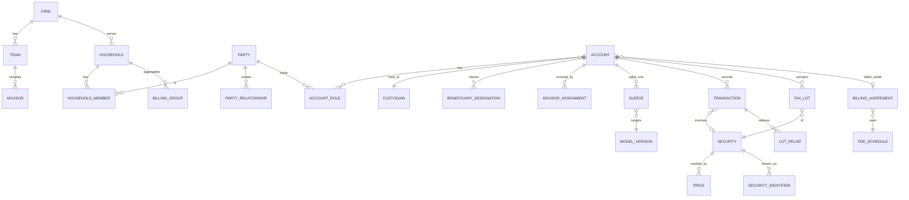

# US Wealth Management / RIA Operations: a Domain-Model Research Brief

> Research notes gathered on 2026-10-23 while grounding the domain. They inform the decisions but are not decisions: the vocabulary is [GLOSSARY.md](../../GLOSSARY.md) (where this brief says party or holding, the glossary says Person and Position), and where this brief and an ADR or [docs/product.md](../product.md) disagree, those win. Regulatory dates and figures are as of the cited sources.

Prepared 2026-10-23 for designing the data and domain model of an advisor-facing platform (CRM + portfolio + AI assistant) that runs on synthetic data. Every non-obvious claim has a URL. Regulatory dates are as of the sources cited, so re-check them before treating any as current law.

---

## 0. Top modeling insights (read this first)

1. **Party, role, account and household are separate things.** People and entities are _parties_. An account is a legal registration with _owner roles_ (owner, joint owner, trustee, custodian-for-minor, beneficiary, power of attorney, trusted contact). A household is a CRM and billing grouping, not a legal entity. Most bugs and compliance failures come from merging these.
2. **Positions are derived; transactions are facts; the custodian is the book of record.** Store the custodian's transactions append-only and derive positions and lots from them. Then reconcile daily against the custodian's own position file, and treat every break as a first-class record.
3. **Every money fact carries at least three dates:** trade date, settlement date and the date you learned it (posting or as-of date). Statements, bills and performance reports must be reproducible "as known on date X", which makes the model bitemporal.
4. **Quantities, prices and money are different types with different precision.** Never use binary floats (Plaid's API exposes `double`s, so convert at the boundary). Round once, at a documented boundary, with a rounding mode chosen for the purpose: half-even for neutral aggregates, round _up_ for RMDs, largest-remainder for fee allocation.
5. **Fee billing is a contract engine.** Schedule, tiering (blended or cliff), timing (advance or arrears), valuation basis (period-end or average daily balance), flow proration, householding for breakpoints, exclusions and payer account are all per-agreement data. The SEC's top fee findings are exactly these parameters applied wrongly.
6. **Tax lots are the unit of truth for tax math.** Lot relief method, holding period, wash-sale adjustments that link lots across accounts (including IRAs and a spouse's accounts) and corporate-action basis allocation all live on lots.
7. **AI outputs are records.** Meeting summaries, drafted emails and extracted statement data become books-and-records and marketing-rule artifacts once used. Model them with provenance, model version, human review state and retention.

---

## 1. Core entities and relationships

### 1.1 Firm, advisors and teams

- **RIA (firm).** Registers with the SEC, or with states below the SEC thresholds, through Form ADV. Part 1A reports _regulatory assets under management_ (RAUM), and Part 2A is the client brochure that discloses fees and billing practice ([Form ADV Part 1A instructions](https://www.sec.gov/file/instructions-part-1a-1)). Retail clients also get Form CRS, a short relationship summary ([SEC Form CRS adopting release](https://www.sec.gov/rules/final/2019/34-86032.pdf)).
- **IAR (investment adviser representative).** A person identified by a CRD number, and often dually registered as a broker's registered representative. At each custodian the advisor or team is identified by **rep codes**. Revenue on one account can be **split** across advisors by percentage, so model `account_advisor_assignment(account, advisor, role, split_pct, valid_from, valid_to)`.
- **Team.** A grouping that owns a book of households and has its own service roles (lead advisor, associate advisor, client service associate, paraplanner).
- **Compensation.** At wirehouses, advisors are paid a percentage of the gross revenue they produce, set by a **payout grid**. Kitces cites roughly 35% at the low end and about 50–55% for top producers. Independent RIA economics are often described as a 40/35/25 split (advisor compensation / overhead / profit) ([Kitces](https://www.kitces.com/blog/aum-revenue-requirement-breaking-away-wirehouse-broker-to-independent-ria/)). For a platform, a payout grid is a tiered function of trailing production, with the same tier math as fee schedules (§2.8).

### 1.2 Clients, prospects, households

- **Person / organization (party).** Holds legal name, date of birth (which drives RMDs and Social Security), SSN or TIN (store it encrypted and show only the last 4), citizenship, employment, and control-person or affiliation flags.
- **Household.** A CRM grouping used for relationship management, reporting and **fee breakpoint aggregation**. Wealthbox models contacts as Person, Household, Company or Trust, and lets opportunities attach to any of them ([Wealthbox help](https://help.wealthbox.com/hc/en-us/articles/29980388846107-How-do-I-add-an-Opportunity)). Real families cross household lines: grandparents fund a grandchild's 529, and adult children have their own households. Keep household membership _and_ a separate party-to-party relationship graph (spouse, child, trustee of, power of attorney for).
- **Prospect / lead.** The same party record with a lifecycle state (lead → prospect → client → former client). Don't create separate tables that must later be merged.
- **Trusted contact.** FINRA Rule 4512 requires broker-dealers to make reasonable efforts to collect a trusted contact person for non-institutional accounts ([FINRA 4512](https://www.finra.org/rules-guidance/rulebooks/finra-rules/4512)). Rule 2165 lets firms place temporary holds when financial exploitation of a specified adult is suspected ([FINRA 2165](https://www.finra.org/rules-guidance/rulebooks/finra-rules/2165)).
- **Beneficiaries.** Recorded per account at the custodian in primary and contingent tiers, with percentages that must sum to 100% per tier and a per stirpes or per capita election. Taxable accounts use transfer-on-death (TOD) designations instead. The custodian's copy is the legal one, so the platform's copy is a mirror that needs reconciling.

### 1.3 Accounts and registration types

An account is opened at one **custodian** under one **registration type**. The type determines the owner roles, the tax treatment and which rules apply.

| Registration                               | Owner roles                     | Tax status               | Modeling notes                                                                                                                                             |
| ------------------------------------------ | ------------------------------- | ------------------------ | ---------------------------------------------------------------------------------------------------------------------------------------------------------- |
| Individual                                 | 1 owner                         | Taxable                  | TOD beneficiaries optional                                                                                                                                 |
| JTWROS (joint with rights of survivorship) | ≥2 owners                       | Taxable                  | Passes to the survivor outside probate                                                                                                                     |
| TIC (tenants in common)                    | ≥2 owners with % interests      | Taxable                  | Ownership percentages needed                                                                                                                               |
| Traditional IRA                            | 1 owner                         | Tax-deferred             | RMDs; tracks contributions and basis (nondeductible, Form 8606) ([IRS IRAs](https://www.irs.gov/retirement-plans/individual-retirement-arrangements-iras)) |
| Roth IRA                                   | 1 owner                         | Tax-free                 | No owner RMDs; 5-year rules                                                                                                                                |
| SEP / SIMPLE IRA                           | 1 owner + employer plan link    | Tax-deferred             | Employer contributions                                                                                                                                     |
| Rollover IRA                               | 1 owner                         | Tax-deferred             | A traditional IRA labelled by funding source                                                                                                               |
| Inherited (beneficiary) IRA                | Beneficiary, decedent reference | Deferred or Roth         | 10-year rule, annual RMDs in some cases (§2.9)                                                                                                             |
| 401(k) / 403(b)                            | Participant                     | Deferred or Roth         | Usually **held away** at a recordkeeper and read through aggregation                                                                                       |
| Trust (revocable / irrevocable)            | Trustee(s), grantor, trust TIN  | Grantor or non-grantor   | Trust date and document; trustee powers                                                                                                                    |
| UTMA / UGMA                                | Custodian for a minor           | Taxable (kiddie tax)     | Age of termination is set by state                                                                                                                         |
| 529 plan                                   | Account owner + beneficiary     | Tax-advantaged education | Owner ≠ beneficiary; state plan ([IRS 529 Q&A](https://www.irs.gov/newsroom/529-plans-questions-and-answers))                                              |
| Corporate / entity                         | Entity + authorized signers     | Entity-level             | Beneficial ownership under CDD rules                                                                                                                       |

Model it as `Account(id, custodian_id, custodian_account_number, registration_type, tax_status, opened_on, closed_on, base_currency, discretionary: bool, billing_agreement_id, model_assignment…)` with `AccountRole(account_id, party_id, role, pct, valid_from, valid_to)`.

### 1.4 Custodian

Advisory client assets sit with a _qualified custodian_ (a bank or broker-dealer such as Schwab, Fidelity or Altruist). Under the custody rule, the custodian sends clients account statements at least quarterly, and an adviser that can deduct fees has custody ([17 CFR 275.206(4)-2](<https://www.ecfr.gov/current/title-17/chapter-II/part-275/section-275.206(4)-2>)). Custodians expose data through daily file feeds and APIs: Schwab runs a developer portal for third-party integrations ([InvestmentNews](https://investmentnews.com/fintech/schwab-adds-developer-portal-for-fintechs/203381)), and Fidelity's Wealthscape Integration Xchange offers APIs and data feeds ([WealthManagement.com](https://www.wealthmanagement.com/financial-technology/fidelity-s-tech-upgrade-includes-data-aggregation-and-insights)). Model a `DataSource` per custodian and feed, and keep the custodian's own account and security identifiers alongside your internal IDs.

### 1.5 Securities (security master)

**Identifiers.**

- CUSIP: 9 characters, North American ([CUSIP Global Services](https://www.cusip.com/identifiers.html)).
- ISIN: 12 characters, ISO 6166 (country prefix + national ID + check digit) ([ISO 6166](https://www.iso.org/standard/78502.html)).
- FIGI: an open identifier ([OpenFIGI](https://www.openfigi.com/about/figi)).
- SEDOL.
- Ticker plus exchange MIC.

Tickers get reused and changed, and CUSIPs change on corporate actions. Key securities on an internal ID and keep a time-versioned identifier table `security_identifier(security_id, scheme, value, valid_from, valid_to)`. Plaid's security object reflects the same reality: `cusip`, `isin`, `sedol`, `figi`, `ticker_symbol`, `market_identifier_code`, `is_cash_equivalent`, a `type` of cash / cryptocurrency / derivative / equity / etf / fixed income / loan / mutual fund / other, plus `option_contract` and `fixed_income` sub-objects ([Plaid Investments API](https://plaid.com/docs/api/products/investments/)).

**Instrument types that behave differently.**

| Type         | Pricing                                                                                                                                                                                                                                                               | Quantity                                              | Gotchas                                                                                                                                                                                                                                   |
| ------------ | --------------------------------------------------------------------------------------------------------------------------------------------------------------------------------------------------------------------------------------------------------------------- | ----------------------------------------------------- | ----------------------------------------------------------------------------------------------------------------------------------------------------------------------------------------------------------------------------------------- |
| Equity / ETF | Last or close, in USD; ticks of $0.01, plus a $0.005 increment for some stocks under amended Rule 612 ([Sidley](https://www.sidley.com/en/insights/newsupdates/2024/10/sec-adopts-rules-modifying-minimum-pricing-increments-access-fee-caps-and-order-transparency)) | Fractional shares possible                            | Splits, spin-offs, mergers                                                                                                                                                                                                                |
| Mutual fund  | NAV once daily, forward pricing ([Rule 22c-1](https://www.ecfr.gov/current/title-17/chapter-II/part-270/section-270.22c-1))                                                                                                                                           | Typically 3 decimal places                            | Average-cost basis allowed; reinvested distributions; share classes                                                                                                                                                                       |
| Bond         | **% of par** (98.50 = 98.5% of face) plus **accrued interest**                                                                                                                                                                                                        | Face amount, not shares                               | Day count: 30/360 for corporates ([FINRA 11620](https://www.finra.org/rules-guidance/rulebooks/finra-rules/11620)), munis ([MSRB G-33](https://www.msrb.org/Rules-and-Interpretations/MSRB-Rules/General/Rule-G-33)); amortization; calls |
| Option       | Premium per share × multiplier (usually 100)                                                                                                                                                                                                                          | Contracts (Plaid reports quantity as contracts × 100) | Expiration, assignment and exercise transactions                                                                                                                                                                                          |
| Cash / sweep | $1.00                                                                                                                                                                                                                                                                 | Dollars                                               | Bank deposit sweep vs money market fund; sweep yield is a fiduciary issue (§1.8)                                                                                                                                                          |

**Classification** (asset class, sub-class, sector, region, style) belongs to the _firm_, versions over time, and is often look-through for funds. Store it as a time-versioned mapping, never as a column on the security.

### 1.6 Positions and tax lots

- **Position** = (account, security, as_of_date) → quantity, plus derived market value, cost basis and unrealized gain. Plaid holdings carry `quantity`, `institution_price`, `institution_price_as_of`, `institution_value`, a nullable `cost_basis`, `vested_quantity`, and `tax_lots[]` with `original_purchase_datetime`, `quantity`, `purchase_price`, `cost_basis` and `position_type` LONG/SHORT ([Plaid](https://plaid.com/docs/api/products/investments/)). Note that `cost_basis` is _nullable_: held-away and transferred-in positions often lack basis.
- **Tax lot** = (account, security, acquired_on, quantity_open, cost_basis_total, holding_period_start, adjustments[]). Adjustments include wash-sale deferrals, return of capital, corporate-action allocations and gifted or inherited basis. Brokers must pass cost basis along on transfers: a transfer statement is due within 15 days of the transfer's settlement ([26 CFR 1.6045A-1](https://www.law.cornell.edu/cfr/text/26/1.6045A-1)).

### 1.7 Transactions

Plaid's taxonomy is a good canonical starting vocabulary. It has six `type`s (buy, sell, cancel, cash, fee, transfer) and 44 `subtype`s, including dividend, qualified and non-qualified dividend, dividend reinvestment, interest, long-term and short-term capital gain (plus reinvestment), contribution, deposit, withdrawal, distribution, management fee, account fee, transfer fee, trust fee, margin expense, tax withheld, non-resident tax, return of principal, split, spin off, merger, exercise, assignment, expire, sell short, buy to cover, adjustment, and pending credit/debit. Signs: `amount` is positive when cash is debited (a buy) and negative when cash is credited (a sale), and `quantity` is positive for buys and negative for sells ([Plaid](https://plaid.com/docs/api/products/investments/)). Custodians use opposite conventions, so normalize at ingest and keep the raw record.

The categories a domain model needs:

1. **Trades:** buy, sell, short, cover. Each has trade date, settle date, quantity, price, gross, commission/fees and net, and sells carry lot-relief instructions.
2. **Income:** dividend (qualified or ordinary), interest, capital-gain distribution, reinvestment (which is income + buy as a linked pair). Each has ex-date, record date and pay date.
3. **External flows:** contribution, withdrawal or distribution, ACAT in or out, check, wire, ACH. These are the flows that matter for performance (§2.6) and fee proration (§2.8).
4. **Internal flows:** journals between accounts at the same custodian. They are external flows to each account and net zero for the household.
5. **Fees and expenses:** advisory fee (with a link to the bill), custody, wire and transfer fees.
6. **Tax:** withholding, foreign tax.
7. **Corporate actions:** split, reverse split, spin-off, merger (cash, stock or mixed), name or CUSIP change, return of capital. Issuers report the basis effect on IRS Form 8937 ([IRS](https://www.irs.gov/forms-pubs/about-form-8937)).
8. **Corrections:** cancel or rebill of an earlier transaction (§3.4).

### 1.8 Cash

Each account has a cash position, usually swept into a bank deposit program or a money market fund. Sweep design is a live compliance issue: in January 2025 the SEC settled charges against Wells Fargo and Merrill Lynch, with $60M in combined penalties, over advisory-client cash sweep programs where yield differentials reached almost 4% ([SEC 2025-16](https://www.sec.gov/newsroom/press-releases/2025-16)). Track **settled vs unsettled cash**, **available to withdraw**, **reserved for pending fees or RMDs**, and **cash targets in the model**. These are separate balances, not one number.

### 1.9 Prices and marks

`price(security_id, price_date, price_type [close/NAV/evaluated/bid/mid], value, currency, source, received_at)`. Bonds and illiquid holdings use _evaluated_ prices from vendors, and alternatives are marked quarterly with a lag. Keep the source and an "as of" date per price, because Plaid flags staleness the same way (`close_price_as_of`, `institution_price_as_of`). Market value must be reproducible from the stored price version, not from "latest".

### 1.10 Models, sleeves, targets and drift

- **Model portfolio:** a versioned set of target weights (security- or asset-class-level) with tolerance bands, cash target and restrictions.
- **Sleeve:** a slice of an account (or of the household) managed to its own model or manager. It is common in unified managed accounts (UMAs) and needs **virtual sub-accounting**: sleeve-level positions, cash and performance inside a single custodial account.
- **Assignment:** `account_model_assignment(account|sleeve, model_version, valid_from)`, plus restrictions (do-not-buy lists, legacy positions held but not traded, ESG screens) and an asset-location policy.
- **Drift:** current weight − target weight, as absolute percentage points or relative to the target (§2.10).

### 1.11 Entity relationship sketch



---

## 2. Money and math

### 2.1 Representing money, quantities and prices

- **No binary floating point for money.** `0.1 + 0.2 ≠ 0.3` in IEEE-754. Use integer minor units (cents as `bigint`) for posted cash and ledger amounts, or fixed-point decimal (`NUMERIC`). Fowler's _Money_ pattern pairs an amount with a currency and handles allocation explicitly ([Fowler, Money](https://martinfowler.com/eaaCatalog/money.html)). Use ISO 4217 currency codes, which also define each currency's minor-unit exponent ([ISO 4217](https://www.iso.org/iso-4217-currency-codes.html)).
- **Separate types with separate scales.** These are suggestions; pick and document your own:
  - Cash `Money`: scale 2 for USD when posted, with intermediate calculations at scale ≥ 6.
  - `Quantity`: scale 6–8. Fractional shares and mutual funds commonly carry 3 decimal places, crypto 8+.
  - `Price`: scale 6–8. Bonds are quoted as % of par, so `Price` needs a `quote_basis` (per-share, percent-of-par, per-contract).
  - `Rate`: annual fee rates are decimal fractions (0.0075) or basis points (75 bps). Store them exactly.
- **Rounding modes are business rules.**
  - _Half-even_ (banker's rounding) avoids upward bias in aggregates ([Python `decimal`](https://docs.python.org/3/library/decimal.html)).
  - Postgres `round(numeric)` rounds ties **away from zero**, so database and application rounding can disagree ([PostgreSQL math functions](https://www.postgresql.org/docs/current/functions-math.html)). Round in one place.
  - Round up when the number is a _minimum required_ amount, such as an RMD.
  - Allocate with _largest remainder_ so the parts sum to the whole. Example: a $100.00 fee split across three equal accounts gives 33.333… each, which floors to 33.33 × 3 = 99.99; the leftover cent goes to the largest fractional remainder, with a deterministic tie-break such as account ID → 33.34 / 33.33 / 33.33.
- **Round once, at the posting boundary.** Compute fees and allocations in full precision and round when the amount becomes a posted ledger entry. Store both the unrounded calculation (for audit) and the posted amount.

### 2.2 Market value and accrued interest

`MV = quantity × price × multiplier` (multiplier is 1 for equities and 100 for standard options). For bonds, `MV_clean = face × price% / 100` and `accrued = face × coupon × (days / basis)`.

_Example:_ a $10,000-face corporate bond with a 5% coupon (semiannual, Jan 15 / Jul 15), priced at 98.50 and settling Mar 10. Under 30/360, days = (3−1)×30 + (10−15) = 55, so accrued = 10,000 × 0.05 × 55/360 = **$76.39**. Clean MV = $9,850.00 and dirty MV = **$9,926.39**. Reports should show MV and accrued separately, and performance should include accrued interest so returns don't jump on coupon dates.

### 2.3 Cost basis methods (worked example)

Lots of stock XYZ in a taxable account:

| Lot | Acquired   | Shares | Price | Basis  |
| --- | ---------- | ------ | ----- | ------ |
| A   | 2023-03-01 | 100    | $50   | $5,000 |
| B   | 2024-11-15 | 100    | $80   | $8,000 |
| C   | 2025-08-01 | 100    | $60   | $6,000 |

Sell 150 shares on 2025-10-15 at $70, for proceeds of $10,500. Long-term means held **more than one year** ([26 USC 1222](https://www.law.cornell.edu/uscode/text/26/1222)), so A is long-term and B and C are short-term.

- **FIFO** (the default at most brokers; Schwab lists FIFO as its default for equities and ETFs, alongside LIFO, high cost, low cost, tax lot optimizer, average cost and specified lot ([Schwab](https://www.schwab.com/learn/story/save-on-taxes-know-your-cost-basis))):
  - Lot A 100 shares: $7,000 − $5,000 = **+$2,000 LT**
  - Lot B 50 shares: $3,500 − $4,000 = **−$500 ST**
  - Net +$1,500
- **Specific ID / highest cost first** (B, then C):
  - Lot B 100 shares: $7,000 − $8,000 = **−$1,000 ST**
  - Lot C 50 shares: $3,500 − $3,000 = **+$500 ST**
  - Net **−$500**: a harvested loss instead of a $1,500 gain. Specific ID needs adequate identification at the time of sale ([26 CFR 1.1012-1](https://www.law.cornell.edu/cfr/text/26/1.1012-1)).
- **Average cost** is allowed only for regulated investment company shares (mutual funds, many ETFs) and dividend reinvestment plan stock ([26 CFR 1.1012-1(e)](https://www.law.cornell.edu/cfr/text/26/1.1012-1)). Average = $19,000 / 300 = $63.3333…, so the 150 shares sold carry basis $9,500.00 and the gain is $1,000. For holding period, the shares sold are treated as the earliest acquired: 100 shares LT with basis $6,333.33 give **+$666.67 LT**, and 50 shares ST with basis $3,166.67 give **+$333.33 ST**. The two halves sum exactly to $9,500.00, which is the largest-remainder rule at work again.

**Modeling consequences.**

- Lot relief is a separate fact (`lot_relief(sell_txn, lot_id, qty, basis_relieved)`).
- The method is set per account and per security type, with a per-trade override.
- Realized gain/loss is a derived, stored record whose ST/LT character is fixed at sale.

### 2.4 Realized and unrealized gains

- `Unrealized = MV − open lot basis`, reported per lot with ST/LT character as of today, because the character changes as time passes.
- `Realized = proceeds − relieved basis (± wash-sale adjustment)`.
- **Gifted and inherited basis.** Inherited lots generally step up to fair market value at death, with long-term holding regardless of how long they were held. Gifted lots carry the donor's basis, subject to a dual-basis rule for losses ([IRS Pub 551](https://www.irs.gov/publications/p551)). These are lot attributes, not account attributes.
- **Covered vs noncovered.** Brokers report basis on Form 1099-B only for _covered_ securities, phased in by acquisition date: stock from 2011, mutual funds and DRIPs from 2012, simpler debt and options from 2014 ([IRS 1099-B instructions](https://www.irs.gov/instructions/i1099b)). Older lots may have no custodian-reported basis.

### 2.5 Wash sales and tax-loss harvesting

**Rule.** A loss is disallowed if substantially identical securities are bought within 30 days before or after the sale, a 61-day window ([26 USC 1091](https://www.law.cornell.edu/uscode/text/26/1091); [IRS Pub 550](https://www.irs.gov/publications/p550)). The disallowed loss is added to the replacement lot's basis, and its holding period carries over ([26 USC 1223](https://www.law.cornell.edu/uscode/text/26/1223)).

_Example:_

- 2025-11-03: sell 100 shares XYZ at $40 with $50 basis, a $1,000 loss.
- 2025-11-20: buy 100 shares at $42.
- The loss is disallowed and the new lot's basis is $4,200 + $1,000 = **$5,200**.
- If only 60 shares are bought back, 60% of the loss ($600) is disallowed and $400 is allowed. The 60-share lot's basis is $2,520 + $600 = $3,120.

**Cross-account reach.** A replacement purchase in the client's IRA, or the spouse's, still triggers the rule, and the loss is **permanently** lost because IRA basis is not increased ([Rev. Rul. 2008-5, via Kitces](https://www.kitces.com/blog/irs-shuts-down-wash-sale-evasion-technique/)). Dividend reinvestments inside the window also count. So wash-sale detection must run at the **household (taxpayer) level across custodians**, including held-away accounts. That makes it a strong argument for the party/household graph in §1.2.

**Tax-loss harvesting.** Sell lots with unrealized losses, buy a non-substantially-identical substitute (e.g. a different index ETF), and block repurchase of the original for 31 days. Model it as a `harvest_opportunity(lot, loss, replacement_security, wash_window_end, blocking_accounts[])`. The IRS does not define "substantially identical", so the substitute map is firm policy with a version.

### 2.6 Returns: TWR, Modified Dietz, IRR

**Time-weighted return (TWR)** removes the effect of external flows by chaining sub-period returns: `TWR = Π(1 + r_i) − 1`, where `r_i = EMV_i / (BMV_i + CF_i) − 1` and the portfolio is valued at each flow. GIPS requires time-weighted returns for most composites. Money-weighted returns are allowed when the firm controls external flows and the strategy is closed-end, fixed-life, fixed-commitment or significantly illiquid. Portfolios must be valued at least monthly and on the dates of large cash flows ([GIPS Standards](https://www.gipsstandards.org/standards/)).

**Modified Dietz** approximates TWR without a valuation on every flow date:

`R_MD = (EMV − BMV − ΣCF_i) / (BMV + Σ w_i·CF_i)`, where `w_i = (CD − D_i)/CD` (CD = calendar days in the period, D_i = days elapsed when flow i occurs).

**Money-weighted return (IRR)** solves `BMV·(1+r)^1 + Σ CF_i·(1+r)^(w_i) = EMV`. It measures the _investor's_ experience, including the timing of their flows.

_Worked example_ (2025, 365 days):

- Jan 1: BMV $100,000.
- Jul 1: value before the flow is $110,000; a $50,000 deposit brings it to $160,000.
- Dec 31: EMV $152,000.

| Method         | Calculation                                                                                                                 | Result       |
| -------------- | --------------------------------------------------------------------------------------------------------------------------- | ------------ |
| TWR            | (110,000/100,000) × (152,000/160,000) − 1 = 1.10 × 0.95 − 1                                                                 | **+4.50%**   |
| Modified Dietz | w = (365−181)/365 = 0.5041; gain = 152,000 − 100,000 − 50,000 = 2,000; denominator = 100,000 + 0.5041 × 50,000 = 125,205.48 | **+1.60%**   |
| IRR            | 100,000(1+r) + 50,000(1+r)^0.5041 = 152,000                                                                                 | **≈ +1.60%** |

The manager earned 4.5% on a dollar invested all year. The client's dollars earned only about 1.6%, because the deposit landed just before the losing half. Show both, and label which is which.

**Modeling consequences.**

- Performance needs daily (or flow-date) valuations, a precise definition of an _external flow_ at each level (a journal between two household accounts is external to each account and internal to the household), and fee treatment (gross vs net of fees).
- Sub-period returns compound by geometric linking. Store daily returns, link them on demand, and annualize only periods longer than one year.
- **Benchmarks:** a benchmark is a time series of index returns. A blended benchmark (60% equity index / 40% bond index, rebalanced monthly) is itself a model with versions.
- **Marketing.** Under the Marketing Rule, advertising gross performance requires net performance too. Portfolio performance needs 1-, 5- and 10-year periods. Hypothetical performance needs policies and procedures ([17 CFR 275.206(4)-1](<https://www.ecfr.gov/current/title-17/chapter-II/part-275/section-275.206(4)-1>)). Records supporting performance must be kept under Rule 204-2(a)(16).

### 2.7 AUM, three ways

1. **Regulatory AUM (Form ADV Item 5.F).** Securities portfolios receiving "continuous and regular supervisory or management services", at gross value, where an account counts as a securities portfolio if at least 50% of it is securities, with cash allowed to count ([Form ADV Part 1A instructions](https://www.sec.gov/file/instructions-part-1a-1)). This number drives SEC vs state registration (around $100M).
2. **Billable AUM:** what the fee schedule applies to, after exclusions.
3. **Assets under advisement / total wealth:** includes held-away 401(k)s, real estate and outside accounts.

Store these as three named measures over the same positions and never call any of them just "AUM".

### 2.8 Advisory fee billing (worked examples)

The parameters (all per agreement, disclosed in ADV Part 2A Item 5):

- **Schedule shape:** _tiered_ (blended or marginal; each tier's rate applies only to the dollars in that tier) or _cliff breakpoint_ (the whole balance at the bracket's rate); flat %; flat dollar; minimum fee; cap.
- **Timing:** quarterly or monthly, **in advance** (billed on the beginning value, refund on termination) or **in arrears** (billed on the period's value).
- **Valuation basis:** period-end value or **average daily balance (ADB)**. Orion describes ADB billed in arrears as typically considered best practice ([Orion](https://orion.com/node/1146)).
- **Period fraction:** actual days / 365 (or 366) vs one quarter.
- **Flow proration:** new accounts, contributions and withdrawals mid-period, sometimes with a materiality threshold.
- **Householding:** aggregate the household's accounts to pick the breakpoint, then allocate the fee back to accounts.
- **Exclusions:** held-away, legacy or unsupervised positions, cash above a threshold, annuities. An excluded asset may still count toward the breakpoint, so keep **billable value** and **breakpoint value** as separate measures.
- **Payer account:** the fee for account X can be debited from account Y. Avoid paying taxable-account fees out of an IRA.

**What goes wrong.** The SEC's 2018 risk alert, drawn from more than 1,500 exams, lists:

- valuing assets differently from the agreement;
- billing at the wrong frequency, or billing new clients a full period in advance without proration;
- **failing to aggregate household accounts for breakpoints**, or not applying breakpoints at all;
- practices that differ from ADV disclosure.

([SEC risk alert](https://www.sec.gov/files/ocie-risk-alert-advisory-fee-expense-compliance.pdf)). Each of these is a parameter in the list above, so a billing engine should be **data-driven by the agreement**, with every bill keeping a snapshot of the inputs it used.

**Schedule used in the examples:** 1.00% on the first $1M, 0.75% on the next $4M, 0.50% above $5M.

**Example 1: tiered vs cliff vs no householding** (household of $2,500,000: IRA $1,000,000, Joint $1,200,000, Roth $300,000).

- Tiered, householded: 1,000,000 × 1% + 1,500,000 × 0.75% = 10,000 + 11,250 = **$21,250 a year** (0.85% effective).
- Cliff, householded: 2,500,000 × 0.75% = **$18,750 a year**. Cliff schedules have discontinuities: $999,999 → $9,999.99, but $1,000,000 → $7,500.
- Tiered, _not_ householded (the error): IRA $10,000 + Joint ($10,000 + $1,500) + Roth $3,000 = **$24,500 a year**, an **overcharge of $3,250 a year**.

**Example 2: quarterly fraction and allocation.** Q1 2026 has 90 days.

- 21,250 × 90/365 = 5,239.7260… → **$5,239.73**, vs 21,250 / 4 = **$5,312.50**. The $72.77 difference must match the agreement.
- Allocating $5,239.73 by billable value (40% / 48% / 12%): IRA 2,095.890 → $2,095.89, Joint 2,515.068 → $2,515.07, Roth 628.767 → $628.77. The sum is $5,239.73. When rounding leaves a cent over or short, assign it by largest remainder.

**Example 3: ADB vs period-end** (flat 1%, arrears, Q1 2026). The account holds $1,000,000 for 60 days, then $1,300,000 for 30 days after a deposit.

- ADB = (1,000,000 × 60 + 1,300,000 × 30)/90 = **$1,100,000**, fee = 1,100,000 × 1% × 90/365 = **$2,712.33**.
- Period-end: 1,300,000 × 1% × 90/365 = **$3,205.48**.

**Example 4: proration in advance.** A new $500,000 account at 1% is funded Feb 15, 2026. Days remaining in Q1 = 14 + 31 = 45, so the fee is 500,000 × 1% × 45/365 = **$616.44**.

**Data shape.** `fee_schedule(version) → tiers[]`; `billing_agreement(account|group, schedule_version, timing, valuation_basis, day_count, proration_policy, exclusions[], payer_account, min_fee, valid_from)`; `bill_run(period, status, inputs_snapshot_hash)`; `bill_line(account, billable_value, breakpoint_value, gross_fee_unrounded, fee_posted, adjustment_of?)`. A posted fee becomes a custodian debit instruction, the resulting custodian _fee transaction_ must reconcile back to the bill line, and later corrections are new adjustment lines (§3.4).

### 2.9 Required minimum distributions (RMDs)

- **Start age:** 73 for people born 1951–1958, and 75 for those born 1960 or later (SECURE 2.0, [26 U.S.C. 401(a)(9)(C)(v)](https://www.law.cornell.edu/uscode/text/26/401); [26 CFR 1.401(a)(9)-2(b)(2)](https://www.law.cornell.edu/cfr/text/26/1.401%28a%29%289%29-2)). The final regulations apply to calendar years beginning on or after January 1, 2025 ([26 CFR 1.401(a)(9)-1(d)](https://www.law.cornell.edu/cfr/text/26/1.401%28a%29%289%29-1); [Mercer](https://www.mercer.com/en-us/insights/law-and-policy/irs-sets-2025-for-final-rmd-rules-extends-10-year-rule-relief/)). 1959 is a gap: the statute's two clauses both reach someone born that year (73 in 2032, 74 in 2033), the regulation marks that paragraph only "[Reserved]", and the [IRS RMD FAQs](https://www.irs.gov/retirement-plans/retirement-plan-and-ira-required-minimum-distributions-faqs) and [Pub 590-B](https://www.irs.gov/publications/p590b) give only age 73 as the start age. The first RMD can be delayed to April 1 of the following year, which means two RMDs in that year.
- **Formula:** `RMD_y = balance at Dec 31 of year y−1 / distribution period(age at end of year y)`, using the Uniform Lifetime Table in [IRS Pub 590-B](https://www.irs.gov/publications/p590b). A different table applies when the sole beneficiary is a spouse more than 10 years younger.
- **Example:** owner born 1951, age 75 in 2026, IRA balance $800,000 on 12/31/2025, divisor 24.6, so RMD = 32,520.325… → **round up to $32,520.33**, because the requirement is a minimum.
- **Aggregation:** RMDs from several traditional IRAs can be aggregated and taken from any one of them, but 401(k) RMDs cannot be satisfied from an IRA. Store the obligation at the person level and satisfaction per account.
- **Shortfall penalty:** a 25% excise tax, reduced to 10% if corrected in time (SECURE 2.0).
- **Inherited IRAs:** most non-spouse beneficiaries must empty the account by the end of the 10th year. If the owner died on or after the required beginning date, annual RMDs are also required. The IRS waived the penalty for 2021–2024 (Notice 2024-35), and annual RMDs are enforced from 2025 ([Vanguard summary](https://workplace.vanguard.com/insights-and-research/perspective/irs-releases-required-minimum-distribution-relief-for-certain-beneficiaries.html)).
- **Platform objects:** `rmd_obligation(person, year, plan_group, amount_required, deadline)` and `rmd_progress` (the sum of qualifying distributions, with year-to-date tax withholding). This is a natural AI "next best action" trigger (§6).

### 2.10 Drift and rebalancing

- **Drift.** Target 60/40 on $1,000,000. After a rally, equities are $680,000 and bonds $360,000, for $1,040,000 total. Equity weight is 65.38%: drift is +5.38 percentage points absolute, or +8.97% relative (5.38/60).
- **Trades to target:** equity target 624,000, so sell **$56,000** of equities and buy $56,000 of bonds.
- **Band definitions disagree.** A 5-point absolute band triggers here, while a 20%-relative band (±12 points on a 60% sleeve) does not. Vanguard's study found annual or semiannual monitoring with roughly 5% thresholds a reasonable balance of risk control and cost ([Vanguard via AAII](https://aaii.com/journal/article/best-practices-for-portfolio-rebalancing)). The band type is model data.
- **Real-world rebalancing** is a constrained optimization: tax lots (prefer selling in IRAs or selling loss lots), wash-sale blocks, cash targets and reserved cash (fees, RMDs), minimum trade sizes, restrictions and household-level asset location. The output is a _proposed trade list_ with per-trade rationale, which an advisor approves.

---

## 3. Data flow realities

### 3.1 Custodian feeds and reconciliation

Custodians send end-of-day files (or API snapshots) for accounts and demographics, positions, transactions, prices, security master and often unrealized lots. Portfolio accounting systems rebuild positions from transactions and **reconcile** them against custodian positions. Orion describes reconciling positions, prices and values six days a week. Its _Asset Comparison Report_ flags accounts that have value in Orion but no position file from the custodian that day. When the transactions needed to balance a position never arrive, its analysts post manual **placeholder transactions**, and those are audited separately ([Orion](https://orionadvisortech.com/blog/auditing-placeholder-transactions/); [Orion asset comparison](https://orionadvisortech.com/blog/tech-tip-thursday-keep-your-data-clean-with-the-asset-comparison-report/)). Addepar separates **positions** (edges in an ownership graph between entities) from **transactions** ([Addepar positions](https://developers.addepar.com/docs/positions), [transactions](https://developers.addepar.com/docs/transactions)).

**Reconciliation as a model:**

```
recon_run(source, as_of_date, file_id, started_at, status)
recon_break(run, account, security, internal_qty, custodian_qty, diff, cause?, status[open|explained|resolved], resolution_txn_id?)
```

Typical breaks:

- missing or late transactions (common for corporate actions);
- price differences;
- an account closed at the custodian but still active internally;
- a transfer in transit, where an ACAT has left one account but not landed in the other;
- pending or unsettled trades.

For synthetic data, _generate breaks deliberately_: a realistic feed simulator emits late, duplicate, cancelled and corrected records.

### 3.2 The dates that matter

| Date                      | Meaning                                                                                                                                                                                                                                                              |
| ------------------------- | -------------------------------------------------------------------------------------------------------------------------------------------------------------------------------------------------------------------------------------------------------------------- |
| Trade date                | When the economic exposure changes. Positions and performance usually run on trade-date accounting                                                                                                                                                                   |
| Settlement date           | When cash and securities actually move. **T+1** for most US securities since May 28, 2024 ([Davis Polk](https://www.davispolk.com/insights/client-update/sec-adopts-t-1-settlement-effective-may-2024)). It drives settled cash and withdrawable balances            |
| Ex / record / pay date    | Dividends: entitlement and payment. Under T+1 the ex-date is generally the _same day_ as the record date ([SEC-filed exchange rule](https://listingcenter.nasdaq.com/assets/rulebook/bx/filings/SR-BX-2023-028.pdf)). Accrue on ex-date and receive cash on pay date |
| Posting / process date    | When the custodian booked it, which can be days after the trade date for corrections                                                                                                                                                                                 |
| Received-at (system time) | When _your_ system learned it                                                                                                                                                                                                                                        |
| As-of (report) date       | The date a report or bill describes                                                                                                                                                                                                                                  |

ACAT transfers have their own clock: under FINRA Rule 11870 the carrying firm must validate (or take exception to) a transfer instruction within one business day and complete it within three business days after validation ([FINRA 11870](https://www.finra.org/rules-guidance/rulebooks/finra-rules/11870); [Reg Notice 07-50](https://www.finra.org/rules-guidance/notices/07-50)). Assets that don't fit ACATS (annuities, alternatives, some mutual funds held directly at the fund company) move by non-ACAT processes that take weeks. A transfer is therefore a **multi-step workflow entity** (requested → validated → in transit → completed / rejected, with partial transfers), not a single transaction.

### 3.3 Corrections, restatements and bitemporality

Custodians correct history by **cancelling and rebooking** ("cxl/rebill"), often with the _original_ trade date. That means a Q1 statement generated on April 5 can differ from the Q1 numbers recomputed on May 10. Questions you must answer:

- _What did the client's statement or bill show when we sent it?_ (record time)
- _What do we now believe the Q1 return was?_ (valid time)

Fowler calls the two axes **actual time** and **record time**, the same pair as the database terms valid time and transaction time ([Fowler, Bitemporal History](https://martinfowler.com/articles/bitemporal-history.html)).

**Practical design:**

- Transactions are **append-only**. A correction is a new record that reverses and replaces an earlier one (`supersedes_id`), with `effective_date` (trade date) and `recorded_at`.
- Derived artifacts (daily positions, returns, bills, statements) store the **watermark** (the max `recorded_at`) they were computed from, so they can be reproduced exactly.
- GIPS requires an error-correction policy that sets materiality, which decides whether you restate a published return or just disclose ([GIPS](https://www.gipsstandards.org/standards/)). Fee bills are **never rewritten**: a correction produces an adjustment line in the next bill run, credit or debit, linked to the original.

### 3.4 Immutable ledgers and event sourcing

- **Double-entry.** Every movement debits one account and credits another, so the sum is zero. Positions and balances are folds over entries. Stripe's internal Ledger is an immutable, auditable system of record for money movement, processing about five billion events a day ([Stripe Engineering](https://stripe.dev/blog/ledger-stripe-system-for-tracking-and-validating-money-movement)). Fowler's accounting and event-sourcing patterns describe the same idea of state rebuilt from events ([Fowler, Event Sourcing](https://martinfowler.com/eaaDev/EventSourcing.html)).
- **Two units.** In a portfolio ledger, entries come in _two units_: currency (cash) and quantity per security. A buy is one transaction with two legs: −cash in USD and +qty in XYZ. Each unit balances separately, never across units.
- **The custodian is still authoritative.** Your ledger is a _shadow_ that must reconcile, unlike Stripe, which is the system of record for its own money. Use **idempotency keys** (custodian transaction ID + version) so feed replays are harmless.
- **Separate facts from projections.** Raw feed records (immutable, as received) → normalized events (with mapping version) → ledger entries → projections (positions, lots, performance, bills). Each layer can be rebuilt from the one before.

---

## 4. Advisor workflows, CRM and compliance

### 4.1 Pipeline

Typical stages run from lead → intro or discovery meeting → data gathering → plan or proposal presentation → agreement signed (won) → onboarding → funded. Wealthbox's default opportunity stages are Evaluation, Identify Decision Makers, Qualification, Needs Analysis, Review and Proposal, with Won and Lost as outcomes outside the stages ([Wealthbox stages](https://help.wealthbox.com/hc/en-us/articles/29980449946523-What-are-the-Opportunity-Stages-common-questions)). Opportunity value is usually _expected assets_ and expected fee revenue, not deal price. Track `opportunity(household, stage, expected_aum, probability, source, close_date)` and stage history.

### 4.2 Onboarding and account opening

- **Identity and AML.** The custodian, as a broker-dealer, runs the customer identification program (CIP) under [31 CFR 1023.220](https://www.ecfr.gov/current/title-31/subtitle-B/chapter-X/part-1023/subpart-B/section-1023.220) and collects beneficial ownership for legal entities. FinCEN's AML/CFT program rule for investment advisers was adopted in 2024 for a Jan 1, 2026 start but postponed to **Jan 1, 2028** pending a scope review ([MoFo](https://www.mofo.com/resources/insights/260108-fincen-hits-pause-no-aml-rule-for-investment-advisers-until-2028)).
- **Know your customer and suitability.** For broker-dealers: FINRA 2090 (KYC) and 2111 (suitability) ([2090](https://www.finra.org/rules-guidance/rulebooks/finra-rules/2090), [2111](https://www.finra.org/rules-guidance/rulebooks/finra-rules/2111)), and Reg BI's best-interest standard for retail recommendations ([Reg BI release](https://www.sec.gov/rules/final/2019/34-86031.pdf)). RIAs owe a fiduciary duty of care and loyalty under the Advisers Act ([SEC fiduciary interpretation](https://www.sec.gov/rules/interp/2019/ia-5248.pdf)). Either way you store a dated **investment profile**: objectives, time horizon, liquidity needs, tax bracket, and risk tolerance from a questionnaire score and band.
- **Investment Policy Statement (IPS).** CFA Institute's template covers scope and purpose, governance, return and risk objectives and constraints, and risk management and rebalancing ([CFA Institute](https://rpc.cfainstitute.org/policy/positions/elements-of-an-investment-policy-statement-for-individual-investors)). Model it as a versioned document linked to model assignments and bands.
- **Paperwork.** Advisory agreement (with the fee schedule), custodian new-account forms, beneficiary forms, transfer forms (ACAT / TOA), standing letters of authorization for third-party money movement (an SEC staff no-action letter set conditions for SLOAs under the custody rule, [IAA no-action letter 2017](https://www.sec.gov/divisions/investment/noaction/2017/investment-adviser-association-022117-206-4.htm)), and delivery of Form ADV Part 2 and Form CRS.
- **Workflow entity.** `onboarding_case(household) → checklist items → e-sign envelopes → custodian account requests (status) → funding transfers (status)`.

### 4.3 Ongoing service

- **Review meetings:** annual or semiannual, with a prep packet (performance, allocation vs target, RMD status, beneficiary review, planning updates) and post-meeting notes and tasks.
- **Service requests:** address changes, beneficiary changes, distributions, recurring withdrawals, RMD setup, tax withholding elections, cost basis method changes, account closures.
- **Money movement requests** are the riskiest, because of wire fraud and elder exploitation. Use maker-checker approval, call-back verification, trusted-contact use and an audit trail.
- **Tasks, notes and activities:** Redtail and Wealthbox model activities, tasks and notes linked to contacts, with categories such as appointment, call and task ([Redtail via Ibexa Connect](https://doc.ibexa.co/projects/connect/en/latest/apps/redtail-crm/)).

### 4.4 Compliance constraints that shape the data model

- **Books and records, Rule 204-2.** Required records include written communications about advice, recommendations, fund movements and orders (204-2(a)(7)), advertisements, and performance support. Retain them at least **five years** from the end of the fiscal year of the last entry, the first two in an appropriate office, with conditions for electronic storage ([17 CFR 275.204-2](https://www.ecfr.gov/current/title-17/chapter-II/part-275/section-275.204-2)). The SEC's off-channel communications sweep reached stand-alone RIAs in 2024; one adviser paid $6.5M over unpreserved texts ([Mondaq summary](https://www.mondaq.com/unitedstates/securities/1453296/the-sec-fines-stand-alone-adviser-for-off-channel-communications)). In practice: **messages, meeting notes and AI drafts that are sent are records**, so make them immutable once sent and give them a retention policy.
- **Marketing Rule 206(4)-1.** Covers testimonials and endorsements, performance presentation and hypothetical performance; the SEC staff FAQ was updated in 2025 ([K&S summary](https://www.kslaw.com/insights/articles/new-marketing-rule-faqs-facilitate-compliance-on-net-performance)). An AI that writes client-facing content containing performance numbers creates advertisement-review exposure.
- **Reg S-P amendments (2024).** Require an incident-response program, customer breach notification within 30 days, and service-provider oversight. Compliance dates were Dec 3, 2025 for larger advisers and June 3, 2026 for smaller ones ([KPMG](https://kpmg.com/us/en/articles/2024/regulation-sp-sec-final-amendments-reg-alert.html)). This is a vendor-due-diligence and data-classification requirement for any platform holding client data.
- **Form ADV / CRS.** Billing behaviour must match disclosure (§2.8). Keep disclosure versions and delivery records.

### 4.5 Breakaway transitions

A breakaway is a wirehouse advisor going independent. It is a bulk-onboarding project:

- **Client list.** Under the Protocol for Broker Recruiting, departing reps may take client name, address, phone number, email and account title. Several wirehouses left the Protocol in 2017 ([ThinkAdvisor](https://thinkadvisor.com/2018/02/27/the-skinny-on-the-broker-recruiting-protocol)).
- **Re-papering.** Every account needs new forms, because accounts cannot move by negative consent.
- **Account mapping.** Map old registrations to new ones and record the old account numbers.
- **Mass ACATs.** Expect partial transfers, proprietary funds that cannot transfer and must be liquidated (a tax event!), and annuities and alternatives that need non-ACAT paths.
- **Cost basis** arrives by transfer statement, 15 days after settlement (§1.6).
- **Revenue.** There is a revenue gap until assets land.

For a platform, model `transition_project → household_transition → account_transition(old_account_ref, new_account, status, assets_expected, assets_received)`, with an AUM-landed burn-up chart. This is also a strong synthetic scenario.

---

## 5. Financial planning concepts for AI features

- **Goals:** retirement income, education (529), home, gifting and legacy. Each has a target amount, date, priority and funding accounts, and progress is computed from projections.
- **Cash flow:** income streams (salary, Social Security, pensions, RMDs, rental) and expenses (essential vs discretionary). These need inflation, start and end dates and tax character.
- **Net worth:** a balance sheet of managed + held-away + real assets − liabilities. **Held-away** accounts come through aggregators (e.g. Plaid Investments), with gaps in nullable basis and staleness (§1.6) that should show in the UI.
- **Monte Carlo:** "probability of success" is widely used but often misunderstood. Kitces research argues for communicating guardrails (pre-set spending adjustments) and "probability of adjustment" instead, and notes that Monte Carlo can be less conservative than historical simulation at common thresholds ([Kitces](https://www.kitces.com/blog/retirement-income-guardrails-monte-carlo-client-communication/)). Store the simulation's assumptions (capital market assumptions version, seed, number of trials) with every result, so it can be reproduced and archived.
- **Social Security:** full retirement age is 67 for people born 1960 or later. Claiming early cuts the benefit by 5/9 of 1% per month for the first 36 months and 5/12 of 1% after that (30% less at 62) ([SSA](https://www.ssa.gov/benefits/retirement/planner/agereduction.html)). Waiting earns 8% a year in delayed credits up to age 70 ([SSA](https://www.ssa.gov/benefits/retirement/planner/delayret.html)). Spousal and survivor benefits make this a household optimization.
- **Tax projections:** brackets, capital gains rates, Roth conversion headroom, Medicare IRMAA (based on MAGI from two years earlier, [SSA](https://www.ssa.gov/benefits/medicare/medicare-premiums.html)) and the qualified charitable distribution (QCD) strategy. Tax-return OCR is a mature advisor product category (Holistiplan, below). The 2025 One Big Beautiful Bill Act changed several parameters ([IRS](https://www.irs.gov/newsroom/one-big-beautiful-bill-provisions)), so tax tables must be versioned by tax year and law.

---

## 6. Where AI is applied in advisor tech (2025–2026)

| Use case                            | What it does                                                                                                                                                                           | Examples (illustrative, not endorsements)                                                                                                                                                                                                                                                                                                                                                                                                                                                                                                                                                                                                                                               |
| ----------------------------------- | -------------------------------------------------------------------------------------------------------------------------------------------------------------------------------------- | --------------------------------------------------------------------------------------------------------------------------------------------------------------------------------------------------------------------------------------------------------------------------------------------------------------------------------------------------------------------------------------------------------------------------------------------------------------------------------------------------------------------------------------------------------------------------------------------------------------------------------------------------------------------------------------- |
| Meeting notes                       | Records, transcribes and summarizes the meeting, extracts action items, writes notes and tasks to the CRM, drafts a follow-up email                                                    | AI @ Morgan Stanley Debrief (June 2024; drafts an email and saves the note to Salesforce, with client consent) ([Morgan Stanley](https://www.morganstanley.com/press-releases/ai-at-morgan-stanley-debrief-launch)); Jump and Zocks rank highest in Kitces satisfaction research, where about 18% of advisory teams had adopted AI note tools ([Kitces](https://www.kitces.com/blog/ai-notetakers-client-meeting-for-financial-advisors-adoption-satisfaction-trends-research-productivity/)); CRM-native note tools ([Kitces AdvisorTech, Apr 2025](https://www.kitces.com/blog/the-latest-in-financial-advisortech-april-2025-news-wealthbox-ai-meeting-note-tool-hubly-advisor360/)) |
| Meeting prep                        | Agenda, household summary, performance, current vs target allocation, life events, open tasks                                                                                          | Salesforce Agentforce "Client Meeting Preparation" for wealth advisors ([Salesforce](https://www.salesforce.com/it/agentforce/use-cases/financial-services/financial-advisor-assistance/))                                                                                                                                                                                                                                                                                                                                                                                                                                                                                              |
| Tax planning from documents         | Reads tax returns, pay stubs and account data; drafts strategies                                                                                                                       | Holistiplan (OCR + calculation engine) ([Holistiplan](https://www.holistiplan.com/?p=8771)); Altruist's Hazel tax tool, whose Feb 10, 2026 launch coincided with sharp drops in wealth-manager stocks ([Daily Upside](https://www.thedailyupside.com/advisor/wealthtech/why-altruists-new-ai-tax-tool-spooked-investors-in-schwab-lpl-raymond-james/))                                                                                                                                                                                                                                                                                                                                  |
| Document extraction                 | Statements, estate documents and insurance policies turned into structured data                                                                                                        | FP Alpha estate document analysis ([ThinkAdvisor](https://www.thinkadvisor.com/luminaries-awards/profile/firm/2171FPAlpha/)); Trust & Will document extraction ([Trust & Will](https://trustandwill.com/learn/document-extraction))                                                                                                                                                                                                                                                                                                                                                                                                                                                     |
| Compliance review                   | Flags promissory or misleading language in marketing and communications                                                                                                                | Saifr (Fidelity) ([Saifr](https://saifr.ai/compliance-for-rias))                                                                                                                                                                                                                                                                                                                                                                                                                                                                                                                                                                                                                        |
| CRM data entry and next-best-action | Updates contact facts from conversations; suggests follow-ups (RMD not yet taken, beneficiary review overdue, cash above target, harvestable loss, upcoming birthday or age milestone) | Salesforce "Next Steps" agents ([Salesforce](https://www.salesforce.com/agentforce/use-cases/sales-service-prep/))                                                                                                                                                                                                                                                                                                                                                                                                                                                                                                                                                                      |

**Regulatory posture.**

- FINRA's 2026 Oversight Report (Dec 2025) has a standalone GenAI section and addresses **AI agents** for the first time. It stresses technology-neutral obligations, supervision and governance ([Debevoise](https://www.debevoise.com/insights/publications/2025/12/finras-2026-regulatory-oversight-report-continued)).
- SEC 2026 exam priorities review the **accuracy of firms' AI representations** and the supervision of AI use ([Weil](https://www.weil.com/-/media/mailings/2025/q4/sec-division-of-examinations-announces-2026-examination-priorities.pdf)).
- The SEC withdrew its 2023 predictive-data-analytics conflicts proposal in June 2025 ([Paul Hastings](https://www.paulhastings.com/insights/client-alerts/sec-withdraws-14-pending-rule-proposals)).

**Design implications for an AI assistant.**

1. **Ground every number** in the ledger or projections through tools, never in model memory. Cite the source record and as-of watermark in the answer.
2. Treat AI outputs as `ai_artifact(kind, inputs_refs[], model_id, prompt_version, output, status[draft|edited|approved|sent], approved_by, sent_record_id)`. Sent items become records under 204-2.
3. **Human-in-the-loop for actions.** An agent _proposes_ CRM updates, trades and money movement, and a human approves them. Keep proposals and approvals as separate rows.
4. Extraction confidence and field-level provenance (document, page, bounding box) let reviewers verify quickly.
5. Use **synthetic-only data with deterministic seeds**, so evaluation sets for meeting notes, statement extraction and compliance review are reproducible.

---

## 7. Implications for the synthetic dataset (brief)

- Generate **households first**: life stages (accumulator, pre-retiree, retiree, widow(er), business owner), each with a realistic mix of registrations, held-away 401(k)s and family links across households.
- Simulate **markets as a price process per security**, with corporate actions (splits with cash-in-lieu, mergers, spin-offs), dividends on ex/record/pay dates and evaluated bond prices.
- Emit **custodian-style feeds** with realistic noise: late corporate actions, cxl/rebill corrections, duplicate records, missing basis on transferred lots, and accounts closed at the custodian but open internally.
- Seed **known-answer cases** (the worked examples above) as fixtures: FIFO / specific ID / average cost, a wash sale across a spouse's IRA, TWR vs MWR divergence, householding breakpoints, ADB proration, an RMD with round-up, and largest-remainder allocation.

---

## Sources (selected primary references)

- SEC: [Form ADV Part 1A instructions](https://www.sec.gov/file/instructions-part-1a-1) · [Rule 204-2](https://www.ecfr.gov/current/title-17/chapter-II/part-275/section-275.204-2) · [Rule 206(4)-1](<https://www.ecfr.gov/current/title-17/chapter-II/part-275/section-275.206(4)-1>) · [Rule 206(4)-2](<https://www.ecfr.gov/current/title-17/chapter-II/part-275/section-275.206(4)-2>) · [Reg BI](https://www.sec.gov/rules/final/2019/34-86031.pdf) · [Form CRS](https://www.sec.gov/rules/final/2019/34-86032.pdf) · [Fiduciary interpretation](https://www.sec.gov/rules/interp/2019/ia-5248.pdf) · [Fee risk alert 2018](https://www.sec.gov/files/ocie-risk-alert-advisory-fee-expense-compliance.pdf) · [Cash sweep settlement 2025-16](https://www.sec.gov/newsroom/press-releases/2025-16) · [Rule 22c-1](https://www.ecfr.gov/current/title-17/chapter-II/part-270/section-270.22c-1)
- FINRA: [2090](https://www.finra.org/rules-guidance/rulebooks/finra-rules/2090) · [2111](https://www.finra.org/rules-guidance/rulebooks/finra-rules/2111) · [2165](https://www.finra.org/rules-guidance/rulebooks/finra-rules/2165) · [4512](https://www.finra.org/rules-guidance/rulebooks/finra-rules/4512) · [11620](https://www.finra.org/rules-guidance/rulebooks/finra-rules/11620) · [11870](https://www.finra.org/rules-guidance/rulebooks/finra-rules/11870)
- IRS / Treasury: [Pub 550](https://www.irs.gov/publications/p550) · [Pub 551](https://www.irs.gov/publications/p551) · [Pub 590-B](https://www.irs.gov/publications/p590b) · [RMD FAQs](https://www.irs.gov/retirement-plans/retirement-plan-and-ira-required-minimum-distributions-faqs) · [1099-B instructions](https://www.irs.gov/instructions/i1099b) · [Form 8937](https://www.irs.gov/forms-pubs/about-form-8937) · [26 USC 1091](https://www.law.cornell.edu/uscode/text/26/1091) · [26 USC 1222](https://www.law.cornell.edu/uscode/text/26/1222) · [26 CFR 1.1012-1](https://www.law.cornell.edu/cfr/text/26/1.1012-1) · [26 CFR 1.6045A-1](https://www.law.cornell.edu/cfr/text/26/1.6045A-1) · [31 CFR 1023.220](https://www.ecfr.gov/current/title-31/subtitle-B/chapter-X/part-1023/subpart-B/section-1023.220)
- Industry / standards: [GIPS](https://www.gipsstandards.org/standards/) · [CFA IPS paper](https://rpc.cfainstitute.org/policy/positions/elements-of-an-investment-policy-statement-for-individual-investors) · [Plaid Investments](https://plaid.com/docs/api/products/investments/) · [Addepar API](https://developers.addepar.com/docs/resource-overview) · [Orion recon](https://orionadvisortech.com/blog/auditing-placeholder-transactions/) · [Wealthbox stages](https://help.wealthbox.com/hc/en-us/articles/29980449946523-What-are-the-Opportunity-Stages-common-questions) · [Schwab cost basis](https://www.schwab.com/learn/story/save-on-taxes-know-your-cost-basis) · [SSA early claiming](https://www.ssa.gov/benefits/retirement/planner/agereduction.html) · [SSA delayed credits](https://www.ssa.gov/benefits/retirement/planner/delayret.html)
- Engineering: [Fowler, Bitemporal History](https://martinfowler.com/articles/bitemporal-history.html) · [Fowler, Money](https://martinfowler.com/eaaCatalog/money.html) · [Fowler, Event Sourcing](https://martinfowler.com/eaaDev/EventSourcing.html) · [Stripe Ledger](https://stripe.dev/blog/ledger-stripe-system-for-tracking-and-validating-money-movement) · [Python decimal](https://docs.python.org/3/library/decimal.html) · [PostgreSQL rounding](https://www.postgresql.org/docs/current/functions-math.html)
- Secondary (law-firm and industry summaries, used where the primary text was not retrieved): Davis Polk (T+1), MoFo (FinCEN delay), Mercer and Vanguard (RMD regulations), KPMG (Reg S-P), Debevoise (FINRA 2026), Weil (SEC 2026 priorities), Paul Hastings (withdrawn proposals), Kitces (fees, payout, AI notetakers, Monte Carlo, Rev. Rul. 2008-5), Orion (billing methods), Sidley (Rule 612).
